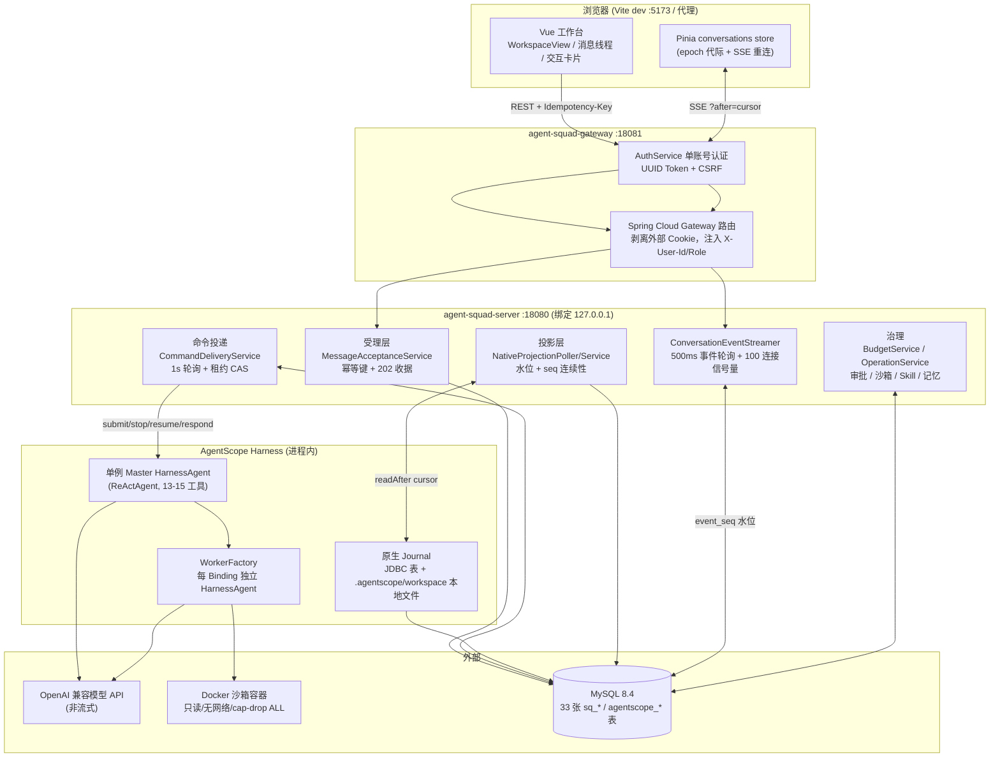
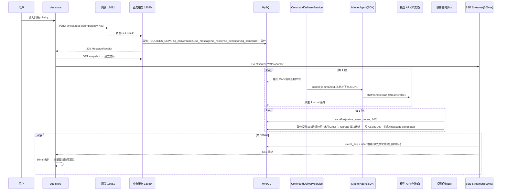
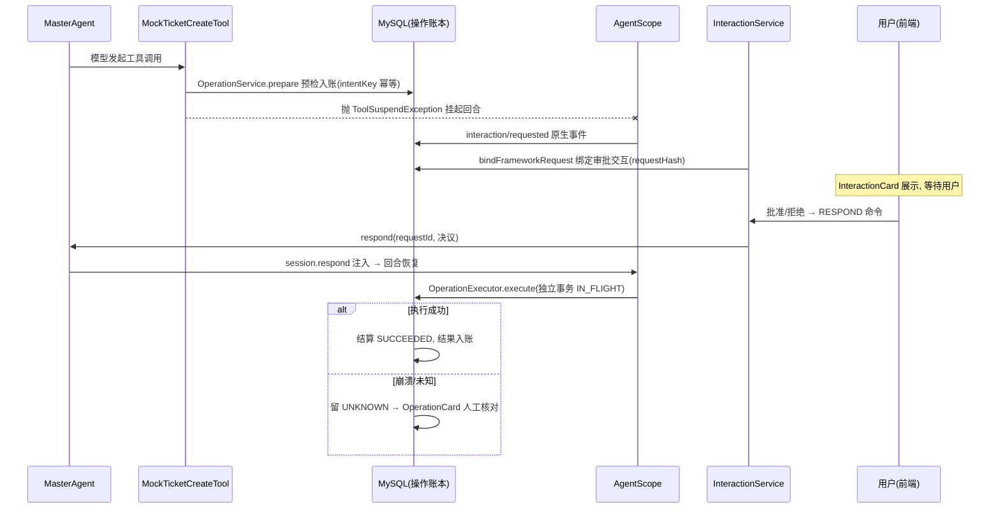
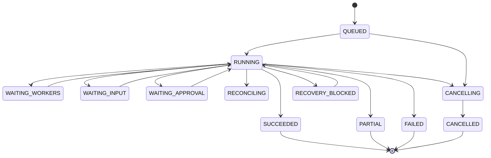

# Agent Squad 项目全量现状审计报告

> 审计日期：2026-11-02 · 分支：`optimize_file_chat`（工作区含 16 个未提交修改文件，审计以工作区当前代码为准）
> 审计方式：静态代码审查 + 构建验证。本次实际执行的命令及结果见 §9.1。未执行后端测试套件（依赖本地 MySQL 容器），未运行真实模型链路，涉及运行时行为的结论均标注证据等级。

---

## 执行摘要

**这个项目实际能做什么**：它是一个基于 Java 21 + Spring Boot + MyBatis + MySQL + Vue 3 的多智能体运行底座，而非一个 AI 编程客户端。核心形态是"持久受理 + 异步命令投递 + 事件投影 + SSE 快照流"的会话平台：用户消息经幂等受理落库后，由后台轮询器领取命令、提交给基于 AgentScope Harness（`2.1.0-BETA1` Maven 依赖）构建的 Master ReActAgent 执行，Master 可直接回答、也可创建 GoalTask 并按 DAG 计划委派独立的 Worker Agent（每 Worker 一个真实 HarnessAgent 实例），工具调用经操作账本 + 审批挂起 + 沙箱（Docker 只读容器、无网络、cap-drop ALL）受控执行，最终结果经原生日志投影为会话消息并推送前端。默认配置（`SQUAD_DELIVERY_ENABLED=false`）下只受理不执行。

**最重要的技术架构**：三层职责分离——平台层（MySQL 持久命令/事件/账本/预算，33 张表，租户前缀唯一键 + 乐观版本 + 租约 CAS 防双主）、运行时层（AgentScope SDK 的 ReAct 循环 + JDBC 分布式存储，平台通过 `NativeSessionGateway` 桥接）、呈现层（`NativeProjectionPoller` 1 秒轮询原生日志 → 事务投影到 `sq_conversation_event` → SSE 按水位续传，天然支持多副本）。

**Agent 能力来源**：推理循环、会话恢复、中断/应答原语、工具契约、Skill 仓库扩展点、Docker 沙箱客户端均来自 AgentScope SDK；命令投递、事件投影、任务状态机、计划 DAG、操作账本与审批、预算预留结算、Skill 导入/Grant、上下文冻结全部为项目自研且实现完整。**模型是 OpenAI 兼容非流式接口**，用户看到的"流式"实为 1 秒粒度的投影轮询。

**最有价值的部分**：预算治理（请求前按稳定 usageKey 预留最坏成本、用量缺失即 markUnknown 不释放）、操作账本级幂等（IN_FLIGHT 独立提交 + UNKNOWN 语义）、以及后端测试体系——59 个测试类 130+ 用例，以真实 Spring 上下文 + 真实 MySQL 隔离库 + 真实 SDK + 本地 HTTP 模型协议桩为骨干，含双实例接管、writer fencing、崩溃恢复等对抗性验证，且 openspec 验收证据诚实标注边界。

**最严重的技术问题**（详见 §10）：① 业务服务无鉴权信任 `X-User-Id` 头 + CORS 全放开带凭证，同机进程或 localhost 页面可冒充任意用户（P0-01）；② `.agentscope/workspace` 本地文件 journal 与"多副本"目标矛盾，多实例接管时该状态不可迁移（P1-02）；③ `CommandDeliveryService` 单线程串行投递，一次 90 秒模型超时阻塞全部用户命令（P1-03）；④ 可配置的 `Runtime.halt(137)` 故障注入代码留在生产执行路径（P1-04）；⑤ 前端零组件/store 测试、无 CI、无 traceId/metrics/健康检查（P2 系列）。

**成熟度结论**：适合**个人使用，尚不具备内部试用条件**。核心链路（受理→投递→投影→SSE）代码完整且有测试背书，但运行时验证仅覆盖协议桩场景（无真实模型端到端记录）、AgentScope 为 BETA 版本、无 CI/CD、可观测性缺位、README 存在与实现不符的声明（Flyway/Java 21/多副本）。该判断的前提：后端测试套件在审计时点可完整通过（本次未执行）；真实模型下的行为未验证；`conversation-first-experience` 验收记录自认"任务完成数 6/16，不能换算为整体产品完成度"。

---

## 1. 项目概况与技术栈

### 1.1 定位与形态

Agent Squad 自述为"面向 Web 的多智能体运行底座"。经代码核实，其真实形态是：

- **不是** Codex CLI 式的 AI 编程客户端——没有任何面向代码仓库的 agent（无 patch/diff 工具、无 Git 集成、无终端命令工具；`disableShellTool()`/`disableFilesystemTools()` 在 [MasterAgent.java:203-209](server/agent-squad-server/src/main/java/com/agentsquad/squad/agent/MasterAgent.java#L203) 显式关闭了 SDK 的 shell/文件系统工具）。
- **是**一个"会话受理 + Master/Worker 委派"的通用任务对话平台：Master（单例 ReActAgent）直接回答或创建 GoalTask，GoalTask 协调回合经 `publish_plan` 发布 DAG 计划，派发给独立 Worker Agent（沙箱 Python 执行 + 产物交付），汇合后回唤 Master 核对作答。

### 1.2 技术栈与主要依赖

| 层 | 技术 | 版本/证据 |
|---|---|---|
| 语言/运行时 | Java（pom `java.version=27` 编译、`maven.compiler.release=21`） | [server/pom.xml](server/pom.xml)；README 声称 Java 21 运行时未验证 |
| 后端框架 | Spring Boot（servlet Web，无 WebFlux） | 3.5.6，父 pom |
| ORM | MyBatis 3.0.4（XML mapper，33 个，无 repository 中间层） | [server/pom.xml](server/pom.xml) |
| 数据库 | MySQL 8.4（本地 Docker 容器，127.0.0.1:13306）；schema 用 `spring.sql.init` 执行单文件 baseline，**非 Flyway** | [application.yml:10-13](server/agent-squad-server/src/main/resources/application.yml#L10) |
| Agent SDK | AgentScope Java（`agentscope-core/harness/extensions-jdbc/extensions-model-openai`） | **2.1.0-BETA1**，[agent-squad-server/pom.xml:27](server/agent-squad-server/pom.xml#L27) |
| 网关 | 独立 Spring Boot 模块 agent-squad-gateway（Spring Cloud Gateway 内置路由 + 自研单账号认证） | [GatewayRoutingConfiguration.java:20-22](server/agent-squad-gateway/src/main/java/com/agentsquad/squad/gateway/config/GatewayRoutingConfiguration.java#L20) |
| 前端 | Vue 3.5 + Pinia 3 + vue-router 4 + Vite 7 + TypeScript 5.9（strict），**无 UI 组件库、无 Markdown 库** | [web/console/package.json](web/console/package.json) |
| 前后端通信 | 同源 Cookie 会话 + CSRF 双提交 + REST JSON；流式用 SSE（EventSource，后端 500ms DB 轮询推流） | 见 §4.1 |
| 模型接入 | OpenAI 兼容 `/v1/chat/completions`，**非流式**（`stream(false)`） | [MasterAgent.java:190-191](server/agent-squad-server/src/main/java/com/agentsquad/squad/agent/MasterAgent.java#L190) |
| 构建/工程 | Maven 双模块聚合；前端仅 dev/build/preview 脚本；无 CI | §9 |

### 1.3 架构图



### 1.4 模块职责表

| 模块 | 职责 | 关键证据 |
|---|---|---|
| `server/agent-squad-gateway` | 单账号认证、CSRF、路由代理、身份头注入 | `auth/AuthService.java` |
| `server/agent-squad-server` `conversation/` | 会话、消息受理（幂等）、回复执行、命令、上下文冻结、删除协调 | `MessageAcceptanceWriter.java` |
| `runtime/` | 完成提案、任务终结协调、计划发布、Worker 派发/汇合/恢复、故障恢复 | `TaskFinalizerService.java` |
| `presentation/` | 读投影：快照查询、SSE 事件流、任务事件投影 | `ConversationEventStreamer.java` |
| `agent/` + `integration/agentscope/` | MasterAgent 适配器、命令投递、原生日志投影、WorkerFactory | `MasterAgent.java`、`WorkerFactory.java` |
| `tools/` | 操作账本、执行器（含故障注入）、连接/密钥库、mock 外部连接器 | `OperationExecutor.java` |
| `interaction/` | 追问（request_input）与审批（mock_ticket_create）交互绑定 | `InteractionService.java` |
| `sandbox/` | Docker 沙箱驱动、stage/commit 产物交付 | `HarnessDockerSandboxDriver.java` |
| `skill/` `memory/` `worker/` `governance/` `artifact/` | Skill 导入/Grant、显式记忆、Worker 能力定义、预算治理、产物管理 | 各包 service |
| `web/console` | Vue 工作台：会话/消息/任务/技能/记忆/Worker 管理 6 个特性域 | `src/features/` |
| `api/` `openspec/` | OpenAPI 契约、能力 spec（R01-R12）、变更计划与验收证据 | `api/openapi.json` |

### 1.5 核心数据流

用户消息 →（幂等受理，事务写 `sq_message`/`sq_command`/`sq_response_execution` + 2 个公开事件）→（1s 轮询领取命令，60s 租约）→ `MasterAgent.submit`（冻结上下文 JSON 注入）→ AgentScope ReAct 循环（非流式模型调用 + 工具）→ 原生 Journal →（1s 轮询，seq 连续校验 + 水位 CAS 投影）→ `sq_conversation_event` →（SSE 500ms 轮询推送）→ 前端收到事件 → 80ms 去抖全量重拉快照渲染。**端到端最小可见延迟 ≥ 2.5 秒（三层轮询叠加），这是架构决定的固定开销。**

---

## 2. 代码仓库与模块架构

```text
agent-squad/
├── server/
│   ├── pom.xml                        # 父 pom：Spring Boot 3.5.6，聚合两模块
│   ├── agent-squad-gateway/           # 认证网关（18081）
│   │   └── src/main/java/.../gateway/{auth,config}/
│   └── agent-squad-server/            # 运行底座（18080）
│       └── src/
│           ├── main/java/com/agentsquad/squad/   # 336 个 Java 文件，16 个业务包
│           ├── main/resources/
│           │   ├── application.yml    # 全部配置：agentsquad.* 前缀
│           │   ├── db/migration/V1__baseline.sql # 1123 行 33 表（近期由 V1-V14 合并）
│           │   └── mapper/<16 域>/    # 33 个 MyBatis XML
│           └── test/java/.../         # 66 文件（59 测试类 + 7 支撑类）
├── web/console/                       # Vue 3 前端（33 源文件 + 1 测试文件）
│   └── src/{app,features(6 域),shared}/
├── api/                               # openapi.json + runtime config schema + ui-manifest
├── openspec/                          # specs(9 能力) + changes(D0-D6 + 进行中变更) + evidence
├── tools/check_design.py              # 静态设计守卫（OpenAPI/文档/DDL 规范校验）
└── .agentscope/workspace/             # SDK 本地 journal（见 P1-02 风险）
```

包结构遵循 Controller → Service → Repository(Mapper) 分层，domain（持久行对象）与 dto（record）分离，`@Resource` 字段注入，与 AGENTS.md 约定一致。全库无内部类、无构造注入，规范执行到位。

---

## 3. 当前功能全量矩阵

实现状态定义：**已实现** = 完整调用链 + 代码证据；**部分实现** = 主功能存在缺关键环节；**仅有框架** = 接口/枚举/表结构存在但无业务实现；**未实现** = 检索无发现。

### 3.A 会话管理

| 功能点 | 状态 | 前端 | 后端 | 关键代码位置 | 存在问题 |
|---|---|---|---|---|---|
| 会话创建 | 已实现 | 首发消息隐式创建 | 事务内原子创建 | [MessageAcceptanceWriter.java:77-81](server/agent-squad-server/src/main/java/com/agentsquad/squad/conversation/service/MessageAcceptanceWriter.java#L77) | — |
| 会话切换 | 已实现 | 路由参数 + epoch 代际隔离 | 无服务端状态（快照+游标恢复） | [conversations.ts:8-18](web/console/src/features/chat/stores/conversations.ts#L8) | 切换丢失未发送草稿/附件（ChatComposer 被 key 重置） |
| 会话删除 | 已实现 | 确认框 + API | DELETING CAS → 逐回复停止意图 → 异步清理 DELETED | [ConversationDeletionService.java:77](server/agent-squad-server/src/main/java/com/agentsquad/squad/conversation/service/ConversationDeletionService.java#L77) | 删除中会话事件静默丢弃（[ConversationEventWriter.java:36-39](server/agent-squad-server/src/main/java/com/agentsquad/squad/conversation/service/ConversationEventWriter.java#L36)），终态只能查状态表 |
| 会话恢复（刷新后） | 已实现 | 快照 + cursor 续传 | 游标校验代际/水位，旧代际返回 410 强制重读快照 | [ConversationQueryService.java:107-150](server/agent-squad-server/src/main/java/com/agentsquad/squad/presentation/service/ConversationQueryService.java#L107) | — |
| 历史消息保存/加载 | 已实现 | `loadOlder` 键集分页 | message_seq 倒序分页 | [ConversationReadMapper.xml:112-130](server/agent-squad-server/src/main/resources/mapper/presentation/ConversationReadMapper.xml#L112) | 前端无上限累积 DOM，长会话性能隐患 |
| 多会话并行 | 已实现（受理层）| 单流订阅当前会话 | 命令投递天然并发；后台会话仅列表被动刷新 | [conversations.ts:190](web/console/src/features/chat/stores/conversations.ts#L190) | 无未读提示；投递层单线程（P1-03） |
| 会话标题 | 部分实现 | 手动改名 | `ConversationTitleService#rename`（独立乐观锁）；schema 有 `AUTO_PENDING/AUTO` 枚举 | [ConversationTitleService.java:45](server/agent-squad-server/src/main/java/com/agentsquad/squad/conversation/service/ConversationTitleService.java#L45) | **自动起名是空壳**：schema 枚举无任何代码写入；rename 的 `reserveEvent` 返回值未检查 |
| 会话与工作目录绑定 | 未实现 | — | 无任何工作目录概念 | 全库检索 | 项目无本地工作区语义（沙箱工作区由平台管理） |

### 3.B Agent 交互与执行

| 功能点 | 状态 | 前端 | 后端 | 关键代码位置 | 存在问题 |
|---|---|---|---|---|---|
| 消息发送与幂等 | 已实现 | 幂等键缓存复用 | SHA256 规范化 + 唯一键冲突补查胜者收据 | [MessageAcceptanceService.java:47-70](server/agent-squad-server/src/main/java/com/agentsquad/squad/conversation/service/MessageAcceptanceService.java#L47) | — |
| Agent 任务启动 | 已实现 | — | `create_goal_task` 工具 / `POST /conversations/{id}/tasks`，每会话单活跃目标 | [GoalTaskService.java:141-168](server/agent-squad-server/src/main/java/com/agentsquad/squad/conversation/service/GoalTaskService.java#L141) | — |
| 多轮执行 | 已实现 | — | SDK ReAct 循环 + `ExecutionConfig`（90s/1 次尝试） | [MasterAgent.java:192-193](server/agent-squad-server/src/main/java/com/agentsquad/squad/agent/MasterAgent.java#L192) | maxAttempts=1，依赖外层退避重投 |
| 工具调用与展示 | 已实现（展示粒度粗）| 快照侧栏卡片 | 13-15 个注册工具，账本级记录 | [MasterAgent.java:139-155](server/agent-squad-server/src/main/java/com/agentsquad/squad/agent/MasterAgent.java#L139) | 无逐工具调用时间线视图；工具过程不向用户透出（提示词明令"不向用户叙述内部调用过程"——设计选择而非缺陷） |
| 命令执行（shell）| 未实现（有意关闭）| — | `disableShellTool()` | [MasterAgent.java:206](server/agent-squad-server/src/main/java/com/agentsquad/squad/agent/MasterAgent.java#L206) | 与 AI 编程客户端的关键差异 |
| 文件读/写 | 部分实现 | 附件上传 + 产物下载 | 附件读取工具（归属校验、10 万字符上限）；写入仅沙箱 tmpfs + stage/commit 交付 | [ReadAttachmentTool.java:34,83-85](server/agent-squad-server/src/main/java/com/agentsquad/squad/agent/tool/ReadAttachmentTool.java#L34) | 无任意文件系统写入（沙箱内除外） |
| 工具审批与权限 | 已实现 | InteractionCard（APPROVAL 双按钮 + requestHash 防篡改）| 写工具预检入账 → `ToolSuspendException` 挂起 → 审批 → RESPOND 命令恢复 | [MockTicketCreateTool.java:69-97](server/agent-squad-server/src/main/java/com/agentsquad/squad/tools/mock/MockTicketCreateTool.java#L69) | 审批目前只挂接在 mock 工具上，无真实外部系统 |
| 运行中取消 | 已实现 | 停止回答 / 停止工作分开 | RESPONSE 乐观版本 CAS + 命令撤销 + STOP 投递；无活跃运行时就地收尾 | [ResponseControlService.java:56-101](server/agent-squad-server/src/main/java/com/agentsquad/squad/conversation/service/ResponseControlService.java#L56) | — |
| 重试 | 部分实现 | 失败卡片重试按钮 | 仅 SERVICE_TRANSIENT 且未超限；后继执行由唯一键防重 | [ResponseRetryService.java:72-92](server/agent-squad-server/src/main/java/com/agentsquad/squad/conversation/service/ResponseRetryService.java#L72) | — |
| 异常恢复 | 已实现 | — | 暂时故障 ≤2 次指数退避；interrupted 原生回合排 `response.resume`；重启后按 due_at 重扫 | [ExecutionFailureService.java:121-145](server/agent-squad-server/src/main/java/com/agentsquad/squad/runtime/service/ExecutionFailureService.java#L121) | `TaskFinalizerService#resumeFromInteraction` 无事务注解，中途崩溃留不一致（P2） |
| 多任务并发隔离 | 已实现 | — | 每 Binding 独立 Worker Agent + guard 租约防双主 | [WorkerFactory.java:102](server/agent-squad-server/src/main/java/com/agentsquad/squad/integration/agentscope/WorkerFactory.java#L102) | `computeIfAbsent` 内含多次 DB 查询与 CAS，长持桶锁（P2） |
| 执行状态事件处理 | 已实现 | 状态条 + 进度条 | 全事件经持久事件表投影 | `NativeProjectionService#accept` | `publishState` 用可能过期的 row.version+1，事件版本号可能失真（P2） |

### 3.C 模型与上下文管理

| 功能点 | 状态 | 说明 | 关键代码位置 | 存在问题 |
|---|---|---|---|---|
| 模型选择 | 仅有框架 | 全局单模型（env 注入），Worker 模型 Profile 硬编码仅 `default` 一个 | [application.yml:47-58](server/agent-squad-server/src/main/resources/application.yml#L47) | 用户不可在前端选择模型 |
| 推理等级/参数 | 未实现 | 无 temperature/reasoning 等参数配置 | 全库检索 | — |
| 推理等级（reasoning effort）| 未实现 | — | — | — |
| 上下文管理 | 已实现（冻结式）| 每次投递冻结会话前缀快照（含 activeTask 事实、recentFailures 安全事实）存 `context_json`，重投复用并验 hash | [ResponseContextService.java:88-147](server/agent-squad-server/src/main/java/com/agentsquad/squad/conversation/service/ResponseContextService.java#L88) | 上下文超 200k 字符直接拒绝，**无压缩/截断策略，长会话将硬失败**（P1） |
| 附件材料 | 已实现 | 20k 字符/文件截断注入 + `read_attachment` 按需全量读取 + MaterialFormatter（JSON 美化/CSV 管道化） | [MaterialFormatter.java:43-72](server/agent-squad-server/src/main/java/com/agentsquad/squad/common/util/MaterialFormatter.java#L43) | 本分支新增，工作区未提交 |
| Token 用量统计 | 已实现（预算维度）| 微单位计价、请求前预留最坏成本、用量缺失 markUnknown 不释放、用户级总预算跨 Scope | [ModelBudgetMiddleware.java:75-133](server/agent-squad-server/src/main/java/com/agentsquad/squad/integration/agentscope/ModelBudgetMiddleware.java#L75) | 前端无 token 用量展示，仅治理侧 |
| 错误/限额处理 | 已实现 | 预算超限拒绝、模型失败分类暂时/永久 | `BudgetService#reserveModel` | — |
| 多供应商兼容 | 仅有框架 | OPENAI_COMPATIBLE 单协议；Profile 结构预留多 provider 字段但仅一个 default | application.yml:50 | — |

### 3.D 前端交互体验

| 功能点 | 状态 | 关键代码位置 | 存在问题 |
|---|---|---|---|
| Markdown 渲染 | 部分实现 | [SafeMarkdown.vue](web/console/src/shared/ui/SafeMarkdown.vue)（手写白名单构造式渲染，无 innerHTML，结构性免疫 XSS）| 仅支持加粗/行内码/围栏码块/标题/列表/段落；**无表格、引用、图片、语法高亮**——对 AI 回答展示能力明显不足 |
| 流式展示 | 部分实现 | 事件触发 80ms 去抖全量快照重拉（[conversations.ts:157-171](web/console/src/features/chat/stores/conversations.ts#L157)）| **无 token 级流式感**，长回答期间界面只有"正在回复…"状态条；每 80ms 重拉全量消息带宽浪费 |
| 工具调用详情 | 部分实现 | InteractionCard / OperationCard（外部操作人工核对）| 无完整工具调用时间线 |
| 产物 Diff 展示 | 未实现 | 仅有产物 blob 下载 | — |
| 自动滚动 | 已实现 | pinned 标志 + 110px 阈值（[MessageThread.vue:22-24](web/console/src/features/chat/components/MessageThread.vue#L22)）| — |
| 历史加载 | 已实现 | `loadOlder` + 滚动位置保持 | 无虚拟滚动，DOM 无限增长（P2） |
| 状态恢复 | 已实现 | epoch 代际 + 序列空洞检测主动断流重连 + 指数退避 | 质量好 |
| 错误反馈 | 已实现 | 四级错误呈现 + 发送失败幂等键复用提示 | — |
| 页面/设置 | 已实现 | 登录、工作台、任务详情（重定向）、技能管理、记忆设置、Worker 管理（ADMIN）| — |

### 3.E 工作空间与工程能力

| 功能点 | 状态 | 说明 | 存在问题 |
|---|---|---|---|
| 工作目录选择 | 未实现 | 无本地工作目录语义 | 与 AI 编程客户端的根本差异 |
| Git 集成 | 未实现 | 无 | — |
| 沙箱执行环境 | 已实现 | sha256 摘要镜像、network=none、只读 rootfs、cap-drop ALL、pids-limit 64、非 root、tmpfs noexec、60s 超时、监督进程清杀逃逸后代 | 实现质量高 |
| stage/commit 受控交付 | 已实现 | `sq_artifact_stage` → 校验 → `sq_artifact` | — |
| 本地资源边界 | 已实现 | 沙箱内 Base64 分块经 `python -I` 注入，路径 Base64 编码，无 shell 注入面 | — |

**清单外实际存在的功能**：显式长期记忆（增删改 + 删除后历史消息替换占位符 + 有效期）、Skill 包导入/版本固定/Grant 隔离/自动发现、外部操作核对（OperationCard 人工裁决 UNKNOWN 结果）、多实例 SSE 水位续传、故障注入测试开关、设计静态守卫脚本。

---

## 4. 核心业务调用链

### 4.1 链路一：发送消息 → 回复呈现



**关键节点**：
1. 受理幂等：规范化 `{text, artifactIds}` SHA256 + `uk_owner_scope_key` 唯一键；同键同内容返回原收据，同键不同内容拒绝（[MessageAcceptanceService.java:53-70](server/agent-squad-server/src/main/java/com/agentsquad/squad/conversation/service/MessageAcceptanceService.java#L53)）。`MESSAGE_SUBMIT` 领取时需无更早未完回复，防倒序（[CommandClaimService.java:31-34](server/agent-squad-server/src/main/java/com/agentsquad/squad/conversation/service/CommandClaimService.java#L31)）。
2. 终态裁决：`propose_completion` 工具提交候选（带 hash 幂等）→ 投影读到 run/end 时校验候选 → 通过则写 ASSISTANT 消息；无/坏候选先自动纠正一次，二次 FAILED（[ResponseExecutionService.java:258-296](server/agent-squad-server/src/main/java/com/agentsquad/squad/conversation/service/ResponseExecutionService.java#L258)）。
3. 离线恢复：每次投影后 `inspectTask` 探测原生回合状态，interrupted 排 `response.resume`（≤2 次）（[NativeProjectionPoller.java:66-86](server/agent-squad-server/src/main/java/com/agentsquad/squad/integration/agentscope/NativeProjectionPoller.java#L66)）。

**缺陷/风险**：三层轮询叠加（1s 投递 + 1s 投影 + 500ms SSE + 80ms 去抖）→ 首字可见延迟 ≥2.5s；`SQUAD_DELIVERY_ENABLED=false` 时整条执行链（MasterAgent、CommandDelivery、投影、交互、终结协调）全部 `@ConditionalOnProperty` 不装配，**只受理不执行**——这是设计开关而非缺陷，但意味着默认克隆运行看到的只是"受理回执"。

### 4.2 链路二：工具调用（以审批型写工具为例）



职责边界清晰：SDK 负责挂起/恢复原语与事件；项目负责账本（intentKey 幂等、IN_FLIGHT 独立提交、UNKNOWN 语义）、审批绑定与核对 UI。**这是账本级幂等的正确做法**。风险：`OperationExecutor.java:60` 的 `Runtime.halt(137)` 故障注入由配置 `agentsquad.fault.after-inflight-exit` 门控，留在生产代码路径（P1-04）；执行器自认"本地单执行器实现，多实例 guard 属后续阶段"。

### 4.3 链路三：会话/任务生命周期

会话：`ACTIVE → DELETING(CAS) → 异步清理 → DELETED`，含 `generation` 代际（防删除重建后旧游标续传）与 `version` 乐观锁（[V1__baseline.sql:242-268](server/agent-squad-server/src/main/resources/db/migration/V1__baseline.sql#L242)）。

GoalTask 状态机（[GoalTaskStatus.java:8-35](server/agent-squad-server/src/main/java/com/agentsquad/squad/conversation/domain/GoalTaskStatus.java#L8)）：



终结协调集中在 `TaskFinalizerService`（tryComplete / recoverMissingProposal / finalizeCancelled）。切会话纯前端行为（关流+重开），服务端无会话级运行状态。Task Master 与 Reply Master 是**同一单例 MasterAgent 的两个执行作用域**（RESPONSE/TASK），由 `ScopedMasterToolsMiddleware` 按 scope 裁剪工具目录并注入不同角色指令。

### 4.4 链路四：异常与中断

| 场景 | 实际行为 | 证据 |
|---|---|---|
| 模型暂时故障 | 分类 SERVICE_TRANSIENT，≤2 次指数退避自动恢复 | `ExecutionFailureService.java:121-145` |
| 模型永久故障 | FAILED 终态，有开放交互/未知操作不放行恢复 | 同上 :136-138 |
| 业务服务重启 | 命令按 due_at 重扫、水位/候选/冻结上下文全持久；集成测试 `retryAfterRestartReturnsOriginalFirstReceipt` 验证幂等 | `MessageAcceptanceHttpTest.java:61` |
| 前端刷新 | 快照 + cursor 续传；旧代际 410 强制重读 | `ConversationQueryService.java:119-150` |
| 用户取消（回答）| 乐观版本 CAS + 撤销 pending 命令 + STOP 投递 | `ResponseControlService.java:56-101` |
| 用户取消（工作）| `updateCancelling` CAS + STOP；SDK 拒绝恢复时置 RECOVERY_BLOCKED | `TaskControlService.java:61-145` |
| SDK 异常分流 | **靠匹配 SDK 异常英文消息字符串**（CommandDeliveryService.java:172-176、MasterAgent.java:281）| SDK 升级即静默失效（P1-05） |
| 消息重复发送 | 幂等键 + 规范化 hash，返回原收据 | 已验证（见 §4.1） |

未发现"取消竞争导致状态悬挂"的代码证据，且 `ConversationDeletionTaskSettleTest` 验证了删除/停止/终结的竞争收尾。**该结论等级：静态+测试背书，未运行时复验。**

---

## 5. Java 后端架构与工程质量

### 5.1 优点（有代码证据）

1. **分层纪律**：16 个业务包统一 controller → service → repository，domain/dto 分离，规范一致；无越层调用发现。
2. **并发正确性意识强**：全库统一模式——乐观版本 CAS（会话/执行/标题）、租约 + token 防双主（命令/Worker guard/操作 fence）、唯一键幂等（事件 seq/producer、幂等键、successor）。SQL 侧 `advanceCursor` 用 `native_event_cursor = #{previous}` CAS 防并发重复投影（[ProjectionMapper.xml:58-62](server/agent-squad-server/src/main/resources/mapper/runtime/ProjectionMapper.xml#L58)）。
3. **事件模型**：原始 journal（agentscope_* 表）与脱敏公开事件（sq_conversation_event，payload 注释明确"脱敏"）分离，投影表水位驱动，任何副本可续传。
4. **SQL 质量**：33 个 mapper 全参数化（`${}` 零命中）、键集分页、批量取 ID 无 N+1、行锁显式。
5. **审批/账本/预算**三个横切面设计成熟（见 §4.2、§3.C）。

### 5.2 问题

| # | 问题 | 证据 | 影响 |
|---|---|---|---|
| B1 | **投递单线程串行**：`@Scheduled deliverDue` 一次慢 SDK 提交（90s 超时）阻塞全部用户命令投递 | [CommandDeliveryService.java:78-84](server/agent-squad-server/src/main/java/com/agentsquad/squad/integration/agentscope/CommandDeliveryService.java#L78) | 单用户长任务期间全平台命令延迟；多用户时不可用 |
| B2 | **死代码/无限重试**：`DELETE_CONVERSATION` 分支不可达（findDueIds SQL 白名单不含），且 `fail()` 无最大次数伪装重试 | 同上 :117,238-239 | 未来加 action 漏配即静默无限重试 |
| B3 | **两处硬编码工具白名单互相覆盖**：MasterAgent.sessionFor 与 ScopedMasterToolsMiddleware 各自维护集合，中间件重写前者 | MasterAgent.java:298-302、ScopedMasterToolsMiddleware.java:71-74 | 漂移即权限缺口，改工具目录要改两处 |
| B4 | **SDK 异常消息字符串匹配**分流 | CommandDeliveryService.java:172-176、MasterAgent.java:281 | BETA SDK 升级即静默失效 |
| B5 | `resumeFromInteraction` 无事务：CAS/锁/事件序号/投影各自独立提交 | [TaskFinalizerService.java:279](server/agent-squad-server/src/main/java/com/agentsquad/squad/runtime/service/TaskFinalizerService.java#L279) | 中途崩溃留"RUNNING 但事件缺失"不一致 |
| B6 | `publishState` 事件版本号可能失真（入口锁定旧 row） | ResponseExecutionService.java:328-331 | 事件审计轨迹与库中版本不一致 |
| B7 | 标题 rename 的 reserveEvent 返回值未检查（对比其他发布点有检查） | ConversationTitleService.java:58 | 竞争下事件序号错乱 |
| B8 | WorkerFactory `computeIfAbsent` 内做多次 DB 查询 + guard CAS，长持 ConcurrentHashMap 桶锁 | [WorkerFactory.java:132-201](server/agent-squad-server/src/main/java/com/agentsquad/squad/integration/agentscope/WorkerFactory.java#L132) | 高并发同 binding 下阻塞其他读 |
| B9 | System prompt 硬编码 1400 字中文于方法内，与中间件注入的第二段角色指令叠加，双份提示词分叉风险 | MasterAgent.java:161-189、ScopedMasterToolsMiddleware.java:56-64 | 提示词即产品逻辑，不可配置、难测试 |
| B10 | README 与实现不符：声称 Flyway（实际 spring.sql.init 单文件）、声称 Java 21（pom java.version=27）、baseline 合并后无 schema 版本演进轨迹 | application.yml:10-13、server/pom.xml | 新架构师会被文档误导 |
| B11 | 上下文超限硬失败（200k 字符拒绝），无压缩/滑动窗口 | ResponseContextService.java:107-123 | 长会话必然走向不可用 |
| B12 | SSE 默认 4 线程池支撑 100 连接 × 500ms 轮询，每轮 REPEATABLE_READ 事务 | ConversationEventStreamer.java:34-35、109 | 高并发轮询延迟叠加；容量上限真实存在但接近时退化 |

### 5.3 测试证据等级说明

静态审查确认测试体系存在且断言质量高（826 处 AssertJ 断言，断言业务终态与数据库事实），但**本次审计未执行测试套件**（需本地 MySQL 13306 容器），运行时通过率以 openspec evidence 记录（d6：132 通过/19 跳过）为准，该记录为真实 maven 输出（含 PID、时间戳、jar SHA-256），可信度较高但存在时效性。

---

## 6. TypeScript 前端架构与工程质量

### 6.1 优点

1. **类型纪律严格**：全 strict + noUnusedLocals，**全库 0 个 `any`**，广泛 `unknown` + narrowing；字段与 OpenAPI 基本对齐。
2. **分布式一致性细节认真**：SSE 序列空洞检测主动断流重连、指数退避、epoch 代际丢弃过期回调、`listRevision`/`snapshotRequest` 双序号防乱序（[conversations.ts:8-207](web/console/src/features/chat/stores/conversations.ts#L8)）。
3. **资源清理无泄漏**：EventSource/定时器集中于 store dispose，组件卸载递增 generation 使过期异步失效，ObjectURL 1 秒 revoke。
4. **服务端权威**：无乐观更新，失败回读快照纠正——与后端事件溯源模型匹配。

### 6.2 问题

| # | 问题 | 证据 | 影响 |
|---|---|---|---|
| F1 | **测试近零**：仅 4 行纯函数有 node:test，store/SSE/Markdown 零覆盖，且无 test script | [package.json:6-10](web/console/package.json#L6)、tests/chatKeyboard.test.mjs | 核心状态机回归无防护 |
| F2 | 无虚拟滚动，`loadOlder` 无上限累积，每 80ms 全量重拉重建消息数组 | MessageThread.vue:50-52、conversations.ts:116 | 长会话 DOM/带宽双膨胀 |
| F3 | 无 token 级流式渲染 | conversations.ts:157-171 | 体验与"聊天客户端"预期差距大 |
| F4 | 手写 Markdown 子集过窄（无表格/引用/图片/高亮） | SafeMarkdown.vue:5-47 | AI 回答（常含表格/代码）展示降级 |
| F5 | 类型手写"镜像" OpenAPI 而非生成，已有漂移（ExecutionFailure 缺 retryable/scopeId；TaskResponse 命名不一致） | chatApi.ts:30-46 | 编译不报错的字段漂移 |
| F6 | 切会话丢未发送草稿/附件（key 重置） | WorkspaceView.vue:42 + ChatComposer.vue:27 | 用户输入损失 |
| F7 | store 8 个模块级可变 let 全局变量，难测试、多实例不安全 | conversations.ts:8-18 | 可维护性 |
| F8 | 空目录 `src/shared/sse`（SSE 实际内联 store），结构误导 | — | 认知噪音 |
| F9 | `ConversationEvent.payload` 定义后从未使用，事件类型靠字符串字面量匹配 | chatApi.ts:76、conversations.ts:190 | 复杂 Agent 事件确实被简化为"通知重拉快照"——协议能力未利用 |

前后端数据模型一致性结论：**结构一致、语义部分未利用**。后端精心设计的逐事件 payload（工具调用细节、审批上下文、任务节点状态）在前端被简化为"触发全量快照重拉"，这是当前前后端交互最大的架构性浪费。

---

## 7. Agent 能力专项分析

### 7.1 定性结论

本项目是一个**自研编排层 + 第三方 SDK 运行时**的 Agent 执行管理平台，不是自研推理循环（循环是 SDK 的 ReAct），也不是纯聊天界面（受理/投递/投影/委派/治理全部自研）。三类能力划分：

| 类别 | 能力 | 证据 |
|---|---|---|
| SDK 天然提供 | ReAct 循环、会话挂起/恢复/respond 原语、JdbcDistributedStore、OpenAIChatModel、Toolkit/AgentTool 契约、Skill 仓库扩展点、DockerSandboxClient、Middleware SPI | agent-squad-server/pom.xml 四个 artifact；MasterAgent.builder 链 |
| 项目自研且完整 | 命令投递+租约、事件投影+SSE 水位、GoalTask 状态机、双 Scope、计划 DAG（MAX_NODES=16/MAX_PARALLEL=4、预算预扣）、操作账本+审批、预算预留结算、Skill 导入/版本/Grant、记忆冻结与占位替换、沙箱策略与 stage/commit 交付 | §4 各链路 |
| 项目尚不具备 | 真实外部系统接入（连接器仅 mock_lookup/mock_ticket）、自动会话标题、上下文压缩、多模型选择、token 级流式、agent 侧文件系统/终端（有意禁用） | tools/mock/ 全部、§3 |

### 7.2 关键事实

1. **单例 Master**：整进程一个 Master HarnessAgent（agentId 硬编码 32 位），所有用户共用——**多用户并发时 Master 的模型调用经预算隔离但 Agent 实例共享**（SDK 会话按 user 隔离，Agent 对象单例是否线程安全取决于 SDK，未见项目侧加锁）。
2. **Worker 是真实独立 Agent**：每 Binding 一个 HarnessAgent，`ConcurrentHashMap` 缓存 + 定期 prune，agentId=definitionId 的 sha256 前 32 位，工具强制白名单校验（未注册即拒绝）。
3. **模型非流式**：用户体感"流式"来自投影轮询，粒度 1 秒。
4. **journal 双落点**：JDBC 表（agentscope_sessions/snapshots/store）+ **进程工作目录下 `.agentscope/workspace` 本地文件**（SDK Harness 默认 WorkspaceConstants.DEFAULT_WORKSPACE_ROOT，项目代码无覆盖配置）。多实例接管时本地 journal 不可迁移——与 README"多副本"声明直接矛盾（P1-02）。
5. **工具信息保留**：完整保留在原生 journal 与操作账本；公开事件 payload 有脱敏投影；前端未消费。
6. **事件协议扩展性**：事件表 seq 连续 + payload_json 结构天然可扩展，后端协议设计优于前端消费能力。

### 7.3 总体评价

Agent 工程能力处于**"编排与治理层成熟、执行边界保守、外部生态为零"**的状态：把它接到真实模型上，它能可靠地完成"对话回答 + 目标委派 + 受控沙箱执行 + 审批 + 预算控制"；但它目前只能用 mock 工具代表真实世界，且所有 Agent 能力都通过一个 BETA 版 SDK 间接获得——SDK 的 API 稳定性是这个项目最大的单点依赖风险（已有两处靠异常消息字符串耦合，见 B4）。

---

## 8. 安全性、稳定性与性能

### 8.1 安全性

| # | 严重度 | 问题 | 证据 | 触发条件/影响 |
|---|---|---|---|---|
| S1 | **高** | 业务服务无鉴权信任 `X-User-Id/X-User-Role` 头，仅注释约束"应限制内部访问"；且业务服务 CORS `allowedHeaders("*")` + `allowCredentials(true)` | [UserContextInterceptor.java:22-30](server/agent-squad-server/src/main/java/com/agentsquad/squad/identity/UserContextInterceptor.java#L22)、WebConfig.java:26-33 | 同机任意进程直连 18080 冒充任意用户；localhost 浏览器页面经 CORS 预检也可冒充。缓解：绑定 127.0.0.1 + 网关剥离外部身份头。网关-业务间无共享密钥/mTLS |
| S2 | 中 | 登录明文 `String.equals` 比较密码（无哈希、非常量时间），无速率限制 | gateway AuthService.java:38-47 | 本地单账号场景可接受，部署形态变化即风险 |
| S3 | 中 | 会话令牌 UUID 存内存 Map，**无 TTL、无上限**，Cookie 无 maxAge/Secure | AuthService.java:33-47 | 泄露后无法自动失效；重启全登出（后者可视为特性） |
| S4 | 中低 | 备份恢复仅有设计文档，无脚本无演练产物；schema 无版本演进（baseline 合并后） | openspec/changes/archive/2026-11-02-d6-integration-release/design.md、application.yml | README 自称"本地验收完成"与实际不符 |
| S5 | 低 | `prefix` 查询整段 longtext 消息正文载入内存（有前置字符计数预算）；产物 longblob 入库（≤10MB/文件） | ResponseContextMapper.xml、V1__baseline.sql:46 | 大会话/大文件内存与存储膨胀 |

**安全做得好的部分**：沙箱隔离（sha256 镜像 + network=none + 只读 + cap-drop ALL + pids-limit + 非 root + tmpfs noexec + 监督进程清杀逃逸后代 + 拒绝静默工作区）达到生产级谨慎；SQL 全参数化；Markdown 构造式渲染结构性免疫 XSS；密钥库 AES-256-GCM 随机 IV、主密钥缺失即拒绝、密文不落日志；租户前缀唯一键纵深防御；预算表只存 request_hash 不存 prompt。

### 8.2 稳定性

- **已覆盖**：命令幂等重投、离线恢复探针、暂时故障退避、双实例接管测试（writer fencing）、删除-停止-终结竞争收尾测试、SSE 断线重连与序列空洞。
- **风险**：B1 投递单线程（单慢请求拖垮全平台）；B5 无事务恢复路径；`.agentscope/workspace` 本地状态与多副本矛盾；SDK BETA 版本升级脆弱性（B4）；进程内网关令牌 Map 重启全失效（单机可接受）。

### 8.3 性能

- **架构性延迟**：三层轮询 + 去抖 ≥2.5s 首字延迟（非流式模型 + 投影轮询的必然结果）。
- **有证据的瓶颈**：SSE 100 连接 × 500ms × REPEATABLE_READ（B12）；前端无虚拟滚动（F2）；命令投递串行（B1）。
- **风险假设（未验证）**：`sq_response_execution.context_json` 存放 200k 字符级冻结上下文，高频投递下 InnoDB 大字段的读写放大；`readAfter(cursor,100)` 每秒全 binding 轮询的 journal 读压力随活跃会话线性增长。验证方式：压测脚本（现无，D6 自认"真实压测属发布门槛"未做）。

---

## 9. 测试与工程化现状

### 9.1 本次审计实际执行的验证

| 命令 | 结果 |
|---|---|
| `mvn -f server/pom.xml -B -ntp compile` | **通过**（exit 0，含工作区未提交的 16 个修改文件与新文件） |
| `npm --prefix web/console run build`（vue-tsc --noEmit + vite build） | **通过**（exit 0，产物 gzip 总量约 70KB） |
| 后端测试套件 | **未执行**（需本地 MySQL 13306 容器与专用环境变量；evidence 记录 2026-10 全量 132 通过/19 跳过） |

### 9.2 测试体系评价

后端测试是本项目工程化最强项（详见 §5.3、§8.2）：真实 Spring 上下文 + 真实 MySQL 隔离库（`as_test_` 前缀，路径哈希复用支持重启幂等断言）+ **真实 AgentScope SDK 不被 mock**（模型侧用本地 HttpServer 实现 OpenAI 兼容协议桩，含 CountDownLatch 制造中断窗口）+ 对抗性数据篡改断言（如 ResponseContextIntegrationTest 直接改 message_seq/内容/过期时间验证冻结不可变性）。Mockito 仅 3 个文件使用。测试策略成熟度显著高于典型个人项目。

### 9.3 工程化缺口

1. **零 CI/CD**：无 .github/workflows、无 Jenkinsfile、无 Dockerfile——高质量测试只在本机手工跑。
2. **前端零测试基建**：无 test script，唯一测试文件无法被任何流水线发现。
3. **可观测性缺位**：无 traceId/MDC（grep 零命中，d6 文档声称有 traceId 与实际不符）、无 metrics/actuator/健康检查端点、无 logback 配置。101 处日志为半结构化 key=value，风格统一但无请求级贯穿。
4. **设计守卫**：tools/check_design.py（301 行）静态校验 OpenAPI 规范/文档链接/DDL 审计字段与注释/禁 DROP TRUNCATE——这是有价值的自制质量门。

**结论：具备稳定迭代的代码与测试基础，不具备稳定迭代的流程与运维基础。**

---

## 10. 现存问题和风险清单

| 编号 | 优先级 | 模块 | 问题 | 代码证据 | 触发条件 | 实际影响 | 建议方向 |
|---|---|---|---|---|---|---|---|
| P0-01 | P0 | identity/gateway | 业务服务无鉴权信任身份头 + CORS 全放开带凭证 | UserContextInterceptor.java:22-30、WebConfig.java:26-33 | 同机进程直连 18080 或 localhost 恶意页面 | 任意用户冒充，读写其全部会话/记忆/技能 | 网关-业务共享密钥头校验；收紧 CORS |
| P1-02 | P1 | integration/agentscope | `.agentscope/workspace` 本地 journal 与多副本目标矛盾 | 仓库根 .agentscope/workspace/ 实存；项目代码无 WorkspaceManager 覆盖 | 多实例部署/接管 | 接管实例恢复路径不完整 | 配置 SDK 工作区到 JDBC 或共享存储，实测接管 |
| P1-03 | P1 | CommandDeliveryService | 投递单线程串行 | CommandDeliveryService.java:78-84 | 任一 SDK 提交慢（90s 超时） | 全平台命令投递停摆 | 投递并发化（按用户/命令分片）+ 超时隔离 |
| P1-04 | P1 | tools/operation | `Runtime.halt(137)` 故障注入留在生产路径 | OperationExecutor.java:58-60 | 误配 `agentsquad.fault.after-inflight-exit=true` | 进程被杀 | 移到独立 test fixture 或 profile 隔离 |
| P1-05 | P1 | integration | 靠 SDK 异常英文消息字符串分流 | CommandDeliveryService.java:172-176、MasterAgent.java:281 | AgentScope 升级消息文案变化 | 恢复/重试语义静默失效 | 升级为异常类型/错误码判断 |
| P1-06 | P1 | ResponseContextService | 上下文超限硬失败，无压缩 | ResponseContextService.java:107-123 | 会话累计超 200k 字符 | 长会话不可用 | 分级策略：滑窗截断或摘要压缩 |
| P1-07 | P1 | 测试/发布 | 运行时验证仅协议桩；真实模型端到端无记录 | evidence 各文件 + README 自认 | 接真实模型 | 未知协议/行为差异 | 真实模型冒烟链路入验证清单 |
| P2-08 | P2 | MasterAgent | 双份提示词 + 双份工具白名单互相覆盖 | MasterAgent.java:161-189,298-302、ScopedMasterToolsMiddleware.java:56-74 | 维护演进 | 提示词分叉、权限缺口 | 单一来源声明工具目录与角色指令 |
| P2-09 | P2 | TaskFinalizerService | resumeFromInteraction 无事务 | TaskFinalizerService.java:279 | 恢复中崩溃 | 状态与事件不一致 | 补 @Transactional 并加恢复测试 |
| P2-10 | P2 | frontend | 无虚拟滚动 + 80ms 全量快照重拉 | MessageThread.vue:50-52、conversations.ts:116-157 | 长会话/长回答 | 页面卡顿、带宽浪费 | 事件增量渲染 + 列表窗口化 |
| P2-11 | P2 | frontend | 无 token 级流式 | MasterAgent.java:190-191、conversations.ts:157 | 所有回答 | 体验停留在"轮询刷新" | 模型 stream(true) + journal 增量投影（SDK 支持） |
| P2-12 | P2 | frontend | SafeMarkdown 能力过窄 | SafeMarkdown.vue:5-47 | 回答含表格/图片 | 内容降级为原文 | 引入白名单式渲染库或扩展子集 |
| P2-13 | P2 | 工程化 | 零 CI/CD、前端零测试、无 traceId/metrics/健康检查 | §9.3 | 团队/长期迭代 | 回归靠自律、线上排障盲 | 最小 CI（mvn test + 前端 build）先行 |
| P2-14 | P2 | presentation | SSE 4 线程支撑 100 连接 500ms 轮询；publishState 版本失真；标题 reserveEvent 未检查 | ConversationEventStreamer.java:34-35、ResponseExecutionService.java:328、ConversationTitleService.java:58 | 并发增长 | 延迟退化、审计失真 | 线程池可配下限提升；补返回值检查 |
| P2-15 | P2 | WorkerFactory | computeIfAbsent 内重 IO/CAS 长持桶锁 | WorkerFactory.java:132-201 | 并发激活同 binding Worker | 其他读阻塞 | 先取锁外预检再入 compute |
| P3-16 | P3 | 文档 | README 与实现不符（Flyway/Java21/多副本/自动标题） | §5.2 B10、§3.A | 新协作者 | 误导 | 按实际更新 |
| P3-17 | P3 | conversation | 删除中会话事件静默丢弃；死代码 fail() 无限重试路径 | ConversationEventWriter.java:36-39、CommandDeliveryService.java:238 | 删除竞态/未来扩展 | 可追溯性弱 | 补替代记录；删死分支 |
| P3-18 | P3 | frontend | 切会话丢草稿；类型手写镜像漂移；空 sse 目录 | F5/F6/F8 | 日常使用/演进 | 输入损失、静默字段漂移 | 草稿 per-conversation 持久化；OpenAPI 代码生成 |
| P3-19 | P3 | database | 产物 longblob 入库、context_json 大字段 | V1__baseline.sql:46 | 大文件/高频 | 存储与内存膨胀 | 产物落盘/对象存储 |
| P3-20 | P3 | gateway | 令牌无 TTL/上限、密码明文比较 | AuthService.java:33-47 | 长期运行/部署变化 | 令牌永驻 | 加过期与上限（本地场景低优先） |

---

## 11. 项目成熟度评分

| 评估维度 | 得分 | 关键事实依据 | 主要限制 |
|---|---|---|---|
| 功能完整度 | 3.5 | 受理→投递→执行→投影→呈现全链路闭环，D0-D6 声明的能力均有代码；但外部连接器仅 mock、模型选择/流式/自动标题缺失 | 运行时验证以协议桩为主 |
| Java 后端架构 | 4 | 分层纪律、幂等/租约/水位/账本模式统一且正确，33 表设计含租户纵深防御 | 投递串行、若干无事务路径、SDK 字符串耦合 |
| TypeScript 前端架构 | 3 | 类型 0 any、SSE 重连/代际隔离质量高 | 无虚拟滚动、无流式渲染、事件 payload 未消费、store 全局可变状态 |
| Agent 能力集成 | 3.5 | 编排（计划 DAG/委派/汇合/恢复）与治理（账本/审批/预算/沙箱）自研完整 | 依赖 BETA SDK、单例 Master 并发行为未验、外部生态为零、非流式 |
| 会话与任务管理 | 4 | 完整状态机 + 竞争收尾测试 + 删除代际屏障 + 离线恢复探针 | 长会话上下文硬失败、自动标题空壳 |
| 稳定性与可靠性 | 3 | 幂等/恢复/双实例测试齐备 | 投递单线程单点、本地 journal 多副本矛盾、真实故障演练未做 |
| 安全性 | 3 | 沙箱/密钥库/SQL/XSS/CSRF 达高标准 | 内部信任模型缺失（P0-01）、网关认证健壮性弱 |
| 性能与资源管理 | 2 | 预算/租约/信号量限流存在 | 轮询叠加 ≥2.5s 延迟、无压测、前端长会话退化 |
| 代码可维护性 | 3.5 | 规范统一、spec-代码-evidence 闭环、设计守卫脚本 | 硬编码提示词/白名单双份、README 失真、baseline 无演进 |
| 测试及工程化 | 3.5 | 后端测试策略成熟（真实栈+协议桩+对抗断言） | 零 CI、前端近零测试、可观测性缺位 |
| 用户交互体验 | 2.5 | 错误反馈/状态恢复/幂等提示细致 | 无流式感、Markdown 降级、丢草稿、单流无未读 |

---

## 12. 当前优势与主要短板

**优势**：① 分布式一致性基本功扎实（幂等、租约、水位、乐观锁、账本、代际屏障贯穿全库且模式统一）；② 后端测试策略成熟且证据文化诚实；③ 治理层（预算/审批/沙箱/Grant）完成度高于多数同类早期项目；④ spec-OpenAPI-DDL 三方同步的工程纪律。

**短板**：① 定位与形态错配——按"多智能体运行底座"建设，但当前安全与认证形态只支持本机单人，多副本声明与本地 journal 矛盾；② 性能模型先天受限（非流式模型 + 三层轮询）；③ SDK BETA 单点依赖且耦合方式脆弱；④ 前端消费能力落后于后端协议设计；⑤ 工程化"最后一公里"（CI/可观测性/前端测试）完全未建。

---

## 13. 待进一步验证的问题

1. **后端测试套件当前通过率**：本次未执行（需 MySQL 容器）；baseline 合并（V1-V14 → V1）后 16 个测试文件被同步修改，是否全部适配需实跑确认。
2. **真实模型端到端行为**：全部集成测试用本地协议桩，真实供应商的超时/限流/错误格式差异未验证。
3. **单例 MasterAgent 多用户并发**：SDK HarnessAgent 线程安全性与按 user 隔离的正确性需并发实测。
4. **`.agentscope/workspace` 本地 journal 在双实例接管测试中的角色**：`WorkerCrashRecoveryIntegrationTest`/`ConversationSseCrossInstanceIntegrationTest` 均为**同进程双 Spring 上下文**，共享同一工作目录——真正的跨机接管未验证（P1-02 的严重度取决于此）。
5. **长会话 200k 字符上限的实际触发点**与冻结 context_json 的读写放大。
6. **未提交工作区改动的完整性**：`conversation-first-experience` 变更进行中（events-artifacts spec + Material/ReadAttachment 实现 + 测试修改），本分支未提交部分与 main 的合并状态。

---

## 14. 总体技术评价

这是一个**工程素养显著高于典型个人项目、但产品形态尚未收敛**的系统。它用接近生产级的分布式一致性手段（幂等受理、持久命令、租约防双主、事件水位投影、账本级审批、预算预留结算）构建了一个多智能体会话底座，测试与证据文化是同类项目中的亮点；同时它的"能力上限"被三个结构性决定锁住：非流式模型 + 轮询投影的性能模型、BETA 版 AgentScope 的单点依赖、以及"本机单人"的安全假设与"多副本底座"的目标之间的错位。

**下一阶段建议方向**（按投入产出排序）：① 修复 P0-01 内部信任模型（小改动、高价值）；② 真实模型冒烟链路 + 最小 CI，把已有的高质量测试变成持续资产；③ 澄清部署形态决策（单机单人 vs 多副本）——它决定 P1-02/P1-03 的优先级；④ 前端消费事件 payload 做增量渲染 + 流式模型接入，补齐体验短板；⑤ 上下文压缩策略，解除长会话硬失败。

---

## 关键代码索引

| 主题 | 文件 |
|---|---|
| 消息受理（幂等） | server/agent-squad-server/src/main/java/com/agentsquad/squad/conversation/service/MessageAcceptanceService.java · MessageAcceptanceWriter.java |
| 命令投递（租约/退避） | .../integration/agentscope/CommandDeliveryService.java · conversation/service/CommandClaimService.java |
| Master Agent（提示词/工具/模型） | .../agent/MasterAgent.java（:139-155 工具注册、:161-189 提示词、:190-193 模型配置） |
| 上下文冻结 | .../conversation/service/ResponseContextService.java · domain/ResponseContextMaterial.java · common/util/MaterialFormatter.java |
| 原生投影与终态裁决 | .../integration/agentscope/NativeProjectionPoller.java · NativeProjectionService.java · conversation/service/ResponseExecutionService.java |
| SSE 流 | .../presentation/service/ConversationEventStreamer.java · ConversationQueryService.java |
| 任务状态机与终结 | .../conversation/domain/GoalTaskStatus.java · runtime/service/TaskFinalizerService.java |
| 计划/Worker 委派 | .../runtime/service/PlanService.java · WorkerDependencyService.java · integration/agentscope/WorkerFactory.java |
| 操作账本与审批 | .../tools/operation/OperationExecutor.java（:60 halt 注入） · tools/mock/MockTicketCreateTool.java · interaction/service/InteractionService.java |
| 预算治理 | .../governance/ModelBudgetMiddleware.java · BudgetService.java |
| 沙箱 | .../sandbox/infrastructure/HarnessDockerSandboxDriver.java · agent/tool/SandboxPythonTool.java |
| 身份与信任边界 | .../identity/UserContextInterceptor.java · server/agent-squad-gateway/.../auth/AuthService.java · GatewayAuthenticationFilter.java |
| DDL（33 表） | server/agent-squad-server/src/main/resources/db/migration/V1__baseline.sql |
| 配置 | server/agent-squad-server/src/main/resources/application.yml |
| 前端状态/SSE | web/console/src/features/chat/stores/conversations.ts |
| 前端 Markdown | web/console/src/shared/ui/SafeMarkdown.vue |
| 前端 HTTP/CSRF | web/console/src/shared/api/http.ts |
| 测试基建 | server/agent-squad-server/src/test/java/.../testsupport/MySqlTestDatabase.java · runtime/ResponseModelStub.java |
| 验收证据 | openspec/changes/archive/2026-11-02-d6-integration-release/evidence/ · 2026-11-02-d3-multi-worker/evidence/ · 2026-11-02-conversation-first-experience/evidence/ |
