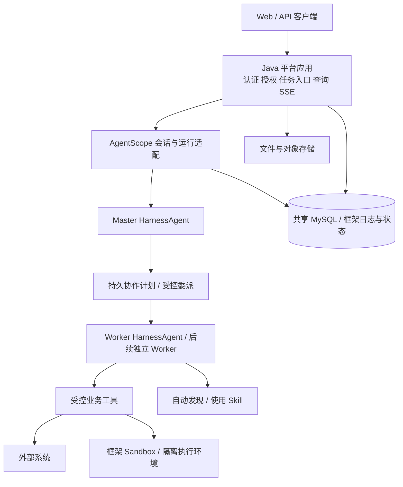

# 整体技术架构与选型

2026-10-20 修订。需求保持 R01–R12；语言方向采用 Java，Agent 框架采用 AgentScope Java 路线。具体框架版本与生产恢复集成尚未冻结，依据见[调研报告](research/agentscope-java.md)。本仓库仍处于设计阶段。

## 1. 技术基线

| 层面 | 建议 | 当前边界 |
| --- | --- | --- |
| 语言 | Java 21 | 主服务及 Master/Worker；Python 不再是必需运行服务 |
| 应用 | Spring Boot、Spring MVC、Spring Security | 登录、公共 API、授权、业务服务；具体 Boot patch 待框架依赖兼容验证 |
| Agent | AgentScope HarnessAgent / 受控 Worker 工厂 | 推理、工具循环、上下文、Skill 与状态；生产跨Worker委派走受控工具，见 ADR-003 |
| 版本 | v2.0.4 作稳定比较基线，v2.1.0-BETA1 作恢复评估候选 | 新 Session API 不在 v2.0.4 中，不能混用文档与稳定制品；不依赖 main |
| 平台数据 | MyBatis、MySQL 8.4、Flyway | 用户、连接、权限、操作账本、读模型等业务数据 |
| 框架存储 | AgentScope 原生日志适配 | 与业务表共用 Spring `DataSource`，表和状态权威分开；不增加第二套数据库连接配置 |
| 模型 | AgentScope 模型扩展，先接 DeepSeek | 配置化端点、模型、凭据与能力；避免再造一套模型客户端 |
| 执行 | 框架 Sandbox 接口与隔离执行环境 | 不预设 Python Runner；隔离部署、网络、资源和凭据仍需设计 |
| 大对象 | ArtifactStore 与对象存储适配 | 归属和下载鉴权在平台；快照、工作文件和交付产物区分管理 |
| 前端 | Vue 3、TypeScript、Vite、Vue Router、Pinia | 一期Web工作台；页面与核心切片同步交付，详见[页面设计](web-console.md) |

上游已核对标签中的 Spring Boot 示例/依赖基线为 4.0.4，不再沿用上一版直接选 4.1.x 的结论。AgentScope 使用 Reactor 不等于业务必须改用 WebFlux；MVC、MyBatis 阻塞调用与框架异步执行需隔离线程并验证。所有 SDK 依赖固定同一发布版本，实施前验证 Jackson、Reactor 与 Boot BOM 的依赖树。

## 2. 职责与部署

先采用 Java 模块化单体，Master/Worker 是逻辑角色，不预设各自一个微服务。平台可多副本，运行时会话所有权及恢复通过固定版本机制和必要补充实现。执行环境与平台进程保持隔离；未来重型 Worker 可独立部署，不因角色名称提前拆服务。

产品 API 不再因 Java/Python 分工增加内部 HTTP 跳转。同 JVM 内部通过类型接口调用；浏览器用 HTTP/JSON 与 SSE。远程 Worker 协议根据实际扩展需要适配，Feign/gRPC/A2A 均不作为当前前置条件。

## 3. 框架负责什么，平台补什么

| 层次 | 责任 |
| --- | --- |
| AgentScope | 模型调用、推理/工具循环、Skill 发现读取、上下文压缩、子 Agent 基础协作、框架原生状态与事件 |
| 运行集成层 | 会话所有者生命周期、任务标识映射、启动发现、恢复协调、确定性汇合、事件投影；版本缺口显式列出 |
| 平台业务层 | 身份、资源授权、凭据、审批约束、操作幂等/核对、显式记忆治理、文件归属、配额与审计 |

恢复集成不得绕过框架状态另造推理引擎。框架原生日志是单 Agent 执行权威；框架 Turn/Run 的平台字段是只读投影。GoalTask/Plan/Job 则是不同层级的产品协作权威，不是 SDK 状态副本。若稳定版缺少必需能力，则选择固定候选版本验证或明确补足，不能同时维护两套任务队列推进同一任务。

R06 的确定性依赖/汇合、R08 的后台子任务接管仍是设计重点。Plan Mode、持久状态、共享任务列表分别不等于 DAG 引擎、自动重跑、执行接管。

## 4. 核心对象需要重映射

- 产品“一次目标”在新方案中对应稳定逻辑任务；与框架 Turn/Run 分开：一个 GoalTask 可含多轮 Master Turn 和多个 WorkerJob，恢复保持产品 ID；详见[运行协议](runtime-contract.md)。
- 平台用户 ID 从登录态得到，RuntimeContext 由服务端建立；不能接受模型或客户端任意指定资源主体。
- Worker 使用独立会话与局部输入，禁用无界递归委派；总并发、调用次数和预算由确定性规则限制。
- Skill 固定运行版本、按作用域可见；脚本只经授权工具执行。
- 一期长期记忆仍只接受用户显式写入；默认自动提取机制须关闭或替换，不因框架默认行为改变需求。

## 5. 现行设计与门槛

[运行协议](runtime-contract.md)和[ADR-003](../decisions/003-runtime-ownership.md)确定层级；[模块](modules/README.md)、[OpenAPI](../contracts/README.md)与[业务DDL](../data/README.md)已按该边界重写，旧接口/旧表不再保留为现行文件。

BETA1 是固定设计候选，不是生产依赖已冻结。框架表 DDL 已有[固定标签结构参考](../data/framework-storage.md)，实际制品/SQL验证、应用依赖编译、会话/子任务接管、外部副作用、权限/记忆删除/SSE 的实验仍是实施门槛，见[评审](review.md)。
