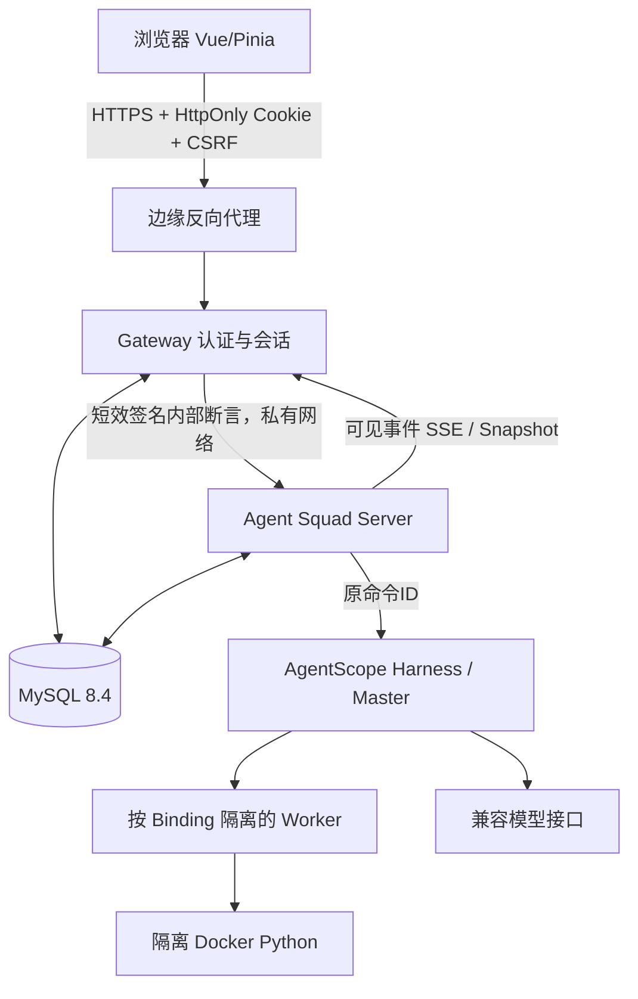

# Agent Squad 多用户正式产品：可执行架构设计与 OpenSpec 实施总方案

> 版本：v1.0 · 2026-11-02  
> 基线：`liumeng-cn/agent-squad` 的 `main@23c057bf5d138f12d772edf4b673a16b4533f0c5`  
> 方式：4 个有依赖顺序的 OpenSpec change；按阶段开发、测试、留证、独立提交  
> 目标：**ChatGPT 式 Web 对话入口 + Master/Worker 多智能体任务 + 多用户正式在线服务**

## 0. 用法

将本交付包中的 `openspec/changes/multiuser-*` 四个目录复制到本地仓库对应的 `openspec/changes/`，先阅读本文件和 `LOCAL_EXECUTOR_PROMPT.md`，再按照 C1→C2→C3→C4 逐个执行。**本包是设计与实施指令，不是已经实施的代码修改，也不保证现有测试在任何机器可直接通过。**

每个 change 包含：`.openspec.yaml`、`proposal.md`、`design.md`、`tasks.md`、`specs/<能力>/spec.md`。与当前仓库 `openspec/config.yaml` 的 `schema: spec-driven`、Chinese task/decision rules 相容。执行时以本地真实源码和测试行为校正细节，差异先写在 design/evidence 中，禁止假装实现与设计一致。

## 1. 已核实的当前项目事实

| 项目 | 已核实源码情况 | 对方案的意义 |
|---|---|---|
| 形态 | Gateway(Spring Cloud Gateway WebFlux) + Server(Spring MVC + AgentScope) + Vue3/Pinia；MySQL 8.4 | 保持模块化单体，避免新的微服务拆分 |
| 数据库 | 44 张表的 `V1__baseline.sql`；`spring.sql.init.mode=always` | 生产必须增加受控迁移与只校验配置 |
| 认证 | 单配置账号，Token + CSRF 内存 Map | C1 建立真正用户身份和跨实例会话 |
| 信任 | Server 读取未签名 `X-User-Id/X-User-Role` | C1 必须建立内部认证断言 |
| 身份隔离 | 多数业务资源含 `user_id`，已有跨用户安全测试 | 复用现有归属模型并扩大负面测试 |
| 运行 | Command 幂等受理+租约、原生 Journal、投影水位；单例 Master + 独立 Worker | 不能因为改并发而破坏原生运行权威 |
| 模型 | `OpenAIChatModel.stream(false)`；真实 DeepSeek E2E 有记录 | C3 流式必须先检验 SDK 安全可见事件 |
| 前端 | SSE 事件到达触发 snapshot 拉取；简化 Markdown；切会话清草稿 | C3 局部增量、体验与安全渲染 |
| 长上下文 | `ResponseContextService` 200000 字符硬上限 | C3 引入窗口与安全摘要 |
| 真实缺陷 | 首轮规划阶段早到 Directive 后模型拿错 ID 进入迭代耗尽 | C3 用结构化 ID 和协调安全点修复 |
| 验收 | 仓库已有真实模型、MySQL 及 SDK 测试记录 | 可作为基线，但须在本地重新执行并记录 |

**来源入口**：`README.md`、`openspec/config.yaml`、`openspec/specs/{access,runtime,master,worker,web-console}`、`server/.../AuthService.java`、`UserContextInterceptor.java`、`CommandDeliveryService.java`、`MasterAgent.java`、`NativeProjectionPoller.java`、`ResponseContextService.java`、`web/workbench/src/features/chat/stores/conversations.ts`；真实模型缺陷：`openspec/changes/archive/2026-11-02-conversation-first-experience/evidence/e2e-2026-11-02.md`。

## 2. 目标架构



- **明确产品与底座双定位**：前端以连续聊天为核心；平台内部维护可靠任务、工具权限、预算、恢复。不要显示 Master/Worker 原始工作过程替代面向用户的回答。
- **第一版部署**：一个 Server 执行实例 + 可冗余 Gateway + 一个 MySQL；Server 多实例开关仅在 C2 真正不同进程接管通过后开放。
- **隔离单位**：用户（唯一 user_id）→ 会话/消息 → 回复执行或 GoalTask → 固定 Binding → 原生 Session/Worker；所有工具、记忆、Skill、产物、预算与 owner 绑定。
- **平台唯一事实权威**：202/Command 状态与账本在 MySQL；SDK Session/Turn/Run 的真实状态来自 AgentScope；公开 SSE 不是执行权威，仅用来呈现业务事实。

## 3. 交付阶段与 Go/No-Go

| Change | 主要成果 | 完成门槛 | 阻断情形 |
|---|---|---|---|
| **C1 `multiuser-01-identity-trust`** | 真实账号 + 持久 Session + 内部签名 + 多用户 UI + Schema | 两用户隔离、双网关会话、停用/改密失效、伪造头 401、完整测试 | 未签名身份仍可访问 / 账号禁用后新工具仍可执行 |
| **C2 `multiuser-02-admission-isolation`** | 并发/容量测量、按用户限额、公平调度、跨进程恢复约束 | 慢任务不无故阻塞其他用户，配额无竞态，原恢复幂等通过 | SDK 数据串用户 / 任务写副作用重复 / slot 计数泄漏 |
| **C3 `multiuser-03-chat-agent-experience`** | 安全实时聊天、Markdown、草稿、长上下文、早到 Directive | 可见文本不泄漏内部状态，断线无重复，已知竞态通过复测 | 直接公开 raw AgentEvent / 丢失最新用户指令 / 旧记忆复活 |
| **C4 `multiuser-04-release-readiness`** | CI、镜像、staging、监控、迁移、备份恢复、发布准入 | CI 不掩盖关键跳过项；容量和灾备实测；上线门槛记录 | 生产启动自动建表 / 公网暴露 Server / 缺密钥仍能启动 |

**所有阶段都要完成一条真实的两用户主链路回归**：登录→发消息→普通回复→按需创建 Task→Worker→汇总→事件/历史恢复；其他专项任务根据任务单验收。安全改动的最高原则是“先拒绝不安全执行，再考虑恢复体验”。

## 4. 交叉一致性要求（避免执行体自作主张）

1. `openspec/specs/` 是稳定行为契约；在途 delta 放 `openspec/changes/<change>/specs/`，通过验收后按 OpenSpec 归档流程合并为稳定规范。
2. `api/openapi.json` 是 HTTP 正式契约；修改 Java DTO/接口时同步调整契约和前端类型，不可以“编译通过”等于接口兼容。
3. `V1__baseline.sql` 目前包含 44 表；本方案 C1 增 4 表，基线预期 48 表。若实际引入 C2 slot、C3 draft/summary，最终表数会继续增加；**表数只是验收清单，按真实表/列/索引核验，不把预期表数写死为最终结果**。
4. 当前 OpenSpec `config.yaml` 及部分 `runtime` 文字对数据库“只 baseline/no migrator”和“启动不 DDL”存在与现实配置矛盾。C1 必须主动修订，以 local/test baseline + prod 显式版本迁移形成一致约束；`openspec/README.md` 的过期 Flyway 陈述同步修订。
5. `AGENTS.md` 已规定 `@Resource` 字段注入、不能在 Spring 类声明内部类、中文说明、mapper XML、ID/审计字段规范，执行体继续遵守；同时更新项目定位为“Web 连续对话为产品入口、Agent 编排为技术核心”，避免后续 AI 误判。
6. 不同变更之间不迁移/复用已变更代码的旧 line number；报告应使用最新分支路径/提交 SHA。

## 5. 统一数据与错误语义

| 语义 | 合同 |
|---|---|
| 401 | 未登录、会话过期或内部身份断言无效；UI 清理本地会话状态 |
| 403 | 已认证但无操作权限；管理员不天然可读其他用户数据 |
| 404 | 无权得知的其他用户资源按不存在处理 |
| 409 | 幂等键冲突、版本冲突、状态不允许；客户端刷新权威状态 |
| 429 | 速率/并发限制，提供可安全重试信息；已 202 的请求不得被悄悄丢弃 |
| 202 | 持久接收用户消息，不代表模型开始/成功 |
| UNKNOWN | 真实外部 WRITE/模型用量的结果不确定；不自动假设成功或失败，不可擅自换 key 重放 |
| SDK 原生恢复 | 始终使用原固定 commandId/Binding/Turn，避免生成第二次执行 |

## 6. 运行质量验证矩阵

| 领域 | 最低测试 | 必须保留的原特性 |
|---|---|---|
| 账户 | 两用户、管理员、停用、改密、重置、登录限流 | Cookie/CSRF 无越权 |
| HTTP | 真实网关转发、multipart 原始字节、SSE 首帧、内部断言验证 | 状态码、idempotency key |
| 数据 | 复合 owner 查询、跨用户伪造 ID | 记忆撤销、Skill Grant |
| 运行 | 两用户并行、STOP/RESPOND、崩溃/重投/单例 Master | 状态机、版本 CAS、幂等 |
| Tool | APPROVAL、WRITE UNKNOWN、Sandbox、产物交付 | 安全核对、不重复副作用 |
| 上下文 | 消息窗口、历史摘要、用户删除记忆 | 冻结快照与 hash 校验 |
| 前端 | SSE seq 空洞、断线重连、流式修订、草稿、Markdown XSS | 不重复提交/不串账号 |
| 上线 | CI、staging、备份恢复、真实测量 | 不碰生产数据库 |

## 7. 标准验证命令（本地环境满足依赖时）

```bash
# 真实命令；执行体需先确认本地独立测试 MySQL 容器和凭据，不可让测试命中生产 DB
mvn -f server/pom.xml -B -ntp test
npm --prefix web/workbench ci
npm --prefix web/workbench run build
# C3 建立 test script 之后执行
npm --prefix web/workbench test
# 需要 Python3/jsonschema 依赖，安装规则按仓库工具说明
python3 tools/check_design.py
```

本仓库已有测试需 `SQUAD_TEST_MYSQL_ADMIN_URL`、`SQUAD_TEST_MYSQL_USER`、`SQUAD_TEST_MYSQL_PASSWORD` 等变量；应使用单独的测试终端/隔离库。`BUILD SUCCESS` 不等于所有用例运行，报告必须说明 skipped 与被 profile/配置屏蔽的场景。C1 的 SDK/模型真实调用测试只在用户已授权测试凭据与成本条件下运行。

## 8. 绝对执行边界

- 可以：本地非生产代码变更、OpenSpec/契约同步、添加测试、构建、隔离测试库 schema 创建与清理（仅明确的 `as_test_*` 自建库）、本地提交到新 feature 分支、生成验收文档。
- 不得自动做：`DROP DATABASE`、删除/清理用户真实开发库、生产 DDL/迁移、线上用户账号或密钥变更、修改 Git remote、主分支强制推送、部署公网/生产、执行真实外部 WRITE、向 Git 提交密钥/日志/完整用户数据。
- 当环境缺少 DB/Docker/SDK/真实模型凭据时：继续完成可验证的静态实现，标记 `BLOCKED` 并保留测试命令；不得用假结果补齐阶段完成记录；下一阶段依赖的关键门槛未过则停止。
- 若代码与方案冲突：先分析已有设计意图，在 `evidence/decision-log.md` 写明差异、候选与最小变更理由；原则上继续执行不冲突的部分，不能未经批准改动产品需求或牺牲安全不变量。

## 9. 阶段交付物

每阶段必须提供：

1. 更新的 `proposal.md/design.md/tasks.md/specs/`，完成任务 `- [x]` 与未完成 `- [ ]` 状态真实一致；
2. Java/TS/SQL/API 的实际提交与 commit SHA；
3. `evidence/verification.md`（执行命令、环境、通过/失败/跳过、关键日志）；
4. `evidence/security-matrix.md` 或 `evidence/performance.md`（按阶段）；
5. `evidence/known-limitations.md`（明确未实现、受阻原因和后续依赖）；
6. 阶段总结：变更文件、兼容性、风险、回滚路径、Go/No-Go。

**最终可以上线** 与 **本地开发完成** 是两个不同状态。C4 所有门槛得到真实证据且用户批准之前，必须将结论写作“尚未正式上线”。