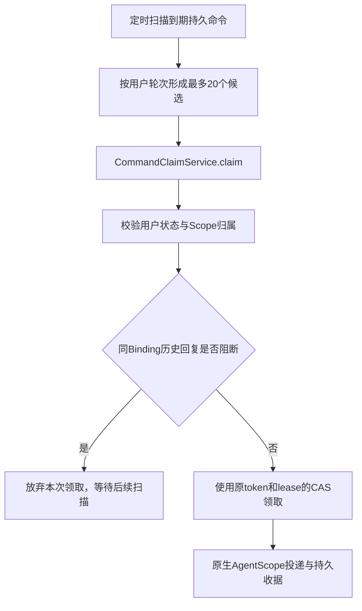

# C2 多用户到期命令公平扫描

> 状态：源码已写入 / 自动化与真实 MySQL 回归已执行；压力下仍存在跨用户等待边界，不能视为完整公平调度。范围仅为待领取命令发现，不改变 AgentScope 原生运行权威。

## 一、业务目标

当用户 A 拥有大量到期命令，而用户 B 只有少量到期命令时，原扫描按照所有命令的 `due_at,id` 排序并固定 `LIMIT 20`，可能导致 B 一直进不了候选窗口。本次目标是按用户轮次选取候选：优先取每个用户的第 1 条，再取每个用户的第 2 条，以减少单用户积压造成的扫描饥饿。

该规则只调整**候选命令发现**：是否真正获得命令领取权，仍由 `CommandClaimService` 与 `DeliveryMapper.claim` 的原事务、状态和租约规则确定。

## 二、排序与过滤规则

1. 命令类型限定为原来的 `SUBMIT / MESSAGE_SUBMIT / MASTER_SIGNAL / TASK_DIRECTIVE / STOP / RESUME / RESPOND`。
2. 仅纳入已经到期的 `PENDING`，或 `delivery_lease_until` 已经过期的 `DELIVERING`。
3. 同用户内部按**可再次领取时间**升序排序：前者使用 `due_at`，后者使用 `delivery_lease_until`，相同时间按自增 `id`。
4. 使用 `ROW_NUMBER() OVER (PARTITION BY user_id ORDER BY ...)` 生成 `user_position`，全局先按 `user_position`、再按领取时间、ID 排序，最终仍然只取 20 条。
5. 保留 `MESSAGE_SUBMIT` 对同 Binding、同代际更早回复未完成时的 `NOT EXISTS` 校验。
6. 排除 `sq_user` 中明确为 `DISABLED` 的账号，但不在扫描阶段把所有没有 `sq_user` 行的本地开发主体直接拒绝；真正的账号活动状态检查仍在领取/业务安全点执行。

## 三、现有链路与事务边界

- SQL 映射仅执行候选查询，不能在扫描阶段写执行状态。
- 同一命令即使被多个进程同时扫描，仍须由原领取事务的 `UPDATE ... WHERE status/lease` 保证唯一有效令牌。
- 已禁用用户的命令不会在扫描查询中被主动改成终态；重新启用后是否继续领取取决于原状态、租约、Scope 和业务授权。

## 四、数据库与容量影响

本次使用 MySQL 8 窗口函数对**全部符合条件的到期命令**排名，可能产生排序与临时表开销。原有 `idx_command_due(status,due_at)` 不代表该查询一定能高效使用索引。没有真实 `EXPLAIN ANALYZE` 及规模化压测证据前，不增加未经确认的索引，也不提高原扫描上限 20。

如果积压量增大，后续 C2 需设计可持久化的用户轮询游标/领取配额，与多实例调度和运行 Slot 一并验证，不能把此窗口查询当作最终公平调度器。

## 五、本地回归用例与执行结果

`DeliveryFairScanIntegrationTest` 已在隔离 MySQL 数据库执行 5 项，全部通过：双用户积压（A=100、B=1）时 B 进入首个 20 条；3 用户 30/2/1 首轮覆盖全部用户；同用户按 due/id 稳定排序；租约过期可领取、未过期不进入；DISABLED 用户排除且无 `sq_user` 行的本地用户保留。上述用例通过 `DeliveryMapper.findDueIds` 的真实 SQL 执行，未使用模拟结果。

2026-11-02 另外在独立库 `as_test_c2_scan_20261102` 做了规模化观察：

| 场景 | 数据规模 | 结果 |
| --- | --- | --- |
| 执行计划（1 万级） | 10,204 条命令、103 个用户 | `EXPLAIN ANALYZE` 总耗时约 20.7ms；`sq_command` 全表扫描，窗口排序后 Materialize 10,001 行 |
| 执行计划（10 万级） | 100,204 条命令 | 总耗时约 169ms；全表扫描 100,204 行，窗口聚合约 105–130ms |
| 同候选重复领取 | 同一 `c2-b-00001` 连续两次 claim | 第一次影响 1 行，第二次影响 0 行，CAS 生效 |
| 多用户各自积压 | 100 个活跃用户各 50 条，另有 A 积压 5,000 条、B 仅 1 条 | 连续 8 轮扫描每轮 20 个不同用户，B 仍未进入候选；原因是每轮领取后用户的下一条命令重新成为 `user_position=1`，积压更深且更早的用户持续排在 B 之前 |

最后一项说明：当前窗口只保证单用户不会占满 20 个候选名额，**不保证用户数超过窗口时的有界等待**。它符合本文“只调整候选发现、不是最终公平调度器”的定位，但在多用户积压场景下仍需持久轮询游标或领取配额；在补齐前不得宣称 C2 公平调度完成。

| 场景 | 准备数据 | 预期 | 状态 |
| --- | --- | --- | --- |
| 双用户积压 | A 有 100 条到期命令，B 有 1 条 | B 的命令能进入首个 20 条扫描结果 | 自动化 PASS |
| 多用户公平 | 3 个用户分别有 30/2/1 条 | 先覆盖不同用户首条，再进入下一轮 | 自动化 PASS |
| 同用户稳定顺序 | 同一用户多个相同到期时间 | 按 `id` 升序 | 自动化 PASS |
| 租约已过期 | `DELIVERING` 且租约早于当前时间 | 按租约时间参与排名 | 自动化 PASS |
| 未过期租约 | `DELIVERING` 且租约等于或晚于当前时间 | 不进入扫描 | 自动化 PASS |
| 非到期消息 | `PENDING` 但 `due_at` 在未来 | 不进入扫描 | 自动化 PASS |
| 旧消息阻断 | 同 Binding 更早回复处于阻断状态 | 后续 `MESSAGE_SUBMIT` 不被扫描 | 未单独执行真实数据用例 |
| 已禁用账号 | `sq_user.status='DISABLED'` | 不占用扫描窗口 | 自动化 PASS |
| 兼容本地账号 | `sq_user` 中没有该本地 userId | 不因账号表缺行而直接过滤 | 自动化 PASS |
| 双进程并发 | 同时查询相同候选并尝试 claim | 最多一个原有效令牌获得领取权 | 仅顺序 CAS 证据；未做双进程并发 |
| 高积压性能 | 典型 1万/10万待处理规模 | 以真实执行计划、延迟和数据库负载判定能否放量 | 已记录 20.7ms/169ms；未观察 CPU、IO 与并发负载 |

## 六、后续必须实现

- 为多用户积压引入持久轮询游标或最近服务时间，补足窗口内 `user_position` 在用户数超过 20 时无法提供有界等待的问题。
- C2 正式每用户/全局执行容量 Slot 和公平调度，不使用短期投递租约冒充运行 Slot。
- 跨进程 Master/Worker 恢复与接管、并行取消及幂等副作用验证。
- 在可用的隔离 MySQL 8 环境执行 `EXPLAIN ANALYZE` 和上述真实回归；未执行前不具备上线准入资格。
