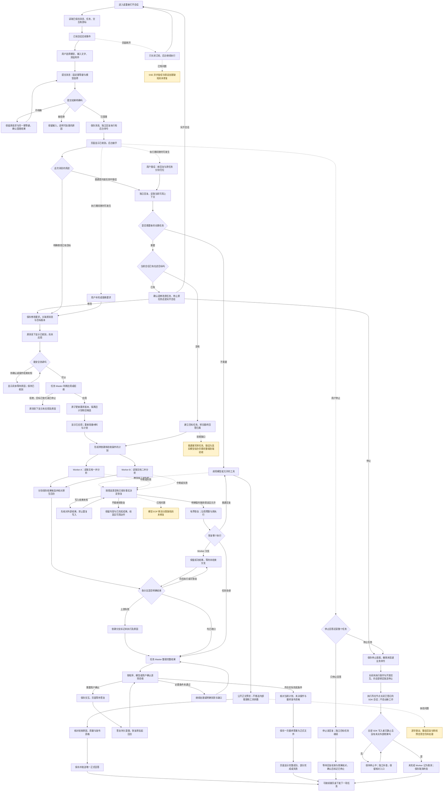
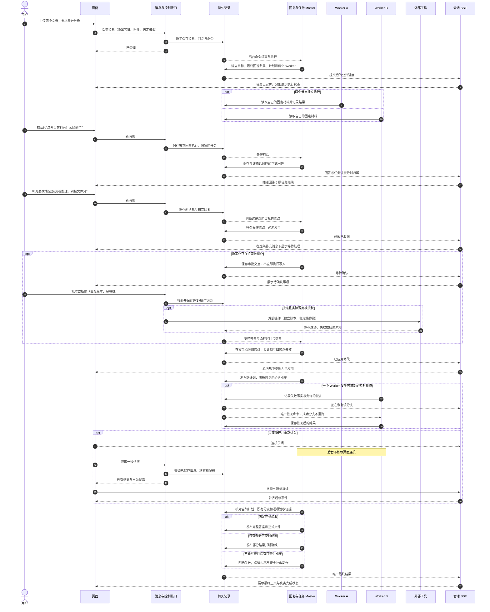

# 复杂聊天交互流程

更新：2026-11-06。图按当前代码与本轮验证整理；不是“所有主线任务均已完成”的声明。

阅读方式：实线表示当前已有路径；黄色节点表示尚缺完整验收或存在已知缺口。页面连接状态与后台执行状态分开。此次没有更改 POST 消息 + 会话 SSE 的交互结构，已舍弃的修改方案没有恢复。

## 从进入会话到任务结束

“普通提问”“修改要求”“新任务”是需要由模型结合上下文和受控工具判断的业务意图，不是前端凭关键词硬分流。若意图不明确应先追问；不能保证用户只要说“并行”就已经创建了 Worker。上图的插话分支表示已有独立回复与任务协调路径，具体复杂意图识别仍需真实模型验收。

## 最复杂组合的时序

该图展示同一会话内“两个文档并行 + 中途插话 + 修改要求 + 审批 + 分支恢复 + 页面重连”的完整关系。不同条件分支可以发生在不同执行阶段，不代表所有异常必然发生在同一次请求。

注意当前审批答复仍有同步外部执行路径，尚未完成主线 6.2 的全异步改造；时序图如实保留这一点，不画成已经全异步。取消的完整分支见上方总图；取消不撤销已经发生的外部写入。SDK 停止是合作式的；网络阻塞时公开 close 接口先等待约十秒再取消本地运行，页面在统一核对前保持停止中。

## 本轮证据与剩余边界

- 修改要求：隔离 MySQL 验证受理、等待、应用、拒绝、回滚、并发修改、停止后拒绝、旧计划隔离及只读查询；页面组件与状态合并测试验证来源消息归位及旧状态不回退。
- 取消：全绑定停止命令、纯控制入口不领取 Worker、SDK 写入者租约及未知操作阻止提前终结；独立补查负责在静止和核对完成后收尾。模拟操作核对完成的夹具不等于验证真实外部系统。
- 恢复：本地 HTTP 模型桩验证 503 后有限恢复、耗尽、显式重试沿用原消息与预算；不等于本次真实 EOF 断流已修复。
- 尚缺：真实模型下整套复杂流程、真实多进程/多机器取消竞争、完整活动分组、全链路 trace、连接鉴权修复及性能准入。图中黄色分支与主线未勾选任务继续保留。

本轮验证收尾：后端选定 49 项通过；前端 38 项 Vitest + 2 项 Node 通过并完成构建。真实 SDK 双 Worker 和阻塞回答的停止已通过本地 HTTP 模型桩验证。主线仍为 10/46；黄色问题未修复，跨机器与完整真实模型场景未验收。图用于解释完整路径，不表示全部分支已上线。
