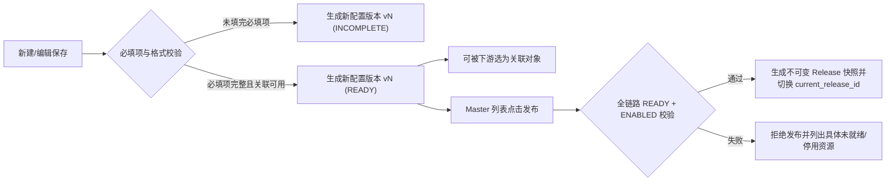

# Agent 配置与发布定格设计

状态：2026-11-23 根据用户确认的核心原则修订。本文定义 MCP、工具、SubAgent 与 Master Agent 的配置版本演进、正向关联校验、编码与别称规范、结构化提示词以及 Master 单点发布定格方案。

---

## 一、核心原则与业务边界

1. **配置与版本演进（改动即新增配置版本）**
   - MCP、工具（Tool）、子智能体（Sub）、主智能体（Master）均可随时编辑保存。
   - **每次保存改动都会生成一个新的不可变配置版本（`v1, v2, v3...`）**，目录表通过 `latest_version_id` 指向最新配置版本；所有资源均支持查看历史配置版本。
   - **配置仅仅是配置**：任何配置的新增、编辑、保存，均不改变线上已发布 Master 的运行配置。

2. **正向配置路径与“保存不卡必填、关联必须可用”**
   - 正向配置链路为：`MCP` → `Tool` → `Sub` → `Master`（`Master` 也可直接关联 `Tool`）。
   - **保存不验证必填**：允许用户先填部分信息暂存。系统在保存时自动计算该版本的**就绪状态（`readiness`：`READY` 就绪 / `INCOMPLETE` 未就绪）**。
   - **关联数据必须已经可用**：下游在关联上游资源时，只按**资源业务 ID** 建立关联，默认指向对方最新版本；被关联的资源必须处于 **`ENABLED`（启用）且最新配置版本为 `READY`（就绪）** 状态。未就绪或已停用的资源不允许被新增关联。
   - 若已关联的上游资源后续被编辑为 `INCOMPLETE` 或被停用，当前配置页保留该关联并高亮标记不可用原因，阻止下游发布，直到修复或移除。

3. **唯一发布入口与数据定格（仅 Master 允许发布）**
   - **Sub、Tool、MCP 不允许单独发布**，列表与详情页均不设发布或激活按钮。
   - **发布入口仅位于 Agent 列表的 Master 行操作栏**。
   - 点击发布 Master 时，系统强校验 Master 自身必填项及整条依赖链（Master → Sub → Tool → MCP）全部处于 `ENABLED + READY` 且无命名冲突，随后将此刻的 **Master 版本 + 关联的 Sub 版本 + Tool 版本 + MCP 版本** 一次性**定格（冻结）**为不可变的发布快照（Release）。
   - 每个 Master 只有一个当前生效发布指针（`current_release_id`）。新发布成功后立即切换生效指针，原发布转为只读历史；暂不提供应急回退或历史版本直接激活入口。

4. **只读穿透与删除保护**
   - 查看 Master 的“当前生效快照”或“发布历史”时，点击查看绑定的 Sub、Tool、MCP 详情，**全程沿该次发布定格的版本 ID 逐层穿透读取**，不会窜读到上游后续新保存的配置版本。
   - 删除采用**逻辑删除（`deleted_at`）**，保留全部历史配置版本与发布快照，不物理级联删除历史数据。仍被未删除下游配置或当前生效发布引用的资源，拒绝停用与删除并明确列出引用方。

---

## 二、命名体系、编码规则与结构化提示词

### 1. 三类名称解耦（引入前端事件展示别称）

| 字段名 | 面向受众 | 适用资源 | 校验与回退规则 | 示例 |
| --- | --- | --- | --- | --- |
| **组件名称** (`name`) | 后台管理员（列表/检索/选择器） | MCP / Tool / Sub / Master | 必填，1～120 字 | `订单查询接口-生产` |
| **展示别称** (`display_alias`) | 聊天前端用户（思考/工具调用/委派事件卡片） | Tool / Sub / Master | 选填，最多 60 字；**留空时前端自动回退展示组件名称** | `查询订单详情` / `订单专员` |
| **模型调用名** (`exposed_name` / `delegation_name`) | 大模型（Tool Calling / 委派标识） | Tool / Sub 委派关系 | 1～64 位（委派名 1～80 位）字母数字下划线连字符；禁止使用 `ask_user` | `query_order_detail` |

### 2. 组件编码自动生成规则

- 所有资源的业务编码（`server_code` / `tool_code` / `agent_code`）**由后端在创建时完全自动生成，前端不提供输入框，创建后永久只读**。
- **统一格式（规则 A · 全大写短横线）**：`{前缀}-{yyyyMMdd}-{3位当日递增序号}`：
  - Master Agent：`AGT-M-{yyyyMMdd}-{001}`（例：`AGT-M-20261124-001`）
  - Sub Agent：`AGT-S-{yyyyMMdd}-{001}`（例：`AGT-S-20261124-001`）
  - 内置工具：`TOOL-B-{yyyyMMdd}-{001}`
  - HTTP 工具：`TOOL-H-{yyyyMMdd}-{001}`
  - MCP 工具：`TOOL-M-{yyyyMMdd}-{001}`
  - MCP 服务：`MCP-{yyyyMMdd}-{001}`（例：`MCP-20261124-001`）
- 按当日同前缀最大编码递增生成，并发命中唯一索引冲突时自动递增重试（最多 5 次）。

### 3. 结构化提示词规范（分模块表单 + 自动拼装 + AI 辅助预留）

Agent 系统提示词采用**业界标准五段式结构化表单**（对应选项 B），同时保存结构化 JSON（`prompt_sections`）与拼装后的完整 Markdown（`system_prompt`）：

| 模块键名 | 页面标签 | 填写引导（Placeholder） | 发布时是否必填 | 字数上限 |
| --- | --- | --- | --- | --- |
| `role` | **角色与定位** | 定义 Agent 的专业身份、服务领域与职责边界 | **必填** | 4000 字 |
| `goal` | **核心目标** | 明确需要解决的核心问题与交付标准 | **必填** | 4000 字 |
| `workflow` | **工作流程与策略** | 处理步骤、何时调用工具、何时委派 SubAgent 或询问用户 | 选填 | 6000 字 |
| `constraints` | **约束与边界** | 禁止事项、安全合规底线、信息不足时的处理规则 | 选填 | 4000 字 |
| `outputFormat` | **输出规范** | 回复结构、语气风格、格式约定（如表格/代码/简洁度） | 选填 | 2000 字 |

- **自动拼装规则**：后端按固定顺序将非空模块拼装为 `system_prompt`：
  ```markdown
  ## 角色与定位
  {role}

  ## 核心目标
  {goal}

  ## 工作流程与策略
  {workflow}

  ## 约束与边界
  {constraints}

  ## 输出规范
  {outputFormat}
  ```
- **平台交互约定追加**：运行时由 `ChatAgentFactory` 在 `system_prompt` 末尾统一追加平台级 `ask_user` 交互准则，不混入用户编辑字段。
- **预览与 AI 辅助预留**：编辑区右侧或底部提供“完整提示词预览（只读折叠）”；标题栏预留“AI 辅助填写/润色”入口（后续可基于 Agent 名称、职责描述、已绑定 Tool 与 Sub 列表，按 `prompt_sections` 分模块生成或局部优化）。

---

## 三、枚举、数据结构与状态转换

### 1. 跨端一致枚举定义（Java / TypeScript / OpenAPI 同步）

| 枚举名 | 取值 | 说明 |
| --- | --- | --- |
| `AgentType` | `MASTER`, `SUB_AGENT` | 页面展示为 `Master` / `Sub` |
| `ToolType` | `BUILTIN`, `HTTP`, `MCP` | 工具实现类型，创建后只读 |
| `McpTransportType` | `STREAMABLE_HTTP`, `SSE` | MCP 传输协议 |
| `ConfigStatus` | `ENABLED`, `DISABLED` | 资源启停状态 |
| `ConfigReadiness` | `READY`, `INCOMPLETE` | 最新配置版本的必填与合法性就绪状态 |
| `AgentPublishState` | `UNPUBLISHED`, `PUBLISHED`, `MODIFIED` | Master 列表发布状态：未发布 / 已发布且无改动 / 已发布但有未发布修改 |

### 2. 数据库表结构设计（Schema：`squad_chat`）

所有表遵循“存储主键 `id` 与业务 ID 分离、统一公共审计字段、禁止 `FOR UPDATE`、条件更新用 `revision`”约定。

#### （1）目录表（维护资源身份、当前最新配置版本指针、启停与逻辑删除）

- **`sq_mcp_server`（MCP 服务目录）**
  - 核心字段：`id`、`mcp_server_id`（UNIQUE）、`server_code`（UNIQUE）、`server_name`、`description`、`status`（`ENABLED`/`DISABLED`）、`latest_version_id`、`latest_version_no`、`latest_readiness`（`READY`/`INCOMPLETE`）、`revision`、`deleted_at`、审计字段。
- **`sq_tool`（工具目录）**
  - 核心字段：`id`、`tool_id`（UNIQUE）、`tool_code`（UNIQUE）、`tool_name`、`display_alias`、`tool_type`（`BUILTIN`/`HTTP`/`MCP`）、`status`、`latest_version_id`、`latest_version_no`、`latest_readiness`、`revision`、`deleted_at`、审计字段。
- **`sq_agent`（Agent 目录）**
  - 核心字段：`id`、`agent_id`（UNIQUE）、`agent_code`（UNIQUE）、`agent_name`、`display_alias`、`agent_type`（`MASTER`/`SUB_AGENT`）、`status`、`latest_version_id`、`latest_version_no`、`latest_readiness`、`current_release_id`（仅 Master 使用，Sub 恒为空）、`revision`、`deleted_at`、审计字段。

#### （2）配置版本表（每次保存新增一条不可变版本，保留完整配置历史）

- **`sq_mcp_server_version`（MCP 配置版本历史）**
  - 字段：`id`、`mcp_server_version_id`（UNIQUE）、`mcp_server_id`、`version_no`（`UNIQUE(mcp_server_id, version_no)`）、`readiness`、`transport_type`、`endpoint`、`credential_ref`、`request_headers`（JSONB）、`timeout_ms`、审计字段。
- **`sq_tool_version`（工具配置版本历史）**
  - 字段：`id`、`tool_version_id`（UNIQUE）、`tool_id`、`tool_type`、`version_no`（`UNIQUE(tool_id, version_no)`）、`readiness`、`exposed_name`、`description`、`input_schema`（JSONB）、`read_only`、`implementation_key`、`mcp_server_id`（关联 MCP 业务 ID）、`remote_tool_name`、`http_spec`（JSONB）、审计字段。
- **`sq_agent_version`（Agent 配置版本历史）**
  - 字段：`id`、`agent_version_id`（UNIQUE）、`agent_id`、`version_no`（`UNIQUE(agent_id, version_no)`）、`readiness`、`description`、`prompt_sections`（JSONB）、`system_prompt`、`max_iters`、审计字段。
- **`sq_agent_version_tool`（Agent 配置版本的工具关联，按业务 ID 关联）**
  - 字段：`id`、`agent_version_id`、`tool_id`、`sort_no`、审计字段；唯一约束 `UNIQUE(agent_version_id, tool_id)`。
- **`sq_agent_version_subagent`（Master 配置版本的 Sub 委派关联，按业务 ID 关联）**
  - 字段：`id`、`master_version_id`、`subagent_id`、`delegation_name`、`delegation_description`、`display_alias`、`sort_no`、审计字段；唯一约束 `UNIQUE(master_version_id, subagent_id)`、`UNIQUE(master_version_id, delegation_name)`。

#### （3）Master 发布定格表（仅 Master 发布时写入，不可变运行快照图）

- **`sq_agent_release`（Master 发布定格主表）**
  - 字段：
    - `id`：内部存储主键
    - `release_id`：发布快照业务 ID（UNIQUE）
    - `master_agent_id`：所属 Master 业务 ID
    - `release_no`：发布序号（`v1, v2...`，`UNIQUE(master_agent_id, release_no)`）
    - `master_version_id`：定格的 Master 配置版本 ID（引用 `sq_agent_version`）
    - `dependency_digest`：定格时的全链路版本指纹（SHA-256）
    - `publish_operation_id`：前端提交的发布幂等标识（`UNIQUE(master_agent_id, publish_operation_id)`）
    - `published_at`：发布时间
    - 公共审计字段
- **`sq_agent_release_subagent`（发布定格的 Sub 委派快照）**
  - 字段：`id`、`release_id`、`subagent_id`、`subagent_version_id`（定格的 Sub 配置版本 ID）、`delegation_name`、`delegation_description`、`display_alias`、`sort_no`、审计字段。
- **`sq_agent_release_tool`（发布定格的工具与 MCP 版本快照，含 Master 直接工具与 Sub 工具）**
  - 字段：`id`、`release_id`、`owner_agent_id`（归属 Master 或某个 Sub 的 `agent_id`）、`owner_agent_version_id`、`tool_id`、`tool_version_id`（定格的工具配置版本 ID）、`tool_display_alias`、`mcp_server_id`（可空）、`mcp_server_version_id`（若为 MCP 工具，定格的 MCP 配置版本 ID）、`sort_no`、审计字段。

> [!IMPORTANT]
> **为什么将“配置版本表”与“Master 发布定格表”分离？**
> 1. 每次修改 MCP / Tool / Sub / Master 并保存，只需向对应的 `*_version` 插入新版本（`version_no + 1`），无需担心破坏已发布快照，天然满足“改动即加新版本、随时查看配置历史”。
> 2. Master 发布时，`sq_agent_release_*` 精确记录当次定格的 `(master_version_id, subagent_version_id, tool_version_id, mcp_server_version_id)` 组合，彻底消除跨 Agent 发布复用工具版本时的“传递依赖漂移”与唯一索引冲突。
> 3. **“有未发布修改（`MODIFIED`）”判定极为清晰**：只要 Master 当前 `latest_version_id != release.master_version_id`，或任一关联 Sub / Tool / MCP 的当前 `latest_version_id` 与 `release` 中定格的 `*_version_id` 不一致，即为 `MODIFIED`。

### 3. 状态流转规则



---

## 四、各配置项就绪度（`READY` vs `INCOMPLETE`）判定标准

保存时**不阻断**未填完的配置（仅校验已填字段的格式合法性、关联对象必须存在且 `ENABLED + READY`），后端按以下规则计算 `readiness`：

1. **MCP 服务（`READY` 条件）**
   - `server_name` 非空；
   - `transport_type` 已选（`STREAMABLE_HTTP` 或 `SSE`）；
   - `endpoint` 为合法 `http/https` URL（不含内嵌用户名密码或 `#fragment`）；
   - 若 `request_headers` 使用了 `{{credential}}`，则 `credential_ref` 已选且存在于系统凭据配置中。

2. **工具 Tool（`READY` 条件）**
   - 通用：`tool_name` 非空、`exposed_name` 非空且合法（非 `ask_user`）、`description`（调用说明）非空、`input_schema` 为合法 JSON Schema 对象；
   - `BUILTIN`：`implementation_key` 已选且存在于 `BuiltinToolRegistry`；
   - `HTTP`：`http_spec.method` 与 `http_spec.url` 合法（主机部分无占位符）、模板中的 `{{参数名}}` 在参数表中均存在、使用 `{{credential}}` 时 `credential_ref` 已选且有效；
   - `MCP`：`mcp_server_id` 已选、`remote_tool_name` 非空，且所选 MCP 当前处于 `ENABLED + READY`。

3. **Agent（Master / Sub，`READY` 条件）**
   - `agent_name` 非空；
   - `prompt_sections.role` 与 `prompt_sections.goal` 非空（合成后的 `system_prompt` 非空）；
   - 若为 `SUB_AGENT`：`description`（职责描述）非空，且无 Sub 委派项；
   - 已绑定的所有 `tool_id` 当前均未删除且处于 `ENABLED + READY`，同一 Agent 内各工具 `exposed_name` 互不冲突；
   - 若为 `MASTER`：已绑定的所有 `subagent_id` 当前均未删除、类型为 `SUB_AGENT` 且处于 `ENABLED + READY`，`delegation_name` 互不冲突且不与绑定工具的 `exposed_name` 或 `ask_user` 冲突。

---

## 五、页面布局与交互规范

### 1. 统一紧凑后台风格
- 保持 48px 顶栏、左侧导航、右侧清爽工作区，统一使用 Element Plus `small` 尺寸控件。
- 编辑页采用**单栏分区布局**（最大宽度 `1120px`，左对齐），顶部展示面包屑、资源名称、**只读编码标签**、当前配置版本号（如 `配置版本 v3 · 已就绪`）、更新时间与 `[保存]` 按钮。
- 页签固定为：
  - MCP / Tool / Sub：`配置`、`引用关系`、`配置历史`
  - Master：`配置`、`发布历史`、`配置历史`

### 2. MCP 编辑页
- **基本信息**：MCP 名称（必填）、编码（新建显示“保存后自动生成”，编辑显示只读标签 `mcp_20261123_xxxxxx`）、说明（选填）。
- **连接配置**：传输方式（Streamable HTTP / SSE）、连接地址、凭据下拉（仅引用名）、请求头键值表（最多 20 行）、高级设置折叠区（超时 1000～120000ms，默认 30000ms）。
- **测试连接**：使用当前表单参数实时探测后端 `probe` 接口，展示耗时与发现的远程工具只读列表；修改连接参数后自动清除旧测试结果。

### 3. 工具编辑页
- **基本信息**：工具名称、**展示别称（`display_alias`，选填，提示“用于聊天界面展示，留空使用工具名称”）**、编码（自动生成只读）、工具类型（内置 / HTTP / MCP，新建可选，创建后只读）。
- **能力与实现配置**：
  - **内置工具**：选择内置实现后自动带出默认模型工具名、调用说明、只读参数表与只读属性（仅模型工具名与调用说明可微调）。
  - **HTTP 工具**：请求方法、请求地址、可视化请求参数表（自动生成 JSON Schema，不让用户手写 Schema）、请求头、请求体模板（仅 POST/PUT/PATCH）、模型工具名、调用说明、只读属性开关、凭据、高级设置（超时、结果 JSON Pointer）。
  - **MCP 工具**：选择已启用且就绪的 MCP → 点击“发现工具” → 选择远程工具 → 自动带出模型工具名、调用说明、只读参数表与只读属性。
- **工具试运行**：底部可折叠面板，根据参数定义自动渲染输入控件，调用当前表单定义即时验证。

### 4. Agent 编辑页（Master & Sub）
- **基本信息**：
  - Agent 名称、**展示别称（`display_alias`，选填）**、编码（自动生成只读）、类型（`Master` / `Sub`，新建单选，创建后只读）；
  - 职责描述（Sub 发布必填，Master 选填）。
- **结构化系统提示词**：
  - 分块展示：**角色与定位**、**核心目标**、**工作流程与策略**、**约束与边界**、**输出规范**（后三项支持紧凑折叠/展开）；
  - 右上角提供 `[预览完整提示词]` 与 `[AI 辅助填写（预留）]` 按钮。
- **工具绑定**：
  - 点击“添加工具”弹窗仅列出 `ENABLED + READY` 的工具（按 `tool_id` 唯一，不选版本号）；
  - 已选工具表格展示：工具名称、展示别称、编码、类型、模型工具名、当前配置版本与就绪状态、详情、移除。
- **Sub 委派（仅 Master 展示）**：
  - 点击“添加 Sub”弹窗仅列出 `ENABLED + READY` 的 Sub Agent（按 `agent_id` 唯一）；
  - 已选表格展示：Sub 名称、**委派展示别称（默认带出 Sub 的 `display_alias` 或名称，允许在当前 Master 下覆盖）**、委派名称（`delegation_name`，默认由 Sub 编码生成，可改）、委派说明（默认带出 Sub 职责描述，可覆盖）、状态、详情、移除。
- **高级设置（默认折叠）**：最大执行步数（`1～200`，留空显示平台默认值）。

### 5. 列表页操作栏差异
- **MCP 列表 / 工具列表**：`编辑`、`启用/停用`、`删除`
- **Agent 列表**：
  - **Sub 行**：`编辑`、`启用/停用`、`删除`（不显示发布状态与发布按钮，展示“最新配置版本 `vN`”及就绪状态）
  - **Master 行**：`编辑`、`发布`（仅 `ENABLED` 时可点）、`启用/停用`、`删除`（展示当前生效发布 `Release #M` 以及是否有未发布修改 `MODIFIED`）

---

## 六、接口契约与核心事务流程

统一路径前缀：`/api/v2/agents/management`，所有接口返回 `ApiResult<T>`。

### 1. 候选与配置维护接口

| 接口 | 方法与路径 | 说明 |
| --- | --- | --- |
| MCP 列表 / 新增 / 详情 / 保存 | `GET/POST /mcp-servers`, `GET/PUT /mcp-servers/{mcpServerId}` | `PUT` 保存时生成新 `sq_mcp_server_version` 并条件更新 `sq_mcp_server.revision` |
| MCP 历史版本详情 | `GET /mcp-servers/{mcpServerId}/versions/{versionId}` | 只读查看指定历史配置版本 |
| 工具列表 / 新增 / 详情 / 保存 | `GET/POST /tools`, `GET/PUT /tools/{toolId}` | `PUT` 保存时生成新 `sq_tool_version` 并条件更新 `sq_tool.revision` |
| 工具历史版本详情 | `GET /tools/{toolId}/versions/{versionId}` | 只读查看指定历史配置版本 |
| 可选 MCP 候选 | `GET /tools/mcp-options` | 仅返回未删除且 `status=ENABLED`、`latest_readiness=READY` 的 MCP |
| 发现 MCP 远程工具 | `POST /mcp-servers/{mcpServerId}/remote-tools` | 按 MCP 业务 ID 读取其最新配置版本在事务外连接并返回 `tools/list` |
| Agent 列表 / 新增 / 详情 / 保存 | `GET/POST /agents`, `GET/PUT /agents/{agentId}` | `PUT` 保存时生成新 `sq_agent_version` 及其业务 ID 绑定，条件更新 `sq_agent.revision` |
| Agent 配置历史版本详情 | `GET /agents/{agentId}/versions/{versionId}` | 只读查看某次保存的 Agent 配置版本 |
| 可选工具 / 可选 Sub 候选 | `GET /agents/tool-options`, `GET /agents/subagent-options` | 仅返回未删除且 `ENABLED + READY` 的 Tool / Sub |

### 2. Master 两阶段发布接口与并发控制

1. **发布预检**：`GET /agents/{agentId}/publish-preview`
   - 校验目标为 `MASTER` 且 `status = ENABLED`；
   - 递归解析当前 `latest_version_id` 依赖树（Master → Sub → Tool → MCP）；
   - 发现任何节点未就绪（`INCOMPLETE`）、已停用（`DISABLED`）、已删除、名称冲突或凭据缺失时，返回明确错误列表；
   - 全部通过时，计算全链路版本指纹 `dependencyDigest`（由各节点的 `id:latest_version_id:revision` 排序后哈希），连同本次即将定格的完整依赖清单返回前端确认弹窗。

2. **确认发布**：`POST /agents/{agentId}/publish`
   - 请求体：`{ "revision": 12, "dependencyDigest": "sha256...", "publishOperationId": "uuid..." }`
   - **幂等处理**：若 `(agentId, publishOperationId)` 已存在发布记录，直接返回该次发布结果。
   - **事务内乐观复核與定格（无 `FOR UPDATE`）**：
     1. 重新读取 Master 及依赖链所有 Sub、Tool、MCP 的当前目录行，复核均处于 `ENABLED + READY` 且计算出的 `dependencyDigest` 与请求一致；若期间任何依赖被他人修改或停用，立即抛出 `ApiCode.CONFLICT`（提示“依赖配置已发生变化，请重新确认发布”）。
     2. 插入 `sq_agent_release`、`sq_agent_release_subagent`、`sq_agent_release_tool` 定格全部版本 ID。
     3. 执行带期望 `revision` 和 `status = 'ENABLED'` 的条件更新：
        ```sql
        UPDATE squad_chat.sq_agent
        SET current_release_id = #{releaseId},
            revision = revision + 1,
            last_updater_id = #{actorId},
            last_update_time = CURRENT_TIMESTAMP
        WHERE agent_id = #{agentId}
          AND agent_type = 'MASTER'
          AND status = 'ENABLED'
          AND deleted_at IS NULL
          AND revision = #{expectedRevision}
        ```
     4. 影响行数不为 1 时整笔事务回滚并返回并发冲突。

3. **发布快照只读穿透查询**：
   - `GET /agents/{agentId}/releases/{releaseId}`：返回该次发布定格的 Master 版本、Sub 委派列表及直接工具列表；
   - `GET /agents/{agentId}/releases/{releaseId}/subagents/{subagentId}`：仅在该 `subagentId` 属于该 `releaseId` 时，返回定格的 `subagent_version_id` 详情及其定格的工具列表；
   - `GET /agents/{agentId}/releases/{releaseId}/tools/{toolId}`：仅在该 `toolId` 属于该 `releaseId`（含 Sub 工具）时，返回定格的 `tool_version_id` 及对应定格的 `mcp_server_version_id` 详情。

---

## 七、运行时衔接与验收清单

### 1. 运行时与前端聊天事件衔接
- 聊天会话绑定 Master 的 `agent_code`（或 `agent_id`）。每次新执行（Turn / Run）启动时，读取该 Master 当前的 `current_release_id` 及其定格的 `sq_agent_release_*` 完整快照装配 `HarnessAgent`；已开始的 Turn 固定原快照直至结束。
- 工具调用与 Sub 委派事件向前端推送时，携带定格的 `display_alias`（若为空则取定格时的组件名称），前端事件卡片直接展示该友好名称。

### 2. 核心验收清单
1. **自动编码**：新建 MCP、Tool、Sub、Master 时无需手填编码，保存后自动生成 `{前缀}_{yyyyMMdd}_{随机6位}` 格式编码且只读。
2. **展示别称**：Tool、Sub、Master 支持维护 `display_alias`，Master 委派 Sub 时可覆盖委派别称；留空自动回退组件名称。
3. **结构化提示词**：Agent 编辑页按“角色与定位 / 核心目标 / 工作流程与策略 / 约束与边界 / 输出规范”分块编辑，自动拼装 `system_prompt` 并支持预览。
4. **改动即新版本 & 保存不卡必填**：任意资源缺少必填项也可保存并生成新配置版本（标记为 `INCOMPLETE`），所有历史配置版本均可只读查看；`INCOMPLETE` 或 `DISABLED` 的资源不会出现在下游“添加工具 / 添加 Sub / 选择 MCP”候选项中。
5. **仅 Master 可发布**：Sub、Tool、MCP 无发布按钮；Master 发布时校验全链路就绪并定格版本快照；发布后上游再修改产生新配置版本，不影响已发布 Master 的运行与发布快照详情弹窗。
