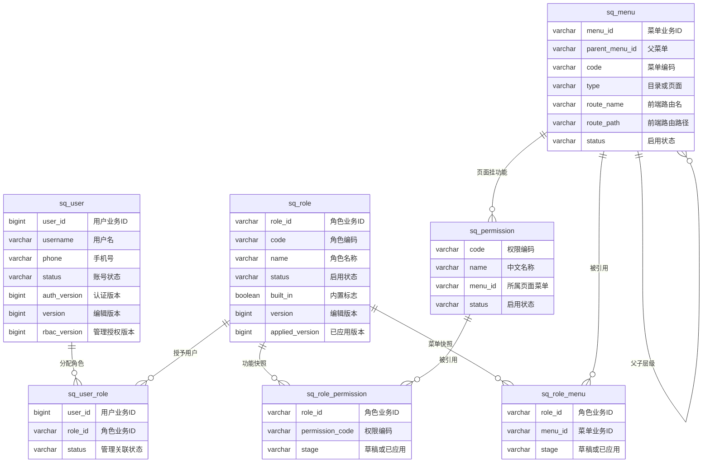

# 管理授权实体关系

用户库 squad_user 的表结构关系。关联统一使用业务标识（user_id、role_id、menu_id、permission code），存储主键 id 仅用于行定位。

## 关系要点

- `sq_user_role` 连接用户与角色，其 status 表示该用户的管理资格是否启用；唯一键 user_id + role_id。
- `sq_role_permission` 和 `sq_role_menu` 都以 stage=DRAFT/APPLIED 保存草稿与生效两份快照，唯一键分别为 role_id + permission_code + stage 和 role_id + menu_id + stage；应用时同事务整体替换 APPLIED 并推进 `sq_role.applied_version`。
- `sq_menu` 通过 parent_menu_id 自引用形成目录树，DIRECTORY 可挂目录或页面，PAGE 不再挂菜单。
- `sq_permission.menu_id` 把功能挂到 PAGE 菜单下；功能生效要求所属页面及祖先目录均启用，且页面在角色的 APPLIED 菜单快照内。
- 生效授权 = 账号正常 + 用户角色关联启用 + 角色启用且已应用 + 功能启用 + 页面及祖先目录启用，多角色取并集。
- `sq_rbac_log` 是独立的授权操作日志，只增不改、无外键，与授权变更同事务写入操作类型、目标业务 ID、摘要和操作人，用于事后追溯，不参与鉴权。
