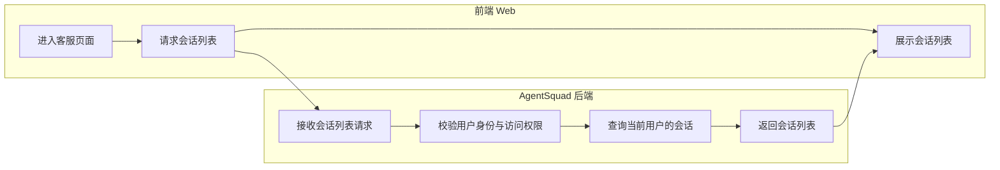
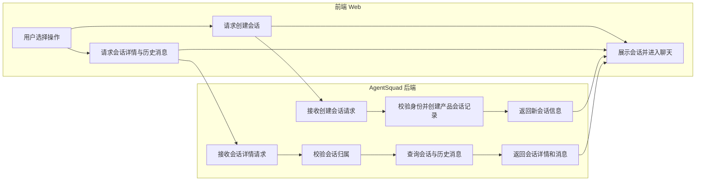
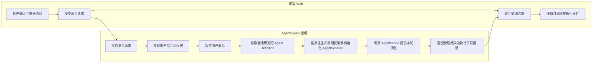
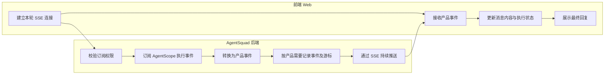
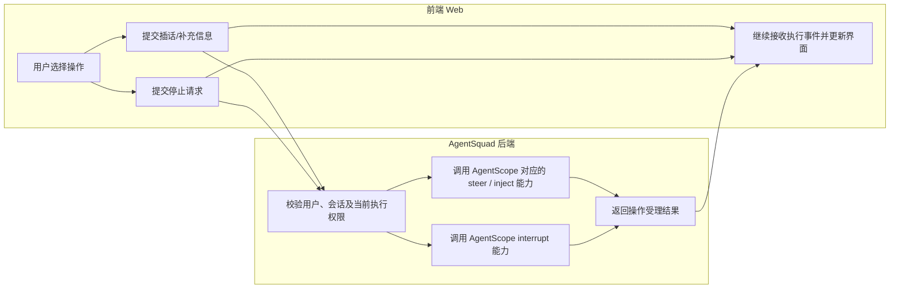
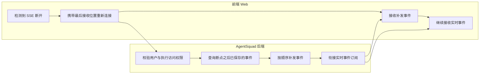

# AgentSquad 一期客服前后端交互流程

> 目的：先明确用户操作、前端请求和后端处理的先后关系，为后续接口清单和 OpenAPI 设计提供依据。
>
> 范围：一期客服主流程。只画前端 Web 与 AgentSquad 后端两条泳道；AgentScope 作为后端内部运行能力，不额外拆成第三条泳道。
>
> 原则：不同场景分图表达，不把页面初始化、消息执行、事件推送和中断恢复塞进同一张图。当前不定义具体请求/响应字段，也不预设 AgentScope 尚未核实的行为。

## 1. 页面初始化与会话列表

用户进入客服页面后，前端获取当前用户可访问的会话列表。后端负责身份校验和数据查询。

## 2. 创建会话或打开已有会话

创建会话与打开已有会话是两种不同操作，因此在同一张图中用分支表示。会话属于 AgentSquad 产品数据；AgentScope 的 AgentSession 如何初始化或关联，按框架原生生命周期处理，具体时机后续核实。

## 3. 发送消息与提交 AgentScope 执行

这张图只描述一次用户消息如何进入 AgentScope。Agent Definition 是 AgentSquad 维护的配置定义；实际 Agent、AgentSession 和本轮执行由 AgentScope 运行时负责。

**边界说明**

- AgentSquad 保存 Agent Definition，不自行维护一套 Agent Runtime。
- Master 创建 SubAgent、调用工具、推理和执行，优先交给 AgentScope。
- 本轮执行标识优先使用 AgentScope 原生任务标识；是否需要额外的产品关联记录，后续根据查询、权限和消息关联需求决定。
- 消息提交成功只表示后端已受理，不代表 Agent 已经执行完成。

## 4. SSE 事件订阅与消息展示

消息提交和事件订阅分开。前端收到受理结果后订阅本轮事件；后端从 AgentScope 获取运行事件，转换为前端可消费的产品事件。

**边界说明**

- SSE 连接只负责事件传输，不拥有 Agent 执行生命周期。
- AgentScope 原生事件不直接暴露给前端；由后端转换为稳定的产品事件。
- 事件是否全部持久化、如何生成游标，需要结合 AgentScope Session Log 能力和断线续传要求进一步确定。

## 5. 用户插话与中断

插话和中断是两种不同意图：插话是向正在执行的 Agent 补充信息或调整要求；中断是要求当前执行停止。两者分别调用 AgentScope 对应的原生能力，具体语义和适用状态需要按当前依赖版本核实。

## 6. SSE 断线重连与事件补发

浏览器断线不应导致 Agent 执行自动终止。前端重新连接时携带已接收位置，后端补发缺失事件，再继续推送实时事件。

**需要保证**：历史补发与实时订阅之间不能出现事件丢失；重复事件需要能够识别和去重。具体实现方式待结合事件存储和 AgentScope 原生日志能力确定。

## 7. 当前流程图暂未确定的设计问题

| 问题 | 当前处理原则 | 后续需要核实 |
|---|---|---|
| AgentSession 初始化时机 | 交给 AgentScope 生命周期管理 | 创建产品会话时初始化，还是首次消息时初始化 |
| AgentSession 与产品会话关系 | AgentSquad 维护必要关联，不复制框架状态 | 原生 Session 标识及恢复方式 |
| 本轮执行标识 | 优先使用 AgentScope 原生任务标识 | 标识是否稳定、能否查询和控制 |
| 消息与执行关联 | AgentSquad 维护产品消息关系 | 一条用户消息与执行任务的关联规则 |
| 事件持久化 | 优先复用 AgentScope Session Log | 产品事件是否需要单独存储 |
| SSE 断线续传 | 由产品后端保证 | 原生日志能否提供可靠游标和补发 |
| 插话与中断 | 调用原生能力 | 当前依赖版本的具体语义和限制 |

## 8. 本文不包含的内容

- Agent Definition 的具体字段和配置 JSON。
- API 请求、响应字段及错误码。
- 数据库表结构。
- AgentScope 内部 Master / SubAgent 推理细节。
- 复杂任务工作台和平台接入能力。

以上内容应在前后端主交互流程确认后，再分别展开设计。
