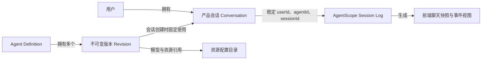

# AgentSquad 一期客服：从零设计的数据与接口边界（草案 v0.1）

> 研究基准：AgentScope Java 官方仓库 tag `v2.1.0-BETA1`，与 AgentSquad 当前 `server/pom.xml` 依赖一致。
>
> 本文是 **greenfield 逻辑设计**。现有 `sq_*` 表、Worker/DAG/Command 体系均不作为新方案的设计前提；只在后续迁移评估时拿来对照。
>
> 数据库、搜索引擎、对象存储和部署方式 **尚未选型**。本文不提供物理 DDL，不提前规定 MySQL/PostgreSQL/Redis/向量数据库。

## 1. 官方证据与已经确认的能力

| 官方事实 | 对一期设计的影响 | 来源 |
|---|---|---|
| `HarnessAgent` 提供推理、记忆、技能、Workspace 和 SubAgent 的原生封装 | 不再自建推理循环、Worker DAG 作为一期客服基础 | [Harness 架构](https://github.com/agentscope-ai/agentscope-java/blob/v2.1.0-BETA1/docs/v2/zh/docs/harness/architecture.md) |
| `AgentSession.submit/steer/inject/interrupt/respond/resume` 提供接收任务、运行控制和恢复机制 | 产品只暴露业务操作入口，不自建 Run 状态机 | [Session Log 与恢复](https://github.com/agentscope-ai/agentscope-java/blob/v2.1.0-BETA1/docs/v2/zh/docs/harness/session-log.md) |
| `Session Log` 保存消息、工具调用、执行事实、Checkpoint 和持久输入队列 | 不默认自建产品消息事实表、Run 表、工具事件日志表 | [Session Log 与恢复](https://github.com/agentscope-ai/agentscope-java/blob/v2.1.0-BETA1/docs/v2/zh/docs/harness/session-log.md) |
| `SessionEvent.seq` 用于有序读取和续传，`eventId` 用于去重；`transcript()` 可读取完成消息 | SSE 首选原生日志 + 产品投影视图，不直接镜像完整原生事件 | [Session Log 与恢复](https://github.com/agentscope-ai/agentscope-java/blob/v2.1.0-BETA1/docs/v2/zh/docs/harness/session-log.md) |
| 一个 Turn 可经历多个 Run，插话可沿用原 Run，恢复时可产生新 Run | 不把“用户消息 = Run = assistant 消息”做成一对一外键 | [Session / Turn / Run 说明](https://github.com/agentscope-ai/agentscope-java/blob/v2.1.0-BETA1/docs/v2/zh/docs/harness/session-log.md#sessionturn-和-run-如何对应) |
| Harness 默认 `EVENT_LOG`，原生日志位于 Workspace 文件系统或独立配置的 SessionLogStore | 同一个日志既承担事实记录也承担恢复，不预设独立 Checkpoint 表 | [上下文管理](https://github.com/agentscope-ai/agentscope-java/blob/v2.1.0-BETA1/docs/v2/zh/docs/building-blocks/context.md) |
| Workspace 中的 `AGENTS.md`、`skills/`、`subagents/`、`tools.json` 与 Builder API 提供等价配置入口 | AgentSquad 可以管理 Agent Definition，然后通过 Builder 映射；不需双份配置真相源 | [Workspace](https://github.com/agentscope-ai/agentscope-java/blob/v2.1.0-BETA1/docs/v2/zh/docs/harness/workspace.md) |
| Memory 默认写入 `memory/YYYY-MM-DD.md` 与 `MEMORY.md` | 不默认自建一套与原生记忆重复的记忆事实表 | [Memory](https://github.com/agentscope-ai/agentscope-java/blob/v2.1.0-BETA1/docs/v2/zh/docs/harness/memory.md) |

### JDBC 表不是功能表的一对一映射

官方 `agentscope-extensions-jdbc` 默认基础表组：

- `agentscope_store`：底层 KV / Workspace 存储，可承载原生 Session Log 对象。
- `agentscope_sessions`：AgentStateStore 的状态项，不能直接等同产品会话；默认 EVENT_LOG 模式的恢复权威是日志。
- `agentscope_snapshots`：沙箱快照二进制存储。

仅开启 JDBC Skill 表组时增加 `agentscope_skills`、`agentscope_skill_resources`；默认未启用。通用表锁实现可能涉及 distributed_locks，但 MySQL/PostgreSQL 方言使用原生 advisory lock 时不应默认将锁表列为必建。

**重要：** 当前表名基于默认前缀和 JDBC 方言，名字可配置。AgentScope SDK 不是 AgentScope Service，不能把 Service 后端数据库表当成必需表。

证据：[JDBC 方言](https://github.com/agentscope-ai/agentscope-java/blob/v2.1.0-BETA1/agentscope-extensions/agentscope-extensions-jdbc/src/main/java/io/agentscope/extensions/jdbc/dialect/AbstractJdbcDialect.java)、[JDBC 表组配置](https://github.com/agentscope-ai/agentscope-java/blob/v2.1.0-BETA1/agentscope-extensions/agentscope-extensions-jdbc/src/main/java/io/agentscope/extensions/jdbc/dialect/AbstractJdbcDialectBuilder.java)、[WorkspaceSessionLogStore](https://github.com/agentscope-ai/agentscope-java/blob/v2.1.0-BETA1/agentscope-harness/src/main/java/io/agentscope/harness/agent/session/WorkspaceSessionLogStore.java)。

## 2. 新方案三类数据

1. **AgentSquad 产品事实**：用户与权限、Agent Definition、业务会话目录、模型/工具/知识/技能资源的管理元数据。
2. **AgentScope 原生执行事实**：Session、Turn、Run、输入队列、执行事件、完成消息、Checkpoint、SubAgent 运行记录、原生 Memory/Workspace。
3. **应用读模型（先不建）**：前端聊天快照、会话消息索引、检索搜索、产品事件、模型成本统计等。如有查询性能、审计保留策略或权限需求，再通过原生日志投影，明确单一事实源。

## 3. 从零开始的产品逻辑实体（非最终物理表）

| 优先级 | 逻辑实体（暂定名称） | 必须保存的产品事实 | 是否与 AgentScope 重复 |
|---|---|---|---|
| P0 | `app_user` | 身份、状态、基础权限 | 否；RuntimeContext 的 userId 不负责认证 |
| P0 | `agent_definition` | Agent 稳定身份、名称、启用状态、当前配置版本 | 否；框架只消费运行定义 |
| P0 | `agent_definition_revision` | 不可变的 Prompt、默认模型、工具/技能/知识配置快照 | 否；应用负责版本审计与会话冻结 |
| P0 | `conversation` | 产品会话 ID、所有人、标题、Agent 定义/版本、原生会话身份、归档状态、最后活动时间 | 否；AgentScope 负责执行状态与日志 |
| P0 | `model_profile` | 可选模型、供应商、服务端密钥引用、模型配置 | 否；框架模型实例不提供产品管理目录 |
| P0 | `tool_source` | 可用工具/MCP 服务的配置、授权范围和启停状态 | 否；Toolkit 管执行，不负责产品治理 |
| P1 | `skill_asset` | Skill 名称、管理状态、版本和发布资源引用 | 可能；需选定产品目录与原生 Workspace/Skill repository 的关系，避免双份内容 |
| P1 | `knowledge_base` | 知识库身份、所有权、状态和权限边界 | 否；RAG 运行能力不等于产品知识库管理 |
| P1 | `knowledge_document` | 知识库与文件的关系、解析/索引状态、来源 | 否；索引块和 Embedding 不在此处预设 |
| P1 | `file_asset` | 文件所有权、上传元数据、保存位置引用 | 否；原生日志不会备份外部文件 |

**以上共 10 个候选产品逻辑实体，不等于一期必须新建 10 张物理表。** 认证方式、Skill 内容源、知识库实现和文件存储未确定，最终数量可能减少或增加。

### 不在第一批创建的表

- `agent_run`、`agent_turn`、`agent_task_queue`：优先复用原生 Session/Turn/Run/Inbox。
- `worker_job`、`plan_dag`、`subagent_execution`：优先复用 AgentScope 原生 SubAgent 机制。
- `conversation_message` 事实副本：先用原生 `transcript()` 与 SessionEvent 生成历史及页面快照；只有产品独立检索、保留策略、查询性能确有需求时再做消息投影。
- `conversation_event` 全量镜像：先用原生 `seq/readAfter` 续传；只有证明原生查询/产品脱敏回放不足时再加专用投影。
- `checkpoint`、`session_log`、`session_inbox` 业务副本：全部由 AgentScope 管。
- `memory_item`：先复用原生 Memory；用户可编辑、可删除、可审计的显式业务记忆如成为刚需，再独立建模。
- `token_usage`、`trace_span`：先走观测出口，是否需要查询汇总表由报表需求决定。

## 4. 关键关系（先定业务关系，不定主键类型）



会话必须持有稳定的 `userId`、`agentId`、`sessionId`（或可确定性恢复这些值），并记录绑定的 Definition revision；**不能把它们设计成与 Session Log 相互矛盾的两套事实源**。

## 5. 从零设计的接口轮廓（只覆盖核心客服流程）

| 场景 | 建议产品 API | 映射到框架或产品操作 |
|---|---|---|
| 用户会话列表 | `GET /api/v1/conversations` | 读产品 Conversation 目录 |
| 新建会话 | `POST /api/v1/conversations` | 建立产品会话并冻结 Agent revision |
| 查询/刷新聊天页面 | `GET /api/v1/conversations/{id}` | 读取原生 transcript/SessionEvent 并生成快照 + cursor |
| 提交新问题 | `POST /api/v1/conversations/{id}/turns` | `AgentSession.submit(requestId, input)` |
| 追加当前任务要求 | `POST /api/v1/conversations/{id}/steer` | `AgentSession.steer(...)` |
| 提供补充资料 | `POST /api/v1/conversations/{id}/materials` | `AgentSession.inject(...)` |
| 订阅/恢复事件 | `GET /api/v1/conversations/{id}/events?after=...` | SessionLog `readAfter` + 产品 SSE 投影 |
| 停止当前执行 | `POST /api/v1/conversations/{id}/interrupt` | `AgentSession.interrupt(runId)` |
| 继续已中断任务 | `POST /api/v1/conversations/{id}/resume` | `AgentSession.resume(turnId)` |
| 回答待办/确认 | `POST /api/v1/conversations/{id}/pending/{requestId}/responses` | `AgentSession.respond(...)` |
| 管理 Agent 定义 | `/api/v1/agents`（CRUD） | 产品 Definition + revisions，配置到原生 Builder |
| 管理模型/工具/技能/知识库 | `/api/v1/models`、`/tools`、`/skills`、`/knowledge-bases` | 产品资源目录，运行时组装与授权 |

以上是**建议的 HTTP 适配协议**，并非 AgentScope SDK 自带这些 REST 路径。

### 参数结构示例 A：提交新问题

```json
{
  "requestId": "client-unique-id",
  "content": "帮我查询订单状态"
}
```

预期返回本次提交回执，包含 `turnId`、当前状态以及可用的事件查询入口；`runId` 在排队时可能尚不存在。HTTP 成功不表示 Agent 已经完成回答。

### 参数结构示例 B：打开或刷新会话

```json
{
  "conversationId": "conversation-id",
  "cursor": "opaque-committed-position",
  "items": [],
  "pending": [],
  "status": "RUNNING"
}
```

`items` 是应用投影出的页面数据，不要求前端理解完整原生事件。刷新后先取快照，再从相同 cursor 续读 SSE，避免消息缺失和重复执行。

### 参数结构示例 C：暂停与继续

- 停止：请求提供目标 `runId`，避免旧页面误停新任务；接口只反馈停止请求受理，最终是否中断以 Session 状态为准。
- 继续：请求提供 `turnId`；原生 `resume` 创建后续 Run，不能重发原用户消息。
- 人工确认：请求携带原生 `requestId` 和应答内容，交给 `respond`。

## 6. 必须验证的六个设计问题

1. **存储方案**：选定数据库前，必须用对应 AgentScope JDBC 方言 DDL 校验，不能直接沿用现有 MySQL 版 schema。
2. **原生日志**：使用 Workspace 分布式后端还是独立 SessionLogStore；多副本 CAS、租约、备份和恢复能力必须验证。
3. **会话列表与删除**：产品 Conversation 如何与原生日志的保留、归档、删除策略联动。
4. **事件投影**：前端内容快照从原生 `seq` 生成是否足够快，是否需要缓存或持久化读模型。
5. **Agent Definition 版本**：同一产品 Agent 的配置升级不应悄悄改变既有会话的执行配置。稳定 `agentId` / Workspace namespace / revision 的关系需要明确。
6. **资源授权**：模型密钥、MCP 凭据、Tool 授权与知识库访问控制只能在服务端做，不能依赖 Agent 自主判断。

## 7. 下一步交付顺序

1. **确定第 1 批 P0 产品实体**：账号、Agent Definition/Revision、Conversation、必要模型与工具资源。
2. **定义数据关系与操作约束**：唯一性、版本冻结、权限边界、归档/删除语义。
3. **绘制核心 API 的请求/响应与状态码**：创建会话、submit、snapshot、SSE、steer、interrupt、resume、respond。
4. **专项验证官方存储**：对固定 tag 做本地集成实验，确认原生日志和状态表实际写入，再决定是否引入消息/事件投影。
5. **最后选择物理存储与生成 DDL**：先功能后选型，避免把数据模型锁定在现有实现上。

**状态：初稿，仅用于设计评审，尚未决定数据库产品、最终表数量或实施迁移方案。**
