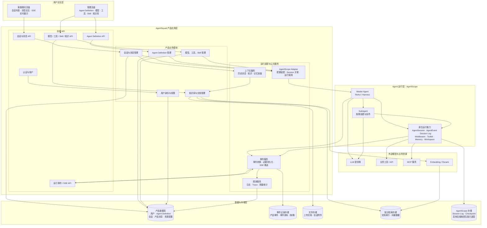

# AgentSquad 一期客服整体架构

> 当前范围：一期智能客服产品。包含客服聊天、多用户会话、Agent Definition 管理、知识与资源管理、基础观测。
>
> 暂不纳入：多业务平台接入中心、平台配置市场、复杂任务独立工作台、通用 DAG 任务调度器。
>
> 架构原则：AgentSquad 负责产品业务与应用基础设施；AgentScope 负责 Agent 运行时能力。产品层不重复建设 Agent Runtime、SubAgent 和执行生命周期。

## 整体架构图

## 架构职责边界

| 层次 | 主要职责 | 归属 |
|---|---|---|
| 用户交互层 | 客服聊天、会话操作、管理配置、事件展示 | 前端 |
| 前端 API | 接收请求、鉴权入口、请求路由、SSE 连接 | AgentSquad |
| 产品业务模块 | 用户、会话、消息、Agent Definition、资源管理 | AgentSquad |
| 运行适配与公共服务 | 将产品配置装配为框架对象；关联 Session；转换事件；准备上下文 | AgentSquad |
| Agent 运行层 | Master 推理、SubAgent 协作、工具调用、运行事件与 Session 生命周期 | AgentScope |
| 数据与存储层 | 产品数据、文件、知识索引、框架运行记录 | 按数据所有权分别管理 |
| 外部模型与资源 | 模型供应商、业务 API、MCP、Embedding/Rerank | 外部依赖 |

## 一期关键边界

1. **Agent Definition 由 AgentSquad 管理。** 产品保存 Agent 的长期配置；执行时由适配层根据定义装配 AgentScope 运行对象。
2. **Agent Runtime 不由产品重复管理。** Agent、AgentSession、SubAgent 和执行过程优先使用 AgentScope 原生能力。
3. **产品会话与 AgentSession 不是同一个对象。** AgentSquad 保存产品会话、消息及必要关联；AgentScope 管理运行时 Session 和执行状态。
4. **事件需要适配，不重复实现运行事件源。** AgentScope 提供原生事件；AgentSquad 将其转换为稳定的产品事件，并负责前端 SSE 交付。事件是否独立持久化仍需结合原生日志能力验证。
5. **知识与记忆分层。** AgentScope 提供运行时上下文/记忆能力；AgentSquad 管理产品侧知识资源、文档、权限和检索服务。
6. **不把外部平台接入中心放进一期。** 一期工具和知识资源先服务当前客服产品自身，后续再抽象平台级接入。
7. **图中模块是逻辑边界，不代表必须拆成独立微服务。** 一期可以在同一个 Spring Boot 应用中按模块组织。

## 后续需要验证的架构问题

- 当前依赖版本 2.1.0-BETA1 对上游 AgentScope 能力的实际覆盖情况。
- AgentSession 的创建、复用、恢复和并发安全边界。
- AgentScope Session Log 能否满足产品事件查询和 SSE 断线续传，是否需要额外事件存储。
- Agent Definition 中哪些配置可直接映射原生 Builder，哪些需要 AgentSquad 自己管理。
- 知识检索、记忆存储和文件存储的具体技术选型。
