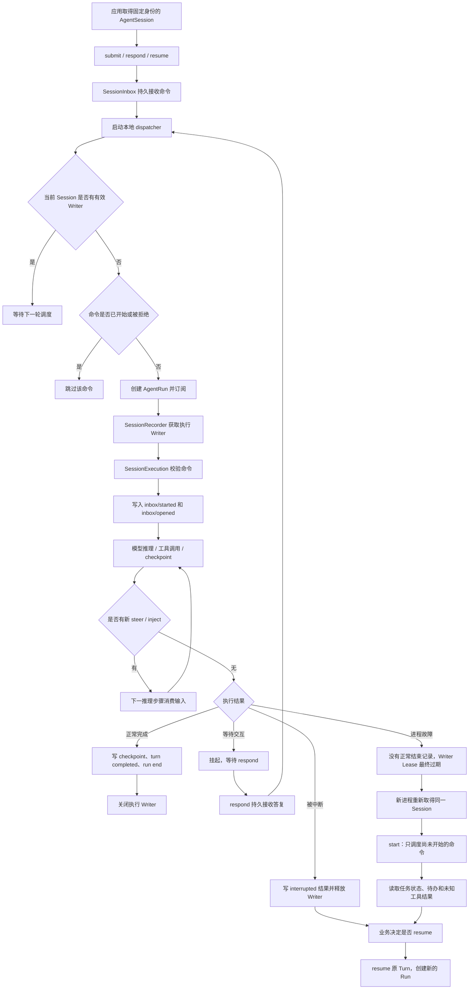

# Scheme Design and Research Records

> AgentSquad 架构方案设计与技术调研记录
>
> 本文是持续更新的研究记录，不是最终架构规范，也不代表文中提到的目标能力已经落地。每次调研应记录源码版本、实际证据、判断依据和未确认事项。
>
> 本次记录日期：2026-11-10
> 项目分支：`feat/20261103_log_optimize`
> 本轮审计基线：AgentScope Java `2.1.0-BETA1`；AgentSquad 提交 `20de964f`
> 记录来源：上一轮源码审计结果。本文先固化已有结论；后续专题继续阅读当前分支代码与指定版本源码，确认分支演进是否改变结论。

## 0. 研究记录约定

### 0.1 结论状态

| 标记 | 含义 |
|---|---|
| 已从源码确认 | 审计记录指出已检查对应实现；后续代码版本变化时仍需复核 |
| 初步判断 | 基于当前证据形成的设计判断，尚未完成专项验证 |
| 待验证 | 缺少压测、故障演练或完整调用链证据 |
| 目标方向 | 希望达到的架构形态，不代表当前代码已经实现 |

### 0.2 每轮调研需要记录

1. 调研问题和范围。
2. 代码仓库、分支、提交 SHA、依赖版本。
3. 实际调用链与关键源码位置。
4. 已确认事实、推断、风险和未解决问题。
5. 可选方案、取舍依据及暂定结论。
6. 后续验证步骤，以及是否需要形成独立 OpenSpec 变更。

不要把“框架提供某个 API”直接等同于“产品已经具备对应能力”；不要把持久化记录等同于运行中任务可恢复；不要把目标架构写成当前实现。

---

# 1. 本轮研究主题：AgentScope 原生执行能力与 AgentSquad 运行架构

## 1.1 研究目标

明确 AgentScope 应承担哪些 Agent 执行职责，AgentSquad 应保留哪些产品和业务协调职责。重点检查：

- SubAgent 后台任务是否能跨进程恢复。
- AgentSession 的执行资格、事件记录、插话、中断和恢复机制。
- Redis Stream 当前在 AgentSquad 中的实际职责。
- AgentScope 原生 Redis Store 是否值得用于 Session Journal。
- Master 的动态 SubAgent 与持久 Worker 任务是否应该统一。
- 数据库锁、条件更新和全局热点的实际风险。
- 1000、5000、10000 个活跃会话下 PostgreSQL / Redis 的读写压力。

## 1.2 关键结论摘要

| 主题 | 当前研究结论 | 状态 |
|---|---|---|
| SubAgent 后台任务 | 任务记录持久化不代表本地 Future 能在其他 JVM 自动恢复；默认失联处理是标记失败 | 已从源码确认（以本轮审计版本为准） |
| AgentSession | 原生 Session 的执行资格、事件日志、输入队列和恢复机制值得优先复用 | 已检查关键实现；需补完整生命周期验证 |
| Writer / Lease / Epoch / CAS | 通过带版本的条件更新管理执行资格，旧执行者失去资格后不能继续提交有效数据 | 已从源码确认 |
| Session 心跳 | 审计发现活跃 Session 可能每秒续租并触发数据库写入，需专项评估 | 已发现，影响待压测 |
| Redis Stream | 当前主要传递 commandId / Binding 唤醒通知，不承载完整运行事件正文 | 已从当前实现检查 |
| Redis Journal | AgentScope 提供 Redis Store 和原子 CAS 能力，可作为原生 Journal 存储候选 | 方向成立，接入与故障语义待验证 |
| Master / Worker | Master 适合使用 AgentSession，并评估开放原生 SubAgent；需要持久执行和验收的 Worker 暂不应直接替换为普通 SubAgent | 初步架构判断 |
| 原生 steer | AgentScope 有 steer 能力，但当前产品层 Gateway 尚未暴露 | 已从代码对照发现 |
| 原生 SubAgent | 当前 Master 和 Worker Builder 都关闭了原生 SubAgent | 已从代码对照发现 |
| 数据库锁 | 不应一刀切删除 FOR UPDATE；应按业务一致性、竞争范围和热点逐项审计 | 初步判断 |
| 总体边界 | AgentScope 管 Agent 执行；Redis 承担运行时高频数据与通知；PostgreSQL 保存业务事实；AgentSquad 管产品规则和交付 | 目标方向 |

---

# 2. SubAgent：异步任务持久化不等于故障后自动续跑

审计了 `WorkspaceTaskRepository` 后，需要明确区分三件事：

1. **任务状态持久化**：记录任务是否运行、是否完成、结果是什么。
2. **执行过程管理**：通过本地 `CompletableFuture` 和本地 Executor 执行任务。
3. **故障检测**：通过心跳和定时扫描识别失联任务。

审计记录中的执行流程：

```text
提交任务
  -> TaskRecord 写入 Workspace
  -> 当前节点使用 CompletableFuture + 本地 Executor 执行
  -> 运行期间定时更新心跳
  -> 节点故障后，超过默认失联阈值
  -> 任务被标记为 FAILED
```

审计版本的默认心跳间隔为 30 秒，超过 10 分钟没有心跳会被标记为 FAILED。需要在后续复核中确认这些默认值是否受配置影响。

由此得到：

- 任务记录可以跨 JVM 保留。
- 其他节点可以查询任务状态。
- 其他节点可以发起取消。
- 但其他节点读取 TaskRecord，不会让原 JVM 的本地 Future 自动恢复。
- 默认故障处理是标记失败，不是从中断位置继续执行。

**结论：**不能把 AgentScope 原生 SubAgent 的任务记录持久化能力直接等同于分布式无状态执行和自动故障接管。复用 SubAgent 前，必须证明它满足 AgentSquad 对独立 Session、执行上下文、计划版本、结果验收和故障恢复的要求。

源码：
- [WorkspaceTaskRepository](https://github.com/agentscope-ai/agentscope-java/blob/5451c73abe47053340683a1cc6d67b290b056648/agentscope-harness/src/main/java/io/agentscope/harness/agent/subagent/task/WorkspaceTaskRepository.java)

---

# 3. AgentSession：原生会话机制是优先研究和复用的部分

本轮串联检查了 `AgentSession`、`SessionInbox`、`SessionExecution`、`SessionRecorder` 和 `JournalSessionLog`。

## 3.1 执行资格与多节点接管

AgentScope 使用以下机制管理 Session 的执行资格：

- Writer：当前执行者身份。
- Lease：执行资格的有效期。
- Epoch：执行资格的版本。
- CAS：基于版本号进行原子更新。

审计记录中的执行过程：

```text
节点 A 申请执行资格
  -> CAS 更新 Session Head
  -> owner=A，epoch=1，lease=2 分钟
  -> 节点 A 获得执行资格

运行期间
  -> 定期刷新执行记录并续租 Writer

节点 A 故障
  -> Lease 到期
  -> 节点 B 申请接管
  -> CAS 更新 Head，epoch=2
  -> 旧节点 A 的 Writer 失效
```

值得保留的设计点：

1. 不需要每次执行都通过业务 SQL 的 `SELECT FOR UPDATE` 抢占记录。
2. 使用版本比较和条件更新，竞争失败的一方重新读取。
3. Lease 到期后允许其他节点接管。
4. Epoch 用于防止旧执行者在失去资格后继续提交数据。

**重要边界：执行资格与任务数据本身分离。**任务可以保存在持久存储中，执行资格通过 Journal 的 CAS 管理，不需要把整个执行过程放进一个长数据库事务。

## 3.2 当前 JDBC Store 的 CAS 实现

本轮审计的配置链路：

```text
RuntimeSessionProvider
  -> JdbcDistributedStore
  -> RuntimeJournalStore
  -> WorkspaceSessionLogStore
  -> StoreSessionStorage
```

底层 `JdbcStore.putIfVersion()` 使用带版本条件的 UPDATE，核心逻辑如下：

```sql
UPDATE agentscope_store
SET value_json = ?,
    version = version + 1
WHERE namespace_path = ?
  AND item_key = ?
  AND version = ?
```

这说明当前 AgentSquad 的 AgentScope 原生 Journal 并非简单依赖 `FOR UPDATE` 实现并发控制，而是使用条件更新实现 CAS。

但 CAS 仍会产生数据库写入和行级竞争，并不意味着数据库没有压力。

## 3.3 Session 心跳可能带来的数据库写入

审计记录发现 `SessionRecorder` 中存在：

```java
private static final Duration LEASE = Duration.ofMinutes(2);
```

运行期间通过周期任务每秒执行一次心跳；心跳过程会调用 `flushNow()` 和 `exportCommitted()`。即使没有待提交事件，`flushNow()` 也可能先续租 Writer。

按审计记录中的实现估算：

| 活跃 Session 数 | 每秒潜在续租操作 |
|---:|---:|
| 1000 | 约 1000 次 |
| 5000 | 约 5000 次 |
| 10000 | 约 10000 次 |

这还没有计算真正的事件提交、业务状态更新和事件投影。

**当前判断：**这是比单独讨论某几个 `FOR UPDATE` 更值得专项研究的数据库压力来源。

**不能直接降低续租频率。**需要同时考虑 Lease 过期、节点暂停、长时间 GC、网络抖动和旧执行者失效等风险。应通过源码确认、压测和故障演练决定参数。

源码：
- [AgentSession](https://github.com/agentscope-ai/agentscope-java/blob/5451c73abe47053340683a1cc6d67b290b056648/agentscope-harness/src/main/java/io/agentscope/harness/agent/session/AgentSession.java)
- [SessionRecorder](https://github.com/agentscope-ai/agentscope-java/blob/5451c73abe47053340683a1cc6d67b290b056648/agentscope-core/src/main/java/io/agentscope/core/session/SessionRecorder.java)

---

# 4. Redis Stream：当前主要是唤醒通知，不是运行时消息正文

本轮对照检查了 `RedisCommandWakeup`、`RedisProjectionWakeup`、`RuntimeProjectionDispatcher` 和事件收件服务。

当前数据分工：

| 数据 | 当前存储位置 | Redis 是否承载实际内容 |
|---|---|---|
| 用户提交的命令 | PostgreSQL `sq_command` | 否，只传 commandId |
| AgentScope 执行日志 | PostgreSQL `agentscope_store` | 否 |
| 原生事件收件 | PostgreSQL `sq_runtime_event_inbox` | 否 |
| Worker 任务状态 | PostgreSQL | 否 |
| 业务执行状态 | PostgreSQL | 否 |
| 命令唤醒 | Redis Stream | 是，但主要传引用 |
| 事件投影唤醒 | Redis Stream | 是，但主要传 Binding 引用 |
| SSE 消息读取 | PostgreSQL 事件投影 | 否 |

当前流程：

```text
用户提交消息
  -> PostgreSQL 创建 Command
  -> Redis Stream 发布 commandId
  -> CommandDeliveryService 从 PostgreSQL 领取命令、校验权限、维护投递状态
  -> AgentScope AgentSession 执行
  -> PostgreSQL 持久化原生 Journal
  -> 事件导出到 PostgreSQL Runtime Event Inbox
  -> Redis Stream 发布 Binding 唤醒通知
  -> RuntimeProjectionDispatcher 从原生 Journal 补读事件
  -> 更新业务状态和会话展示数据
  -> 前端通过 SSE 读取事件投影
```

优点：Redis 丢失唤醒消息，不会直接丢失业务事实，业务状态和原生执行事件仍在 PostgreSQL。

风险：实时执行的关键操作仍多次访问 PostgreSQL，可能产生读写放大。

需要继续测量的三个环节：

1. `SessionLogExporter`：每条事件独立调用收件器，成功后再推进导出游标。
2. `RuntimeEventReceiptService`：每条事件进行绑定校验和数据库事务。
3. `RuntimeProjectionDispatcher`：Redis 只负责唤醒，真正的事件读取仍回到 PostgreSQL。

**后续重点：**统计每个 Agent 事件带来的数据库读写次数、事务次数、消息大小和端到端延迟；不能只用“Redis 更快”作为迁移理由。

---

# 5. AgentScope 原生 Redis Store：值得做专项 PoC

本轮检查发现 AgentScope Redis 扩展提供：

- `RedisDistributedStore`
- `RedisStore`
- `RedisAgentStateStore`
- `RedisSnapshotSpec`

其中 `RedisStore` 使用 Lua 脚本完成原子 CAS：读取当前版本，只有版本匹配时才更新值并递增版本。

这意味着 Redis Store 不只是普通 KV 存储，也具备 AgentScope Session Journal 所需的原子版本更新能力。官方 `StoreSessionStorage` 可以基于 `BaseStore` 建立 SessionLog。

## 5.1 候选分层

```text
AgentScope 原生存储 + Redis
  - Session Journal
  - Session Inbox
  - Agent State
  - 实时执行状态
  - Agent 间通信

异步持久化、事件投影、恢复补偿

PostgreSQL 业务持久层
  - 用户与会话业务关系
  - 任务与计划
  - 执行快照
  - 最终结果
  - 业务审计记录
```

## 5.2 必须先验证的前提

- Redis 持久化、复制、故障恢复和数据保留策略。
- Redis 故障、主从切换、网络分区时 CAS 和 Lease 的行为。
- AgentScope Journal 在 Redis 上的读写模式、数据量和过期策略。
- Session 恢复是否完整，是否存在只恢复元数据而丢失事件正文的情况。
- PostgreSQL 业务事实与 Redis 运行时记录之间的补偿和一致性边界。
- 运行中事件、Inbox、Journal 的清理和归档策略。
- Redis 在 1000 / 5000 / 10000 活跃会话下的内存、网络和命令压力。

**暂定结论：**优先评估 AgentScope 原生 Redis Store，不先自行实现一套 Journal 或分布式锁。Redis 不能简单当成可随时丢弃的缓存；迁移 Journal 前必须完成持久性与恢复演练。

源码：
- [RedisStore](https://github.com/agentscope-ai/agentscope-java/blob/5451c73abe47053340683a1cc6d67b290b056648/agentscope-extensions/agentscope-extensions-redis/src/main/java/io/agentscope/extensions/redis/store/RedisStore.java)

---

# 6. SubAgent 与 AgentSession：两条不同的执行路径

不能把两者当作同一套任务机制。

| 对比 | 原生 SubAgent | AgentSession |
|---|---|---|
| 创建方式 | agent factory | agent.session(context) |
| 执行方式 | call / stream | submit / resume |
| 任务管理 | TaskRepository | SessionInbox |
| 会话记录 | AgentState 等机制 | Session Journal |
| 异步任务 | BackgroundTask | Session Task |
| 插话 | 通过 Agent 间消息交互 | steer |
| 中断 | task_cancel | interrupt |
| 继续执行 | 依赖任务执行机制 | resume |
| 故障后继续 | 默认本地任务不支持自动恢复 | 支持显式恢复未完成 Turn，仍需验证完整故障边界 |

当前 Worker 需要：

- 固定 Binding。
- 独立 Session。
- 可恢复的执行上下文。
- 结果候选和业务验收。
- 计划版本隔离。
- 故障后继续执行。

这些要求明显高于普通 SubAgent 后台任务。

## 6.1 暂定角色分工

**Master：**

优先使用 AgentScope AgentSession，保留原生会话控制能力；进一步评估启用原生 SubAgent，让 Master 可以自主分派一些独立、短期的调查和分析工作。

**Worker：**

当前独立 AgentSession 方案有存在价值。Worker 执行明确任务，Master 负责计划、决策和验收。

Worker 是否改用原生 SubAgent，必须先证明它能满足现有持久化、恢复和业务隔离要求。不要为了统一实现方式牺牲这些能力。

## 6.2 产品层尚未接通的原生能力

AgentScope 原生接口包括：

```java
session.steer(message);
session.interrupt();
session.resume(turnId);
```

本轮审计发现 AgentSquad 的 `NativeSessionGateway` 只暴露：

- submit
- stop
- resume
- respond

尚未暴露 steer。因此当前产品层还不能直接利用 AgentScope 原生能力实现真正的执行中插话。

另外，当前 Master 和 Worker Builder 都调用了：

```java
.disableSubagents()
```

Worker 禁止继续委派符合当前组员定位；但 Master 也禁用了原生 SubAgent，意味着目前只能通过自建 Plan 和 Worker 工具进行多 Agent 协作。

后续需要评估 Master 同时拥有两种能力：

1. 自主创建短期 SubAgent，完成并行调查、信息分析等工作。
2. 使用 Plan / Worker 体系，执行需要持久化、恢复和业务验收的复杂任务。

不必强行统一成一种执行模式。

---

# 7. 数据库锁：按业务目的逐项审计，不做一刀切删除

本轮初步分类：

| 位置 | 当前方式 | 初步判断 |
|---|---|---|
| Command 领取 | 条件 UPDATE + 租约 | 合理，优先保留 |
| Worker Guard | 条件 UPDATE + Token | 合理，优先保留 |
| Task / Plan | FOR UPDATE | 需要保证业务状态一致性 |
| Worker Jobs | 整组 FOR UPDATE | 需要研究并行节点竞争 |
| Runtime Event Inbox | FOR UPDATE | 存在优化空间 |
| Runtime Admission | 全局计数器 FOR UPDATE | 需要重点关注 |

特别关注 `RuntimeAdmissionService`：

- 当前默认关闭。
- 启用后会锁定 `GLOBAL` 容量计数器。
- 所有用户的新执行申请都需要经过这个全局计数器。
- 可能形成热点行，影响大量并发用户的申请速度。

**暂定原则：**先明确每个锁保护的业务不变量，再判断是否能改成条件更新、分段计数、乐观并发控制或其他机制。不要因为 AgentSession 使用 CAS，就推导出业务表不再需要事务或锁。

---

# 8. AgentSquad 目标架构边界

```text
产品与交互层
  聊天、客服、复杂任务、文件与多媒体交付、实时消息、插话和中断

AgentScope 运行时层
  Master：规划、决策、调度、交互
  SubAgent：并行调查、专项分析
  AgentSession：执行、插话、中断、恢复、原生事件记录

Redis 运行时数据层（目标方向）
  Session Journal、运行事件、任务通知、消息流、执行状态

PostgreSQL 业务持久层
  用户、平台配置、业务任务、计划、执行快照、最终结果、审计记录

AgentSquad 产品协调层
  产品规则、权限、业务协调、任务验收和结果交付
```

核心原则：

- AgentScope 负责 Agent 的执行机制。
- Redis 负责运行时高频数据和消息通知。
- PostgreSQL 负责业务事实和长期业务持久化。
- AgentSquad 负责产品规则、业务协调和结果交付。

这是目标方向，不代表当前代码已经实现，也不意味着必须一次性把所有运行时数据迁移到 Redis。

---

# 9. 下一轮研究计划

| 编号 | 专题 | 必须回答的问题 | 预期产出 |
|---|---|---|---|
| A | AgentSession 生命周期 | submit、steer、interrupt、resume 的状态变化、异常恢复、跨节点接管、SSE 反馈如何衔接？ | 生命周期图、状态表、故障场景表 |
| B | SubAgent 原生能力 | Session Mode、动态创建、跨实例通信、后台唤醒、任务恢复有哪些边界？ | Master/SubAgent/Worker 能力对照与建议 |
| C | Redis / PostgreSQL | 原生 RedisStore 接入、事件异步持久化、Journal 生命周期和数据库写入量如何变化？ | 存储方案比较、读写估算、压测计划 |

## 9.1 专题 C 的容量评估要求

分别估算并验证 1000、5000、10000 个活跃会话：

- 每个 Session 每秒/每分钟的心跳、CAS、Journal 写入次数。
- 每个 Agent Turn 的事件数量、平均事件大小和峰值事件大小。
- Inbox 收件、事件导出、事件投影每条事件引起的数据库读写次数。
- 每次用户消息、模型调用、工具调用、Worker 派发额外产生的读写。
- Redis 命令量、网络流量、内存占用和持久化开销。
- PostgreSQL QPS、事务数、热点行等待、连接池占用和 WAL 增长。
- 故障接管耗时、恢复期间补读量、重复事件处理成本。
- 监控采样与批量写入对数据完整性和排障能力的影响。

估算时要列清楚假设、公式、平均值和峰值；没有压测证据的数据必须标注为估算，不能伪装成实测结果。

---

# 10. 当前明确不做的事情

1. 暂不修改代码，不急于调整数据库锁。
2. 暂不把 Worker 直接替换成原生 SubAgent。
3. 暂不把所有 AgentScope Journal 和业务数据一次性迁移到 Redis。
4. 暂不把 Redis 当作无持久性要求的普通缓存。
5. 暂不把目标架构描述成当前已完成能力。
6. 暂不为了追求多实例而跳过恢复、幂等、外部操作不确定状态的验证。

先明确 AgentScope 原生能力边界，再确定 AgentSquad 自己需要补齐的产品能力，最后才进入代码重构。

---

# 11. 本轮源码索引

## AgentScope Java

版本：`2.1.0-BETA1`；源码审计提交：`5451c73abe47053340683a1cc6d67b290b056648`

- [AgentSession.java](https://github.com/agentscope-ai/agentscope-java/blob/5451c73abe47053340683a1cc6d67b290b056648/agentscope-harness/src/main/java/io/agentscope/harness/agent/session/AgentSession.java)
- [SessionRecorder.java](https://github.com/agentscope-ai/agentscope-java/blob/5451c73abe47053340683a1cc6d67b290b056648/agentscope-core/src/main/java/io/agentscope/core/session/SessionRecorder.java)
- [WorkspaceTaskRepository.java](https://github.com/agentscope-ai/agentscope-java/blob/5451c73abe47053340683a1cc6d67b290b056648/agentscope-harness/src/main/java/io/agentscope/harness/agent/subagent/task/WorkspaceTaskRepository.java)
- [RedisStore.java](https://github.com/agentscope-ai/agentscope-java/blob/5451c73abe47053340683a1cc6d67b290b056648/agentscope-extensions/agentscope-extensions-redis/src/main/java/io/agentscope/extensions/redis/store/RedisStore.java)

## AgentSquad

本轮审计基线：`20de964ff1d4719bf32ac3e9e41ae9d5a4804a1b`

- [MasterAgent.java](https://github.com/liumeng-cn/agent-squad/blob/20de964ff1d4719bf32ac3e9e41ae9d5a4804a1b/server/agent-squad-server/src/main/java/com/agentsquad/squad/agent/MasterAgent.java)
- [RuntimeSessionProvider.java](https://github.com/liumeng-cn/agent-squad/blob/20de964ff1d4719bf32ac3e9e41ae9d5a4804a1b/server/agent-squad-server/src/main/java/com/agentsquad/squad/agent/session/RuntimeSessionProvider.java)
- [RuntimeProjectionDispatcher.java](https://github.com/liumeng-cn/agent-squad/blob/20de964ff1d4719bf32ac3e9e41ae9d5a4804a1b/server/agent-squad-server/src/main/java/com/agentsquad/squad/service/RuntimeProjectionDispatcher.java)

> 注意：上面 AgentSquad 链接固定在本轮审计提交，便于回看当时证据。后续研究应同时检查 log 分支当前 HEAD，避免把旧提交的实现状态误当成最新状态。

---

# 12. 本轮阶段性结论

目前最重要的不是立即改代码，而是确定能力边界：

1. AgentScope 原生 SubAgent 后台任务不等于跨 JVM 自动恢复。
2. AgentSession 的原生 Journal、执行资格、输入队列和恢复能力值得优先复用和深入验证。
3. 当前 Redis Stream 主要承担唤醒通知，尚未承载完整运行事件数据。
4. AgentScope 原生 Redis Store 提供了值得验证的 Journal 存储路径，但必须补齐持久性和故障演练。
5. Master 的短期自主 SubAgent 与 Worker 的长期、可恢复、可验收任务可以并存，不必强行统一。
6. Session 每秒续租可能成为数据库压力来源；先测量，再决定优化。
7. 数据库锁需要按业务不变量分析，不能一刀切删除。
8. 先完成 A、B、C 三个专题研究，再形成正式架构决策和实施计划。

**本轮没有修改业务代码，也没有宣称上述目标能力已经上线。**


---

# 13. 专题 A：AgentSession 完整生命周期审计

> 调研日期：2026-11-10
> AgentSquad：`feat/20261103_log_optimize` 分支实际文件
> AgentScope：固定审计源码提交 `5451c73abe47053340683a1cc6d67b290b056648`（项目依赖为 `2.1.0-BETA1`）
>
> 本节以该固定源码版本为依据。不要拿 AgentScope 当前 main 或其他更新提交的文档/API 反推项目依赖版本行为。

## 13.1 先修正一个容易误解的结论

前文说 AgentSession 支持显式恢复，但还不够准确。源码显示它实际提供了三层能力：

1. **已接收命令可以持久保存**：SessionInbox 把 submit / resume / respond 等命令写入持久日志。
2. **新进程可以重新启动命令调度**：使用相同的 Agent 配置、userId、agentId、sessionId 和日志后端，重新取得 Session 并调用 `start()`，框架会扫描尚未开始的持久命令。
3. **已经开始、但执行中断的 Turn 不会被 start 自动续跑**：它需要应用先判断状态，再显式调用 `resume(turnId)`；有未处理交互或工具结果未知时必须先处理。

所以准确说法是：

**AgentSession 原生支持“持久命令接收 + 重启后重新调度未开始命令 + 对中断 Turn 显式恢复”，不是进程崩溃后无条件从断点自动续跑。**

这也修正了上一轮容易产生的另一个印象：AgentSession 不只是单纯保存执行日志。它还有独立的持久输入队列和后台调度器；但调度器不会替业务决定是否安全地恢复已中断任务。

官方源码与文档：
- [AgentSession.java（固定提交）](https://github.com/agentscope-ai/agentscope-java/blob/5451c73abe47053340683a1cc6d67b290b056648/agentscope-harness/src/main/java/io/agentscope/harness/agent/session/AgentSession.java)
- [SessionInbox.java（固定提交）](https://github.com/agentscope-ai/agentscope-java/blob/5451c73abe47053340683a1cc6d67b290b056648/agentscope-core/src/main/java/io/agentscope/core/session/SessionInbox.java)
- [SessionExecution.java（固定提交）](https://github.com/agentscope-ai/agentscope-java/blob/5451c73abe47053340683a1cc6d67b290b056648/agentscope-core/src/main/java/io/agentscope/core/session/SessionExecution.java)
- [Session Log 中文文档（固定提交）](https://github.com/agentscope-ai/agentscope-java/blob/5451c73abe47053340683a1cc6d67b290b056648/docs/v2/zh/docs/harness/session-log.md)

## 13.2 AgentSession 内部到底有哪些东西

`AgentSession` 不是一次模型调用的包装器。它主要由以下部分组成：

| 部分 | 职责 | 是否持久化 |
|---|---|---|
| SessionKey | 确定 userId、agentId、sessionId 对应的会话 | 身份由应用提供 |
| SessionLog | 保存执行事件、消息、checkpoint、Writer 信息 | 是，取决于配置的后端 |
| SessionInbox | 保存待处理命令和交互输入 | 是，使用独立 inbox 日志 |
| SessionExecution | 在一次实际执行中校验并消费已接收命令 | 执行过程由日志记录 |
| SessionRecorder | 记录执行事件、checkpoint、模型/工具相关事实并续租 Writer | 是 |
| 本地 dispatcher | 定时扫描 Inbox，选择可执行命令并启动 AgentRun | 否，属于当前 JVM 的运行组件 |
| active AgentRun | 当前 JVM 正在执行的订阅与执行对象 | 否，不能跨 JVM 序列化恢复 |

一个重要细节：`SessionLog.inbox()` 是独立的输入日志。SessionInbox 接收命令时使用自己的短 Writer Lease，不直接占用 Agent 执行期间的 Writer Lease。执行资格和输入接收因此可以分开管理。

这使得运行中的任务仍可接收 steer / interrupt 等控制意图，而不需要等当前 Agent 执行 Writer 完全释放后才能写入 Inbox。

## 13.3 生命周期总图



图中有两条不能混淆的路径：

- **未开始的命令**：持久队列里有命令，但尚无 `inbox/started` 事实。新进程调用 `start()` 后可以重新调度。
- **已经开始的命令**：日志已经有 `inbox/started`，对应 Turn 尚未结束。新进程不会把原命令再执行一次；要先判断它是否可恢复，再新建 resume 命令继续原 Turn。

## 13.4 submit：先持久接收，再异步执行

AgentScope 的 `submit(idempotencyKey, input)` 关键步骤：

1. 检查 Session 尚未关闭，校验幂等键。
2. 使用幂等键生成稳定 Turn ID。
3. 将输入冻结为持久命令，写入 SessionInbox。
4. 同一幂等键和相同输入再次提交，返回已有命令；相同键但输入不同则拒绝。
5. 调用 `start()` 启动调度器。
6. 返回 Task 回执；命令可能仍处于 queued，runId 可能还没有。

本轮源码中 `start()` 通过 Reactor 定时调度，每 100ms 执行一次本地 `dispatch()`。它不是把整段模型执行放在 HTTP 请求里同步等待。

```text
submit(commandId, input)
  -> Inbox 写入 inbox/accepted
  -> start dispatcher
  -> 返回 Task(commandId, turnId, runId?, status)
  -> dispatcher 找到可执行命令
  -> AgentRun 开始执行
```

幂等键的意义是防止网络超时重试导致同一用户提交生成两个 Turn。业务层必须稳定复用原命令 ID；不能每次重试都生成新 ID。

源码：
- [AgentSession.submit / start / dispatch](https://github.com/agentscope-ai/agentscope-java/blob/5451c73abe47053340683a1cc6d67b290b056648/agentscope-harness/src/main/java/io/agentscope/harness/agent/session/AgentSession.java)
- [SessionInbox.Transaction.accept](https://github.com/agentscope-ai/agentscope-java/blob/5451c73abe47053340683a1cc6d67b290b056648/agentscope-core/src/main/java/io/agentscope/core/session/SessionInbox.java)

## 13.5 dispatcher：本地调度器如何避免重复执行

本轮固定版本中的 dispatcher 主要逻辑：

1. 如果本地已有 active AgentRun，先检查 Inbox 中是否有针对该 Run 的 interrupt 命令；没有结束当前 Run 前不会启动下一个任务。
2. 如果 Session Log 的 Head 显示仍有未过期 Writer，当前 dispatcher 不启动新执行。
3. 读取 SessionTurns 和 Inbox 快照。
4. 跳过非执行命令、已经有 `inbox/started` 记录的命令、已被拒绝的命令。
5. 如果最新 Turn 尚未结束，不允许新的 submit 抢先启动。
6. 找到可执行命令后创建 AgentRun 并订阅。

这里真正的跨实例保护不是 Java 对象中的 `active` 字段，而是 SessionLog 的 Writer Lease。每个 JVM 都有自己的 AgentSession / dispatcher，但同一份持久日志的执行 Writer 只能由一个有效持有者提交。

不过要注意：

- `active` 只用于当前 JVM 的执行管理，不是分布式状态。
- dispatcher 的 100ms 轮询不是分布式消息通知，多个节点可能同时检查同一队列。
- 最终是否能启动，仍要靠 SessionLog 的 Writer 获取和提交校验。
- 当前源码未证明所有数据库后端在网络分区、时钟漂移和长 GC 下都具备完全相同的故障安全性；这些要结合实际 Store 实现测试。

## 13.6 Writer Lease、心跳和故障接管

`SessionRecorder` 在执行开始时获取 Writer，固定版本中 Lease 为 2 分钟。运行期间的心跳周期为 1 秒，心跳调用 `flushNow()`，先续租 Writer，再提交缓冲事件（如果有），并触发已提交事件导出。

执行正常结束时：

- 保存最终状态和 checkpoint。
- 写入 `turn/completed` / `turn/interrupted` / `turn/suspended` 等终态事件。
- 写入 `run/end`。
- 关闭 Recorder 并释放 Writer。

进程异常退出时，正常 finish/close 不一定发生。其他节点要等 Writer Lease 失效后才可能取得新 Writer。

**Lease 到期只表示旧执行者不再拥有有效提交资格，不表示旧模型请求或外部工具已经被物理停止。**这点对长时间 GC、网络隔离和外部写操作尤其重要。

旧执行者恢复运行时，存储端必须拒绝它使用过期 Writer 提交。业务侧还需要防止外部工具重复执行；Session Log 的 Writer fencing 不能撤销已经发往外部系统的请求。

源码：
- [SessionRecorder 构造、心跳、flushNow、finish、close](https://github.com/agentscope-ai/agentscope-java/blob/5451c73abe47053340683a1cc6d67b290b056648/agentscope-core/src/main/java/io/agentscope/core/session/SessionRecorder.java)
- [SessionLog Writer 接口](https://github.com/agentscope-ai/agentscope-java/blob/5451c73abe47053340683a1cc6d67b290b056648/agentscope-core/src/main/java/io/agentscope/core/session/SessionLog.java)

## 13.7 steer：真正的“执行中插话”是什么语义

`steer` 不是修改正在运行的模型请求，也不是直接中断当前工具。

固定版本源码的处理方式：

1. 通过 SessionInbox 的独立 Writer 接收 steer 命令。
2. 校验 Inbox 中确实存在活动 Run，并且 Head 中的 Writer 与该 Run 匹配、Lease 仍有效。
3. 如果调用方传入 Task，还要校验 Turn ID 仍是目标任务，防止过期页面把要求发给新任务。
4. Agent 在下一推理步骤的 `SessionExecution.beforeStep()` 中读取 steer / inject 命令。
5. 输入消息写入 AgentState 并先保存 checkpoint，再标记命令已应用。
6. 如果 steer 在执行即将结束时到达，`continueOrClose()` 会与 steer 接收使用同一 Inbox 写入保护，避免“前端收到已接收，但 Agent 已结束且永远不消费”的竞态。

官方测试明确覆盖了一个边界：模型最后一次请求尚未返回时接收 steer，Agent 会在同一个 Run 内再进行一个推理步骤，最终输出能看到新要求。

但以下情况不能保证即时生效：

- 已发出的模型请求不会被改写。
- 正在执行的工具参数不会被改写。
- 如果当前 Run 已经结束，steer 会被拒绝。
- 中断前已接收但未应用的 steer 会留在原 Turn，恢复后再消费。

**对产品交互的意义：**“可以插话”应表示输入被持久接收，并在后续推理步骤生效；不能承诺模型正在生成的那段文本会实时被改写。

## 13.8 interrupt：停止请求不等于已经停止

固定版本中的 `interrupt()`：

1. 读取 Inbox 当前活动 Run。
2. 如果没有活动 Run，返回 false。
3. 如果提供 expectedRunId，必须与当前 Run 一致，否则拒绝过期停止请求。
4. 持久写入 interrupt 命令，并关闭 Inbox 中对应的活动 Run 标记。
5. 当前 JVM dispatcher 发现 interrupt 命令后，对匹配的 AgentRun 调用 cooperative interrupt。
6. Agent 在协作检查点看到中断信号后结束本次执行，保存 interrupted 状态并释放 Writer。

因此 `interrupt()` 返回 true 的准确含义是“中断意图已被接受”，不是“模型、工具和线程已经停止”。

如果工具正处于不可中断的阻塞调用，中断要等工具返回或执行到下一个协作检查点。业务界面应继续观察任务状态，不应在收到 true 后立刻宣称任务已取消。

`AgentSession.close()` 会先对本地 active Run 发出中断，最多等待约 10 秒；超时后取消本地订阅。关闭 Agent 不会删除持久日志，但也不意味着外部操作已撤销。

## 13.9 respond：答复待办与 resume 是两种不同的接续方式

`respond(requestId, answer)` 不是普通的新聊天消息。框架会：

- 从持久待办中查找 requestId。
- 校验待办仍存在、归属 Turn 一致。
- 根据待办类型生成对应工具结果或确认结果。
- 使用原 Turn ID 写入 respond 命令。
- 自动启动后台调度。

在挂起式 HITL 下，respond 会创建一个新的 Run，继续原来的 Turn。业务不需要再调用 resume。

但 AgentScope 核心实现也明确区分平台自定义交互：待办数据带有特定 protocol 时，不能绕过所属交互服务直接调用通用 respond。AgentSquad 当前的业务交互先经过 InteractionService，再通过平台命令投递适配器接入原生会话。

## 13.10 resume：恢复原 Turn，但不是重放原 Run

`resume(turnId)` 的校验：

1. 只能恢复最新一个未完成 Turn。
2. 已完成或已取消的 Turn 不能恢复。
3. 仍有待答交互时必须先 respond。
4. 存在 uncertainToolCalls 时必须先核对真实外部结果。
5. 当前执行 Writer 必须已经空闲或失效。
6. 同一个 Turn 不能同时排队两个未开始的 resume 命令。

恢复命令有自己的新 commandId，但沿用原 turnId。执行时：

- 恢复上一次已提交 checkpoint。
- 保留原任务的输入上下文。
- 不重复注入已经处理过的确认结果。
- 生成新的 runId。
- 记录 recovery/applied、turn/resumed 和新的 run/start。

因此：

```text
Turn T1
  Run R1：执行中 -> 中断 / 进程故障
  Run R2：resume(T1) -> 继续同一个 Turn
  Run R3：再次中断后再次 resume(T1)
```

它不是把 R1 的 Java 线程、模型 HTTP 请求或工具内部栈恢复回来。恢复的是 Agent 可继续工作的持久状态。

## 13.11 外部工具结果未知：恢复前必须先核对

这是恢复机制中非常关键的安全保护。

假设 Agent 已调用“创建订单”工具，外部系统可能已经创建成功，但当前进程在把工具结果写入 Session Log 之前崩溃。此时 Session Log 无法确认外部动作是否成功。

AgentScope 的 `SessionProjection` 会识别 uncertainToolCalls。此时：

- `resume()` 会拒绝继续。
- 应用必须查询真实业务系统。
- 确认结果后调用 `reconcileToolOutcomes()`，把实际结果和原因写回日志并建立 checkpoint。
- 核对结果只修复执行记录，不会再次调用原工具。
- 核对后才能显式 resume。

若外部结果仍然未知，不能填一个虚构的成功或失败结果绕过保护。

这也是为什么“恢复执行”不能等同于“从最后一个日志位置自动重跑”。日志能够恢复 Agent 状态，但外部副作用必须由业务系统核实。

源码：
- [SessionRecovery.java](https://github.com/agentscope-ai/agentscope-java/blob/5451c73abe47053340683a1cc6d67b290b056648/agentscope-core/src/main/java/io/agentscope/core/session/SessionRecovery.java)
- [AgentSessionTest.java](https://github.com/agentscope-ai/agentscope-java/blob/5451c73abe47053340683a1cc6d67b290b056648/agentscope-harness/src/test/java/io/agentscope/harness/agent/session/AgentSessionTest.java)

## 13.12 AgentScope 原生能力与 AgentSquad 当前接入情况

以下按本轮 log 分支实际读取的文件判断，不把 SDK API 存在等同于平台已接通。

| 能力 | AgentScope 原生能力 | AgentSquad 当前接入 | 研究判断 |
|---|---|---|---|
| 提交任务 | submit + 持久 Inbox | MasterAgent.submit 使用业务 commandId 作为原生幂等键 | 已接通 |
| 后台调度 | start + 本地 dispatcher | MasterAgent / Worker 会话取得后可 start | 需继续核实恢复调度入口 |
| 查询任务 | task / tasks / inspect | CommittedSessionReader.inspect 从持久日志读取 | 已接通只读查询 |
| 运行中插话 | steer(Task, input) | NativeSessionGateway 接口没有 steer | 尚未接通 |
| 中断 | interrupt(expectedRunId) | stop 使用独立控制 AgentSession 调用 interrupt | 已接通意图投递，最终停止仍由业务状态核对 |
| 待办答复 | respond(requestId, answer) | 先由 InteractionService 管理，再走持久 RESPOND 命令 | 已接通平台受控路径 |
| 恢复 Turn | resume(turnId) | MasterAgent.resume 调用 start + resume；CommandDeliveryService 负责持久 RESUME 命令 | 已接通，恢复策略由平台控制 |
| 读取事件 | SessionLog.readAfter / scan | CommittedSessionReader 读取已提交日志 | 已接通 |
| 页面事件 | SDK 不负责 AgentSquad 的产品事件协议 | RuntimeProjectionDispatcher / NativeProjectionService 更新业务事件投影 | 平台自建 |
| 工具结果核对 | reconcileToolOutcomes | 本轮尚未确认所有平台工具的核对入口与状态是否完整覆盖 | 待专项核查 |

### AgentSquad 的实际调用链

**提交：**

```text
CommandDeliveryService
  -> NativeSessionGateway.submit
  -> MasterAgent.submit
  -> sessionFor(固定 userId / bindingId / sessionId / agentId)
  -> session.task(commandId) 检查是否已受理
  -> session.submit(commandId, input)
  -> 保存原生收据
```

这里复用了业务 commandId 做原生幂等键。平台投递失败重试保持同一 commandId，避免重复创建原生 Turn。

**中断：**

```text
TaskControlService / 回复取消入口
  -> 持久写入 STOP 命令和业务取消状态
  -> CommandDeliveryService 投递 STOP
  -> MasterAgent.stop
  -> 用控制用 HarnessAgent 取得同一 Session
  -> session.interrupt(expectedRunId)
  -> 原生执行协作停止
  -> NativeProjectionService / 业务终态核对
```

MasterAgent.stop 特意不启动待执行队列，也不创建 Worker 或续租业务 guard。若原生没有活动 Run，平台再检查 quiescent 后决定是否可以直接收尾。

**恢复：**

```text
平台恢复策略判定任务可恢复
  -> 持久写入 RESUME 命令
  -> CommandDeliveryService.deliverResume
  -> 从原提交查找 turnId
  -> MasterAgent.resume
  -> session.start()
  -> session.resume(turnId)
  -> 保存命令收据
  -> 新 Run 继续原 Turn
```

**答复待办：**

```text
用户提交交互答案
  -> InteractionService 校验并持久保存答复
  -> RESPOND 命令进入后台投递
  -> CommandDeliveryService.deliverRespond
  -> MasterAgent.respond
  -> session.start()
  -> session.respond(requestId, answer)
  -> 新 Run 继续原 Turn
```

## 13.13 SSE 与实时消息：SDK 会话不是浏览器连接

AgentScope 文档明确区分：

- AgentEvent：当前运行过程中发出的实时通知。
- SessionEvent：已经持久保存的执行记录。
- Session Log：用于历史读取、恢复和可靠重放。
- AgentSession 后台执行：由框架持有，不依赖 HTTP 请求或前端观察连接。

所以浏览器断开不等于后台任务取消；重新连接也不应再次 submit 或 streamEvents，否则可能启动第二次执行。

AgentSquad 当前另有一层业务事件投影：

1. AgentScope Session Log 保存原生执行事实。
2. RuntimeProjectionDispatcher 读取已提交事件。
3. NativeProjectionService 按事件顺序更新业务状态和会话事件。
4. 页面从平台自己的事件投影 / SSE 接口恢复状态。

本轮读取的 NativeProjectionService 对普通回复将事件交给 ResponseExecutionService；对目标任务主要发布 run/start、run/end 和受控交互事件。它不是把 SDK 每个原始事件无差别转发给浏览器。

**当前需要注意：**MasterAgent Builder 的模型配置为 `stream(false)`。因此不能仅凭平台有 SSE 就宣称用户已经能看到模型 token 逐字流式输出。当前 SSE 主要是业务状态和事件通知；模型增量文本是否能通过另一条产品路径实时呈现，仍需单独核实。

源码：
- [MasterAgent.java](https://github.com/liumeng-cn/agent-squad/blob/feat/20261103_log_optimize/server/agent-squad-server/src/main/java/com/agentsquad/squad/agent/MasterAgent.java)
- [NativeSessionGateway.java](https://github.com/liumeng-cn/agent-squad/blob/feat/20261103_log_optimize/server/agent-squad-server/src/main/java/com/agentsquad/squad/agent/session/NativeSessionGateway.java)
- [RuntimeSessionProvider.java](https://github.com/liumeng-cn/agent-squad/blob/feat/20261103_log_optimize/server/agent-squad-server/src/main/java/com/agentsquad/squad/agent/session/RuntimeSessionProvider.java)
- [CommittedSessionReader.java](https://github.com/liumeng-cn/agent-squad/blob/feat/20261103_log_optimize/server/agent-squad-server/src/main/java/com/agentsquad/squad/agent/session/CommittedSessionReader.java)
- [CommandDeliveryService.java](https://github.com/liumeng-cn/agent-squad/blob/feat/20261103_log_optimize/server/agent-squad-server/src/main/java/com/agentsquad/squad/service/CommandDeliveryService.java)
- [ResponseExecutionService.java](https://github.com/liumeng-cn/agent-squad/blob/feat/20261103_log_optimize/server/agent-squad-server/src/main/java/com/agentsquad/squad/service/ResponseExecutionService.java)
- [NativeProjectionService.java](https://github.com/liumeng-cn/agent-squad/blob/feat/20261103_log_optimize/server/agent-squad-server/src/main/java/com/agentsquad/squad/service/NativeProjectionService.java)

## 13.14 恢复策略：哪些由 SDK 决定，哪些必须由 AgentSquad 决定

| 场景 | AgentScope 原生处理 | AgentSquad 应承担的责任 |
|---|---|---|
| 网络重复提交 | 相同幂等键返回原命令 | 保证重试使用同一个业务 commandId |
| 命令已保存但尚未开始 | start 后重新调度 | 确保授权、Binding 和 Agent 配置仍有效 |
| Run 正常完成 | 保存完成事件并释放 Writer | 更新业务状态、验收结果、发布最终答案 |
| Run 被中断 | 保存 interrupted 状态 | 决定允许恢复还是取消 |
| JVM 崩溃 | Writer Lease 最终过期；原 Turn 保留为未完成 | 识别 interrupted，校验权限与恢复次数，决定是否写 RESUME |
| 有待答交互 | 拒绝直接 resume | 先通过平台交互流程取得答复，再 RESPOND |
| 工具结果未知 | 拒绝 resume | 查询外部系统、确认真实结果、记录核对证据 |
| 新计划取代旧 Worker | SDK 不理解业务计划版本 | 由 Worker / Plan 业务逻辑使旧执行失效，禁止旧结果验收 |
| 用户取消 | SDK 合作中断 | 持久化取消意图，等待实际停止，核对外部副作用后再终结 |
| 浏览器断开 | 后台执行继续 | SSE 只负责观察与续传，不将断连当作取消 |

### 一个值得特别肯定的设计

AgentSquad 没有把所有异常恢复都塞进 AgentScope。它将：

- SDK 层的执行资格、原生事件、checkpoint 和 Turn 恢复；
- 平台层的用户授权、业务取消、重试次数、Worker Guard、计划版本、结果验收和最终交付；

分开处理。

这比在业务服务里直接重新调用 Master 或重新提交用户消息安全得多。

## 13.15 本专题发现的问题与待验证事项

### 已确认的问题 / 缺口

1. **steer 没有接到产品层。**NativeSessionGateway 当前无 steer 方法，产品还不能把 AgentScope 的原生插话能力直接开放给聊天界面。
2. **SSE 不等于 token 流。**Master 模型配置 `stream(false)`，当前业务事件投影不能证明逐字流式输出已实现。
3. **startPending 的恢复调用链需要再核实。**MasterAgent 提供了 startPending，且要求 Binding 为 ACTIVE，但本轮尚未完整追到所有启动恢复调度器的调用点。不能据此宣称服务启动后所有 Session 自动恢复。
4. **Worker 恢复额外依赖业务 Guard。**WorkerFactory.sessionFor 会检查并续租 Guard，恢复时不能绕过 WorkerRecoveryService 的业务状态校验。
5. **未知工具结果需要逐个工具验证。**SDK 有统一保护机制，但 AgentSquad 的每一种外部工具是否都能被准确识别、查询和核对，尚未完整证明。

### 需要后续验证的故障矩阵

| 故障点 | 预期行为 | 验证重点 |
|---|---|---|
| Inbox 接收命令前进程崩溃 | 业务命令保持待投递，平台重试 | 不丢命令 |
| Inbox 接收成功、尚未开始时崩溃 | 新进程 start 后调度原命令 | 不创建第二个 Turn |
| 已写 inbox/started、尚未写 run/start 时崩溃 | 原命令不应被当作未开始命令重复执行 | 任务状态识别和恢复入口 |
| 模型调用中崩溃 | Writer 失效后识别 interrupted，显式恢复 | checkpoint 与输入是否完整 |
| 工具外部写入成功、结果未持久化时崩溃 | 进入未知结果核对，不直接重试工具 | 外部副作用是否重复 |
| steer 与 run 完成同时发生 | 接收成功的 steer 必须被应用，或明确拒绝 | continueOrClose 竞态 |
| interrupt 与新 Run 启动同时发生 | 只能中断指定 Run，不能误伤新 Run | expectedRunId |
| 两个 JVM 同时 start 同一 Session | 只有一个能取得执行 Writer | CAS / Lease / fencing |
| 旧 JVM 长 GC 后恢复 | 旧 Writer 不能提交，外部工具也不能重复写 | fencing 与工具幂等 |
| SSE 断开、浏览器刷新 | 后台执行继续，页面按快照和 cursor 恢复 | 不重新 submit |

### 本轮还没有完成的工作

- 没有执行跨 JVM 故障注入测试。
- 没有验证当前数据库后端在进程暂停、网络隔离、时钟偏差下的 Writer fencing。
- 没有测量 AgentSession 100ms 调度轮询和每秒心跳在真实并发量下的数据库开销。
- 没有完整追踪 startPending 在当前分支的所有调用点。
- 没有验证模型 token 流式输出与 SSE 的真实产品链路。
- 没有逐个核验所有外部工具的未知结果核对机制。

## 13.16 专题 A 阶段性结论

1. AgentSession 已具备比普通 SubAgent 更完整的持久会话执行机制：持久 Inbox、独立执行 Writer、checkpoint、事件日志、steer、interrupt、respond 和 resume。
2. 它能在进程重启后重新调度尚未开始的命令；对已经开始但中断的 Turn，必须由应用判断并显式 resume。
3. resume 保留 Turn、创建新 Run，不恢复旧线程或旧工具调用；未知外部副作用必须先核对。
4. steer 是下一推理步骤生效的持久输入，不会修改正在进行的模型请求或工具参数。
5. interrupt 是合作停止请求，返回成功不代表执行已经物理停止。
6. AgentSquad 当前已经接通 submit、stop、respond、resume 和原生日志读取；steer 尚未接通。
7. AgentSquad 的恢复决策仍由业务层掌握，这个边界是合理的；下一步应补齐调用点审计和故障矩阵验证。
8. SSE 业务事件投影与模型 token 实时流是两件事，当前不能混为一谈。

**专题 A 研究完成到源码生命周期与产品接入审计层面；跨进程故障注入、压测和全部恢复调度调用点仍待验证。本轮没有修改业务代码。**
