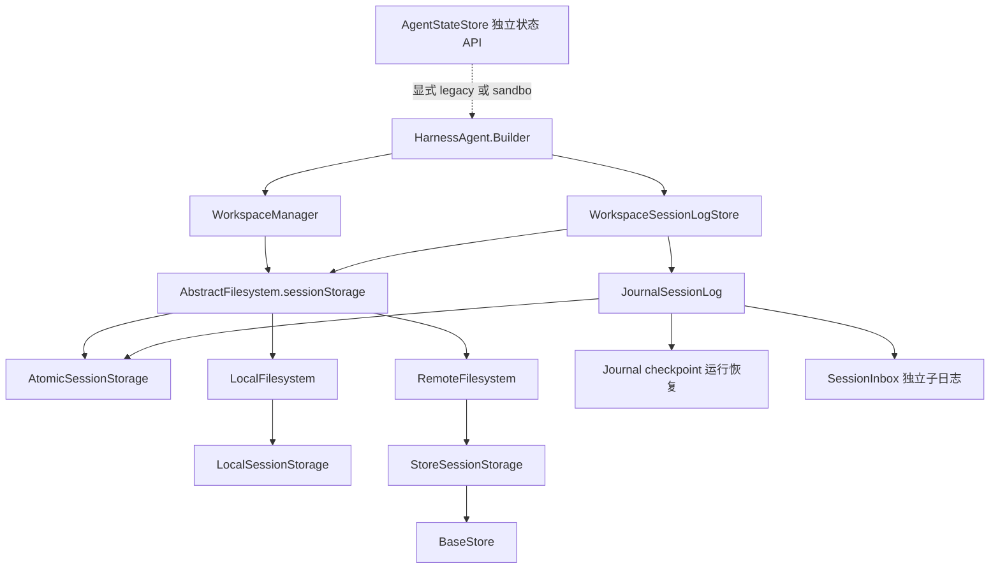

# 存储体系与默认装配

以下【源码确认】以 2.1.0-BETA1 Source Jar 为准，路径相对 artifact 解包根。

## 默认路径

【源码确认】`agentscope-harness/io/agentscope/harness/agent/HarnessAgent.java` Builder.build 的 2553-2578 行只在显式 distributedStore 存在时注入其组件；2586-2604 行表明 native sessions 仅由 journal 恢复，独立 AgentStateStore 仅在 legacySessionHistory 或 sandbox 元数据需要时使用，缺省才创建 JsonFileAgentStateStore；不能说 Harness 一定有默认 JSON StateStore。

【源码确认】`HarnessAgentBuilderSupport.resolveFilesystem():147-167` 无显式 filesystem spec 时使用 LocalFilesystemSpec；`HarnessAgent.java:2663-2664` 构建 WorkspaceManager；2724-2727 默认创建 WorkspaceSessionLogStore。配置 priority 为 explicit builder > DistributedStore > workspace defaults，但各组件有启用条件，DistributedStore 不替用户选择 Filesystem 模式。

【源码确认】`session/WorkspaceSessionLogStore.java:33-45,93-97` 封装 AbstractFilesystem，open 返回 JournalSessionLog(filesystem.sessionStorage(context),key.storagePath())。`filesystem/local/LocalFilesystem.java:597-599` 返回 LocalSessionStorage；`filesystem/remote/RemoteFilesystem.java:149-150` 返回 StoreSessionStorage(store,getNamespace(rc))。Local 与 Remote 都是 Filesystem，但不是同一个持久化实现。

## 职责边界

| 组件 | 保存与职责 | 不应混淆 |
|---|---|---|
| SessionLogStore | 定位、打开与发现日志 | 不是聊天消息关系表 |
| JournalSessionLog | 事件提交、head、writer、checkpoint | checkpoint 不等于独立 AgentStateStore |
| AtomicSessionStorage | 不透明对象读写与 CAS | 普通文件编辑不能替代 CAS |
| SessionInbox | 输入排队与消费事实 | 不等同模型上下文消息列表 |
| AgentStateStore | 显式 Agent 状态快照 API | 原生会话不隐式从它导入历史 |
| WorkspaceManager | 工作区路径、内容、Filesystem 协作 | 不是单一物理存储引擎 |
| AbstractFilesystem | 普通文件操作及 sessionStorage 工厂 | 文件写入与 Journal 提交协议不同 |
| BaseStore | 远程 namespace/key 数据后端 | 不能直接假定覆盖所有 Snapshot |

【源码推导】多个数据族可以共用 workspace 或远程 BaseStore，但接口、原子性边界与序列化格式仍独立；部署时共享普通目录不自动解决执行副作用重复。具体对象格式、并发与恢复见 data-structures、lifecycle、extension 文档。

## 源码定位规则

上述 HarnessAgentBuilderSupport 全路径为 `agentscope-harness/io/agentscope/harness/agent/HarnessAgentBuilderSupport.java`，HarnessAgent 为 `agentscope-harness/io/agentscope/harness/agent/HarnessAgent.java`；文中 session/、filesystem/ 均接在 `agentscope-harness/io/agentscope/harness/agent/` 后。Core 的 JournalSessionLog、SessionProjection、SessionRecorder 位于 `agentscope-core/io/agentscope/core/session/`。路径与行号对应目标版本 Source Jar，不对应本机 v2.0.4 工作树。

【源码确认】恢复的实际消费者位于 `agentscope-core/io/agentscope/core/ReActAgent.java:722-750` 的 activateSlotForContext()：有 SessionRecorder 时从 initial projection restore，无状态才创建 freshState。这说明 Journal checkpoint 与独立 AgentStateStore 是两条明确分开的读取路径。
