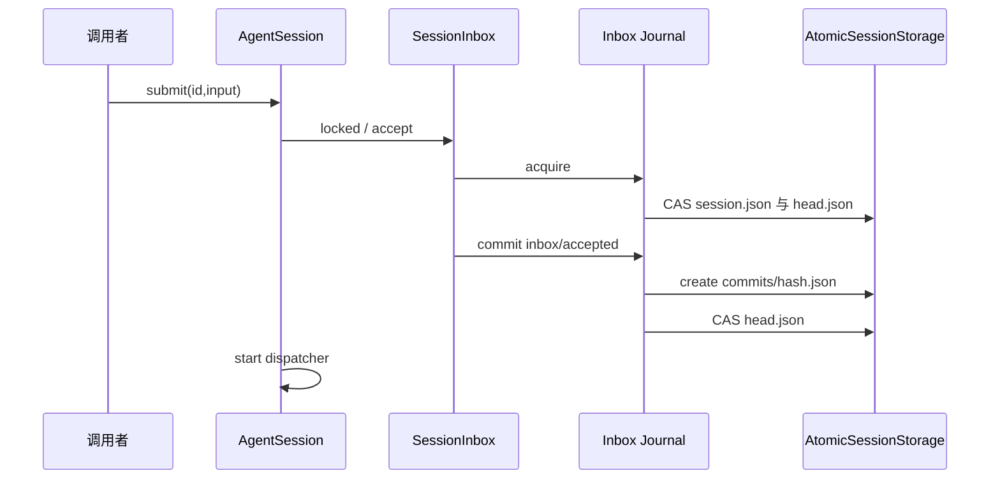
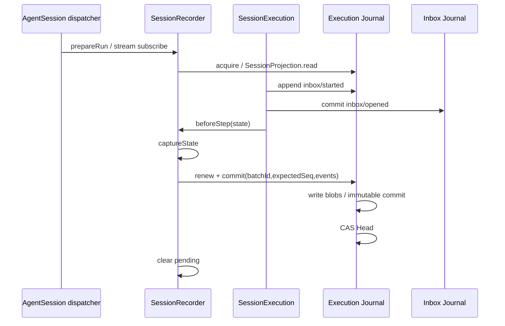
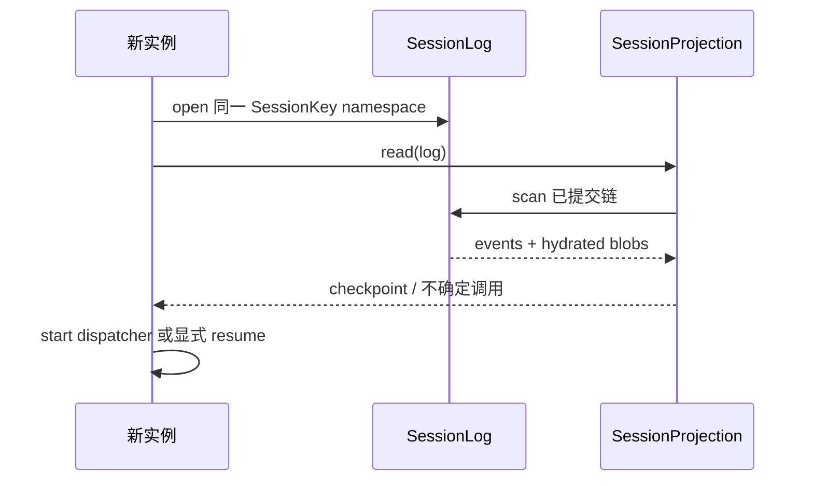
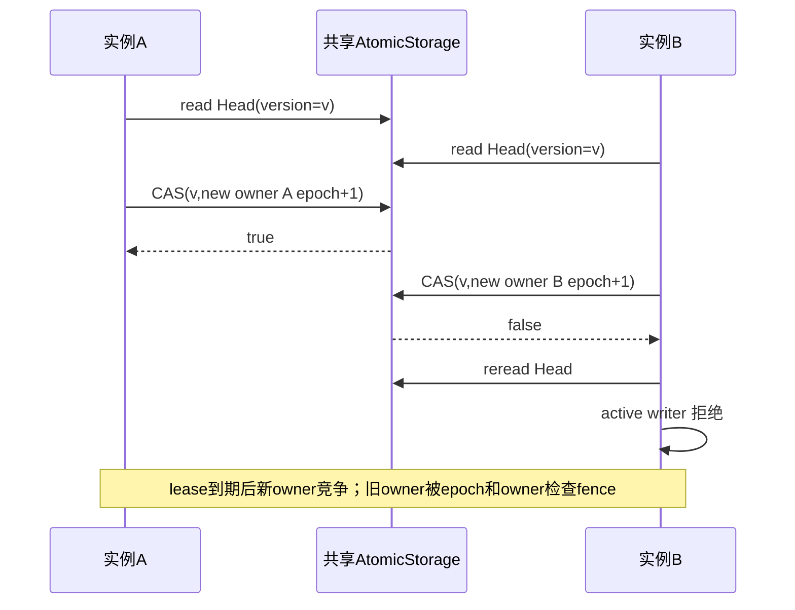

# Session 持久化生命周期

证据版本：2.1.0-BETA1 Maven Source Jar。代码路径以 `agentscope-core/io/agentscope/core/session/`（C）和 `agentscope-harness/io/agentscope/harness/agent/`（H）为前缀。官方 Tag Commit：`5451c73abe47053340683a1cc6d67b290b056648`；主调研记录包含 Source Jar 对照结果。

## A 新建会话与首次输入

【源码确认】H/session/AgentSession 构造器:82–90 → HarnessAgent.sessionKey/sessionLog → WorkspaceSessionLogStore.open:90–93 → filesystem.sessionStorage → JournalSessionLog。此时只创建对象，不代表已持久化。SessionInbox 构造器通过 log.inbox 创建独立 journal，前缀追加 `/inbox`（C/JournalSessionLog.inbox:65–66）。

【源码确认】AgentSession.submit:142–151 从幂等 ID 以 nameUUID(`turn:`+id) 派生 turnId，冻结输入，inbox.locked(tx.accept) 然后 start。Inbox 第一次 acquire 以 CAS 创建 session.json，并以 CAS 创建 head；accept 写 accepted 事件，commit 最后推进 Inbox Head。因此首份数据通常先出现在 Inbox journal。

## B 消息执行与历史

【源码确认】H/session/AgentSession.start:117–123 启动 100ms dispatcher；dispatch:391–430 检查执行 Head 租约，扫描已 accepted、未 rejected、未 started 的执行命令，再 launch:432–473。launch 将 SessionExecution 放入 RuntimeContext，prepareRun 后订阅 stream；订阅才推动执行，不是 submit 返回即完成模型调用。

【源码确认】C/SessionRecorder 构造器:97–150 获取执行 Writer，两分钟 lease，读 SessionProjection，恢复 checkpoint 索引；每秒 heartbeat 调用 flushNow。SessionExecution.prepare:50–95 校验任务状态，记录 inbox/started 到执行日志，在独立 Inbox 写 opened。beforeStep:97–123 把 inject/steer 输入按 message ID 去重加入 state，先 checkpointNow，再记录 inbox/applied。continueOrClose:125–141 在 Inbox 锁下检查 steering，避免结束与插话竞争。

【源码确认】SessionRecorder.captureState:320–387 收集消息、工具请求/结果、状态 checkpoint；flushNow:253–268 先 renew，然后以稳定 batchId 和 durableSeq 提交 pending events；仅提交成功才清空缓冲。

【源码确认】普通消息和工具结果的历史通过 SessionViews.transcript；AgentSession.transcript:100–102 暴露该投影。AgentSession.inspect:104–106 暴露 SessionProjection.read。完整扫描是 log.scan(0,log.head().seq())，JournalSessionLog.scan:321–375 从 Head.commitId 逆向查 parent、验证 seq 和链结构，再正向产出事件。readCommit:274–304 补全 blob、检查 SHA256。不是列目录拼接所有 commit。

## C 宕机与响应丢失

|时间点|源码确认的结果|证据|
|---|---|---|
|仅写入 Recorder.pending|未提交部分没有 durable 保证|SessionRecorder.flushNow:253–268|
|blob/commit 已写而 Head 未更新|对象可能成为孤儿，但不属于已提交可见链|JournalSessionLog.commit:222–257；scan:321–340|
|Head CAS 成功但响应丢失|异常分支重读 Head；同 batch 重试沿可见链查找并比对 hash/firstSeq|commit:206–218、258–268|
|Head CAS 失败|循环重读并核对所有权和 expectedSeq；最多32轮|commit:203–271|
|Writer 宕机|lease 到期后其他 owner 可 acquire，epoch+1|acquire:117–139|
|旧 Writer 恢复|owner/epoch/lease 检查拒绝旧身份；封禁 owner 也拒绝|owned:96–102|

【源码确认】SessionRecorder:120–133 拒绝重复 runId、已完成 turn；uncertainToolCalls 非空时拒绝自动继续，要求显式 reconciliation。SessionRecovery 类职责明确是人工核对，不能将外部副作用宣称为 exactly-once。持久化日志原子提交不等于模型/外部工具调用与日志处于同一事务。

## D 重开历史与恢复输入

【源码确认】WorkspaceSessionLogStore.list:54–72 在当前 filesystem namespace 下发现 Header，返回用户过滤的 SessionKey；open:90–93 重开 journal，恢复不依赖 listing。AgentSession 构造器绑定同一 RuntimeContext，inspect/transcript 读取既有日志；start 的注释及实现:117–123 明确用于服务重启后处理持久化队列。

【源码确认】dispatch 不重新启动已经 inbox/started 的 command（AgentSession:409–418），因此宕机前已开始的执行并非自动无条件重跑；resume 需要显式创建继续命令。恢复 State 来自 SessionProjection/checkpoint，而不是隐式加载旧 AgentStateStore。用户输入已 accepted 但未开始可重新 dispatch；不确定工具结果必须先核对。

## E 多实例与 fencing

【源码确认】多个对象可同时 open；执行写入只允许未过期的一个 owner，竞争通过 AtomicSessionStorage.compareAndSet 实现。该接口契约要求共享 namespace 的所有 Writer 之间 CAS 原子且 ACK 前持久化；后端不满足契约就不能由接口名推断分布式安全（AtomicSessionStorage:21–47）。

【源码确认】JournalSessionLog.sealWriter:146–162 永久创建 owner seal，即使 Head 无需改变也推进底层版本，从而 fence 暂停的 acquisition/commit；acquire 返回前再次检查 seal，避免竞态。lease 时间由进程 Clock 提供；跨主机时钟偏差与真实存储故障行为尚未通过多节点实验验证。

【源码推导】只读 head/scan 无需 Writer，可与写入并行，但稳定前缀由调用时的 seq 限定；这不是数据库读写副本路由功能。

## 验证边界

【待验证】本专题完成静态调用链核对；本地无模型 Demo 已确认 batch 幂等和重新构造存储后的读取，见 [真实样例](runtime-samples.json)。后续已补官方宕机注入测试和三个独立JVM竞争及SIGKILL接管，见 [运行证据](validation-evidence.md)。未运行跨主机时钟偏差、远程服务故障及当前HTTP模型存储全链路。默认 Builder 的完整装配、本地/远端 AtomicStorage 的持久化保证见架构与扩展专题；不能把这里的 SPI 契约当作所有后端已通过的验收结果。
