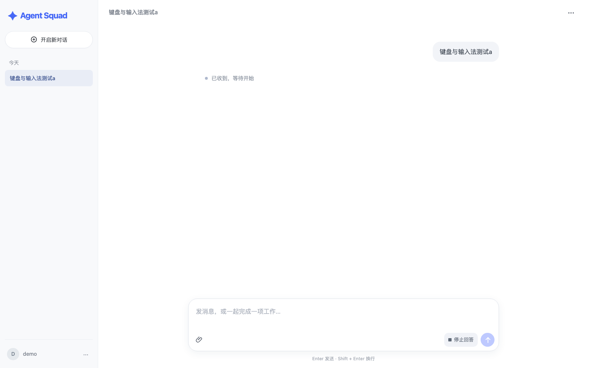

# 对话界面走查（2026-11-02）

补充任务 4.4 的真实页面走查证据；此前的功能与故障回归见 `ui-regression-2026-10-29.md`。

## 环境

- 前端：Vite 7 开发服务，`127.0.0.1:5173`；浏览器经本地转发访问，Cookie 由转发层注入，页面登录态与真实网关一致。
- 后端：`agent-squad-server` 0.1.0-SNAPSHOT，Java 27 运行时、编译目标 Java 21，MySQL 8.4 隔离库，`agentsquad.delivery.enabled=false`（仅验证界面与受理，不验证模型执行）。
- 浏览器：本机 Chrome 156 headless，通过 CDP 固定视口与注入输入事件；窄屏视口 390×844，桌面视口 1440×900。

## 结果

| 项目 | 结果 |
| --- | --- |
| 桌面空态 | 240px 侧栏、居中欢迎区与居中输入框；空态不显示标题栏占位。 |
| 桌面会话 | 正文可读宽度约 820px；有内容后输入框固定底部，历史只出现在侧栏「今天」分组。 |
| 窄屏会话 | 390px 下侧栏收起为抽屉入口，正文与底部输入完整落在视口内，无横向溢出。 |
| 附件 | 通过真实上传接口添加 `走查材料.txt`，输入框上方显示「已就绪」紧凑卡片与带名称的移除按钮。 |
| Enter | 组合输入结束后按 Enter 发送：会话由空态进入具体会话，用户消息进入正文。 |
| Shift+Enter | 事件未被 `preventDefault`，保留浏览器原生换行语义；键盘规则单元测试同样通过。 |
| 中文输入法 | CDP `Input.imeSetComposition` 注入组合文本「测试」：`compositionstart` 触发、Enter 的 `isComposing=true`、未发送且草稿保留；组合结束提交「输入法提交测试」后按 Enter 正常发送。 |
| 可访问性 | 可见交互元素均有可访问名称（按钮 `aria-label`/标题、输入框标签、抽屉与菜单按钮）；隐藏文件输入 `tabindex=-1` 且 `aria-hidden`。 |
| 未实现开关 | 侧栏账户菜单只展示已实现的个人技能、长期记忆、能力设置（ADMIN）与退出登录，没有占位开关。 |

## 限制

- 中文输入法证据来自浏览器输入管线的真实组合事件，不是 macOS 原生候选框的人工点击；候选窗口外观与选词交互未单独截图。
- 本记录只验证界面、受理与附件上传；模型执行、任务派发和真实供应商证据见后续联调记录。

## 页面留证

