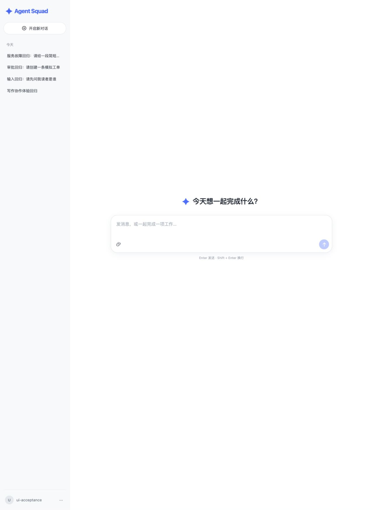
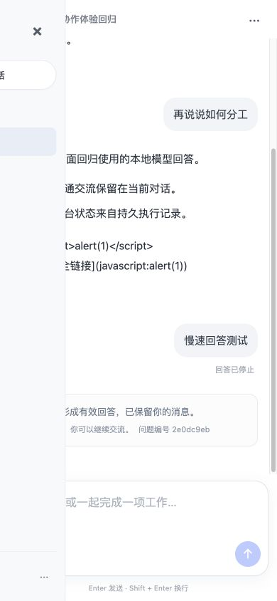
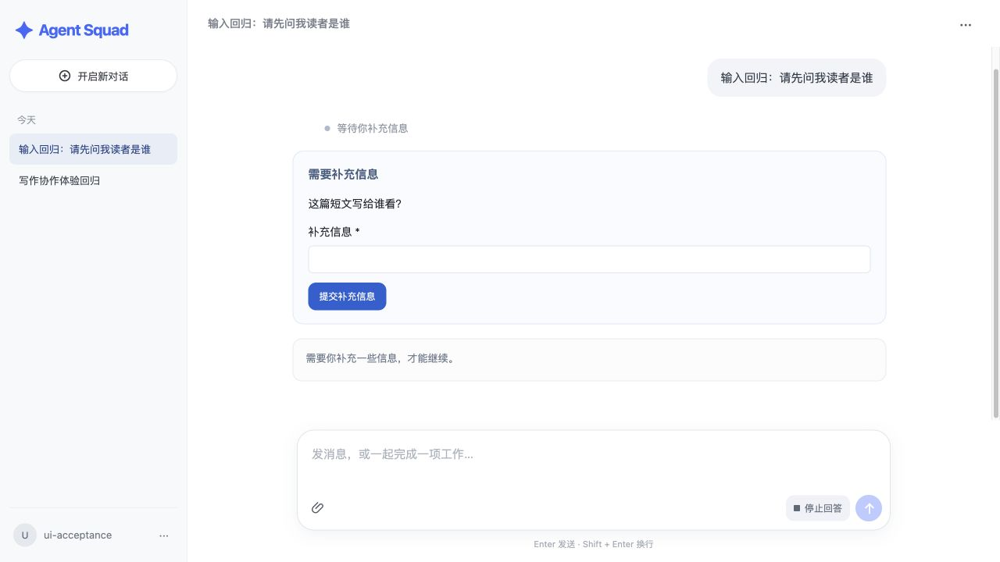
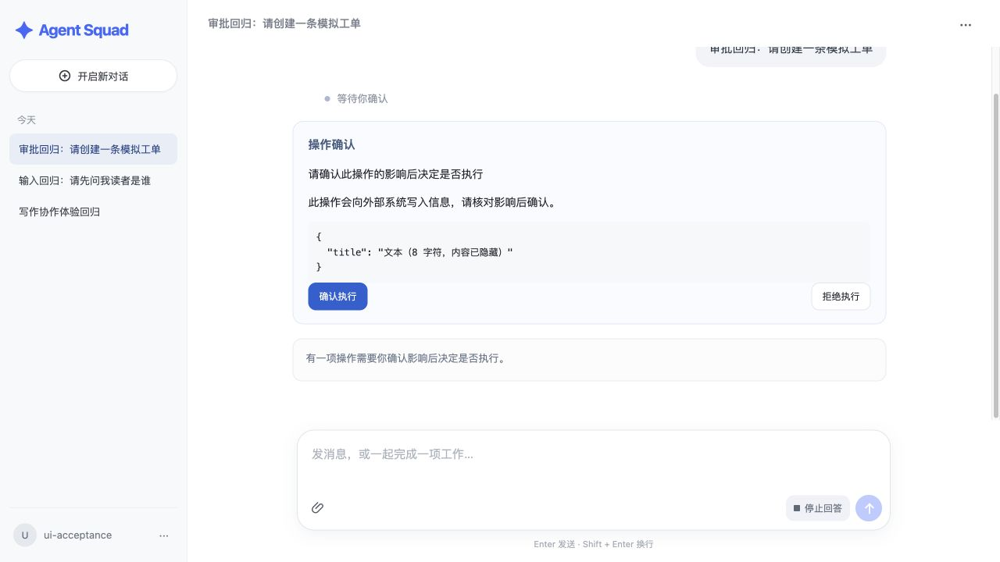
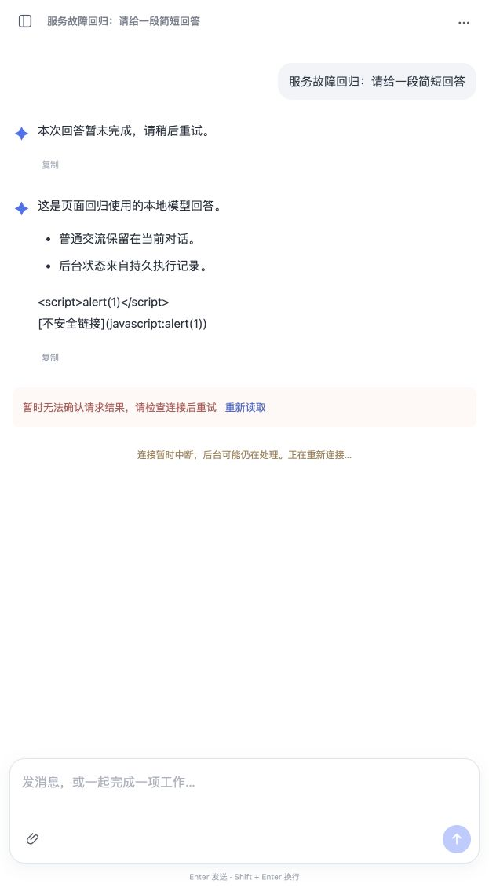

# 对话体验优化与统一回归（2026-10-29）

本记录对应 `conversation-first-experience`，承接原 D3 基线；旧的 acceptance-2026-10-29.md 是当天较早的 V11/6 项完成时点，不代表当前交付状态。

## 功能结果

- 默认打开可输入空态，首发才原子建立会话；普通问答不自动建任务，需要独立推进时由 Master 受控建立目标。
- 连续消息和后台工作分别执行。在途询问只读真实进度；补充/替换要求以 ACCEPTED/APPLIED/REJECTED 指令治理，goalRevision 保护新旧计划与上下文。
- 消息分页快照、会话级 SSE 与标题统一到一个对话。刷新、断线和切换只读取事实，停止回答与停止工作独立；取消终态刷新后仍显示。
- INPUT、审批、文件下载、结构化故障和允许的重试在当前对话内完成。系统环境问题不会给普通用户显示维修按钮，未知外部写入不盲目重发。
- 240px 侧栏、可读宽度正文、空态居中/有内容底部输入、附件图标与紧凑卡片、窄屏抽屉。没有尚未实现的思考/搜索开关，旧任务地址转到所属对话。
- 安全短标题取首条有效消息，不调用模型、不消耗模型预算；用户改名使用独立版本 CAS，历史通用标题增量补全。

## 环境与证据层级

- AgentScope Harness `2.1.0-BETA1`，固定源码 commit `5451c73abe47053340683a1cc6d67b290b056648`。
- Java 实际运行时为本机 JDK 27，编译目标为 Java 21；**没有完成 JDK 21 实际运行验证**。
- 确定性运行测试：临时 H2、隔离 MySQL 8.4、正式 Bridge/SDK/受控工具与本地 HTTP 模型协议响应。临时故障、UNKNOWN、崩溃窗口等证据属于这一层，不等于真实供应商/生产故障演练。
- 真实供应商：`deepseek-chat`，基础问答和引用上文追问均 SUCCEEDED，未创建 GoalTask，答案命中预期文本。在隔离库中，真实模型按需建目标→发布两个有依赖节点→两个 Worker 成功→MASTER_SIGNAL 汇合→正文交付→Task SUCCEEDED，activeTask 和 activeExecutions 均清空、无故障。目标 `cc65a01a-d4a3-4662-b957-4032e03b940d`，会话 `c97e7f1d-6838-4eea-a83c-e9a8ba7899ef`，约 24 秒完成。该隔离实验之后，又以实际 MySQL + DeepSeek + 正式 HTTP/Bridge 完整复验：会话 `184944f3-bddf-43a3-97fa-dac64a3ddf5e`、Task `c3081bb1-90e8-4204-bbf8-23ee34a25a6f` 成功结束，两个 Worker 均 SUCCEEDED，来源回复与目标共用 1 个预算账户，目标模型账单均 SETTLED，受理说明无内部权限错误。此为真实模型功能验证，不是生产故障演练。
- 实际开发库升级前做权限受限备份，V11→V14 增量迁移（V14 为 Java Flyway 标题回填；实际数据库版本本轮未独立核验）；原 3 个会话、1 个任务保留。后续新增问答是本次明确的验收记录，没有清空历史或重置远程配置。

## 回归范围

| 范围 | 证据 |
| --- | --- |
| 后端全量 | 全量 clean test：99 项，98 通过、1 跳过；跳过的是直接依赖旧开发库变量的 MySqlGoalTaskIntegrationTest |
| 真实 MySQL | 17 项专用用例通过：旧 V6 数据升级、共享预算、归属、并发受理/取消、有序派发、目标创建/修订、快照与标题 |
| 在途补充 | 正式 SDK 创建目标→有依赖 Worker→补充指令→安全应用→新版本计划→新正文交付；旧结果不推进新依赖 |
| 故障/恢复 | 可信 HTTP/异常类型分类；原 Turn 最多两次恢复，UNKNOWN 预算仍占额；次数重启不清零；终态重试唯一后继共享原账户 |
| 计划/完成纠正 | 计划最多两次，完成候选最多一次；耗尽结构化失败，不宣告成功或无限调用 |
| 权限/版本 | 新快照、事件、标题和重试 HTTP 的登录/CSRF/归属/版本检查；409 刷新；未来/过期/跨用户游标拒绝 |
| 浏览器 | 桌面 1280px 与窄屏 390px；首发、Shift+Enter、附件就绪/下载、连续对话、改名、停止、刷新、切换、追问及审批卡 |
| 安全渲染 | script 与 javascript 链接原样安全显示，没有脚本执行；下载文件 SHA-256 与上传测试文件一致 |
| 断线 | 停止并恢复隔离前端代理：原消息保留，显示连接中断后自动恢复，模型预算预留条数前后均为 18，没有重发推理 |
| 前端 | vue-tsc 与生产构建通过；键盘规则自动化 2 项通过，覆盖 isComposing、229、composition 状态与 Shift+Enter |
| 契约 | 46 个操作、74 个 Schema、28 张业务表，17 个正例/11 个反例；12 项需求追踪、7 个页面路由；OpenSpec strict 14/14 |

临时日志在 `/private/tmp/chat-*.log`；测试用数据库与模型服务是独立环境，不把探针当成正式外部能力。本记录中最终全量结果以收尾时最新 `chat-release-regression.log` 为准。

## 实际走查中发现并修正

1. 自动恢复若新建 SUBMIT，会在未结束的原生 Turn 后排队，无法继续；改为原 Turn RESUME，并以持久恢复尝试区分计费键，保留旧未知费用。
2. SDK run/end 先于平台投递收据时，控制命令可能卡住；绑定保存已结束 Turn，迟到收据直接补为 APPLIED。
3. 标题 PATCH 被本地 CORS 方法列表拦截；已补全方法并新增携带 Origin 的 HTTP 回归。
4. DeepSeek 拒绝嵌套错误的 publish_plan Schema，连普通问答也无法请求；修正 required/additionalProperties 的对象层级，所有 Master 工具加入结构回归。
5. 框架 wait_async_results 属于其独立异步工作注册表，不能代替本项目 DAG 汇合；Master/Worker 显式禁用该入口，由平台持久命令通知后续协调。

6. 回复与任务协调的模型目录和表达职责按固定 Scope 角色裁剪；回复不看到 prepare_context/publish_plan/apply_task_directive，任务协调不看到 create_goal_task/submit_task_directive，避免把可预防的内部权限错误写进受理说明。底层工具仍保留鉴权。

## 尚未验证或未交付

- 原生中文输入法候选确认的实机走查被系统对 Codex 原生应用控制的限制阻止；已验证中文文本、Enter/Shift+Enter 与组合输入规则自动化，**不能据此声称实机候选确认已通过**。任务 4.4 保留未勾选，仅此验证项待补。
- D4 的 Skill 自动发现/固定版本和长期记忆、D5 的沙箱与 stage/commit/保留清理、D6 多副本/生产备份恢复/负载均未完成。
- 当前附件为经过类型、大小、摘要、归属验证的最小文本上传/下载与受权引用，不等于任意文档解析或沙箱产物发布。
- 真实模型的两次成功问答及写作实验不代表供应商故障恢复、模型质量或所有真实业务连接器均已验收。

## 用户验证入口

启动页面：<http://127.0.0.1:5173/app/conversations>。使用 `.env.local` 中原有登录账号；后端为 `127.0.0.1:18080`。已通过正式管理接口发布并启用 `general-writer@1.0.0` 通用写作能力，使用 default 模型/运行 Profile，无外部工具权限。管理入口用于注册能力，实际选择与派发由 Master 完成。

1. 登录后直接输入普通问题，再追问上文：同一对话保留历史、标题与结果，不把每句话当独立任务。
2. 发起需要多步写作的需求：看到真实处理中状态；期间询问进展或补充语气，仍可继续输入。
3. 分别点击停止回答、停止工作，确认作用对象明确；刷新后显示持久状态，不重新发送。
4. 添加 txt/md/json/csv：输入框内显示就绪卡，可移除；历史附件可直接下载；改名后侧栏与正文标题同步。
5. 中文输入法候选确认不发送，普通 Enter 发送、Shift+Enter 换行；窄屏可打开/关闭历史抽屉。

## 页面留证

