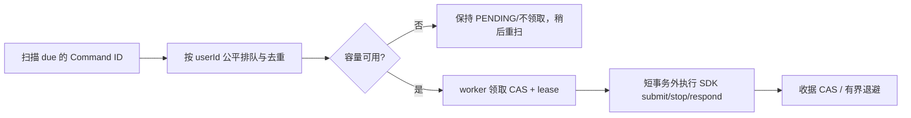

# Design：C2 多用户执行与容量治理

## 1. 执行链基线与验证先行

基线位置：`integration/agentscope/CommandDeliveryService.java`、`NativeSessionGateway.java`、`NativeProjectionPoller.java`、`presentation/service/ConversationEventStreamer.java`、`conversation/service/CommandClaimService.java`、`governance/service/BudgetService.java`。现有 Command `sq_command` 有 `status/due_at/delivery_token/delivery_lease_until`，仅受理 202 不代表执行完成。

先做三项确定性实验，不应先开多线程修改：

1. 注入阻塞/异步 SDK Stub（使用 `CountDownLatch`）让用户 A 的 `submit` 持续 30s；在同一服务进程里观察 B 的 `SUBMIT/STOP/RESPOND` 从到期到领取的实际延迟。记录原生 `session.submit` 返回时点、后续模型异步回合耗时，区分**投递慢**与**模型运行慢**。
2. 投影循环中让 A 的 `readEvents/inspectTask` 阻塞 10s，观察 B 的积压；记录当前 `@Scheduled` 线程池行为。
3. SSE 连接数/轮询数，测 DB 查询次数、连接池占用与 99p 请求延迟；不要把理论轮询周期相加当成严格最低延迟。

根据结果选择：如果 `submit` 确认是非阻塞且各命令处理有界，则保留当前模型，仅补短事务领取/慢操作超时与测试；如果一个慢投递显著延迟其他用户，实施第 2 节有界并发。

## 2. 有界投递调度（按条件实施，避免投递回归）

- 调度线程不得持有 DB 事务等待模型、工具或外部网络；**容量不足时不提前 CAS 领取**，否则租约耗尽会形成重复投递风暴。
- 建立独立 `ThreadPoolTaskExecutor`（可配 `core=4, max=8, queue=32` 作为小规模测试初值，不是生产容量结论）；`SynchronousQueue`/有界队列择一并写过载测试；每个到期 commandId 进程内去重、执行结束清理。
- 公平性：Round-robin 选用户，单用户并发上限建议 2、全局 8（默认值供测试，发布前压测确认）。优先响应 STOP/RESPOND 等控制命令，不能让常规 SUBMIT 队列永久挤掉取消和审批恢复；同一 Session 的 MESSAGE_SUBMIT 仍保留原有顺序约束（CommandClaimService/SQL），不得无条件并行。
- 竞态：多实例通过已有 CAS/lease 保持跨实例互斥；进程内线程池去重只是优化而非一致性权威。调度器线程被中断/执行器拒绝任务时，未领取命令可重扫。
- `fail()` 目前调用 `retry()`，某些不支持的 action 有潜在无限重试；将无法投递的结构错误收敛为明确可观测 `BLOCKED/FAILED` 状态，保持业务回执与审计链；恢复条件仍需人工授权。

## 3. 按用户配额与资源准入

最低实现建议：

| 指标 | 建议测试初值 | 约束点 | 拒绝语义 |
|---|---:|---|---|
| 每用户活跃回复执行 | 2 | `MessageAcceptanceService` / 领取 | 429（可 retry），不得丢已受理消息 |
| 每用户活跃 GoalTask | 2（但每会话仍 1） | GoalTask 创建 | 429/409（按语义） |
| 每用户并发 Worker | 4 | `WorkerDispatchService.claim` | READY 等待容量；不误标失败 |
| 每用户 SSE 连接 | 3 | `ConversationEventStreamer` | 429 或可理解的容量拒绝 |
| 单 IP 登录/匿名请求 | 依 C1 策略 | Gateway | 429 |
| 每用户模型开销 | 保留原有预算参数 | `ModelBudgetMiddleware` | BudgetExceeded；不绕开预留 |

**上表是默认配置建议，不是验收容量承诺。** 最终取值由机器资源/成本压测确定并写配置，避免硬编码。

- 准入要区分已 `202` 持久受理与**新请求拒绝**：请求超额时可在受理前原子拒绝；已经 `202` 的消息不能因为临时容量不足丢弃，而应保持 `QUEUED` 并可观察到排队原因。
- 多实例不得只用 JVM `Semaphore` 当最终配额权威。使用 MySQL 原子计数/配额租约表（若有已有容量表可复用，否则新增 `sq_user_runtime_slot`，键含 user_id/slot_kind/owner_id 与 lease_until，且所有分配/释放/接管都 CAS），不通过 `COUNT` 后再无锁 `INSERT` 形成竞态。使用 DB 唯一键限制重复领取。
- 进程失败后租约自动过期，可恢复任务依据持久命令继续调度；TERMINAL 必须释放，取消竞争需实际证明不会过放/漏放。额外全局上限防止 100 用户各 2 个触发 200 并发请求。
- 优先复用已有 `sq_user_budget` 与 `sq_budget_reservation`，禁止另建第二套 token 成本权威；不改变“用量不确定则 UNKNOWN 不退款”规则。

## 4. 多用户安全与 Agent 运行时

- 固定 `userId` 由 C1 已验证内部断言产生，SDK `RuntimeContext.userId`、Session/Binding、Skill/Memory/Artifact/Operation/预算用同一 owner，逐个 mapper 审查 `user_id` WHERE/关联条件。
- 重点交叉测试：同名会话标题、同幂等键、同文件名、共享 Worker Definition、跨用户伪造 artifactId/goalTaskId/sessionId/operationId/交互 requestId；管理员身份也不可绕过个人数据隔离。
- 单例 Master 的 `HarnessAgent` 线程安全性不可凭“Session 按 user 区分”直接证明，必须两个真实用户 + 并发原生回合 + 对抗性回复/工具调用测试；若 SDK 不保证安全，在 SDK API 明确限制范围内改用按 Scope/Session 的实例或串行化**同一实际共享状态**，不要全局串行化所有用户。

## 5. 跨进程恢复：验证优先，不提前宣布多副本

- 分别启动两个真正的操作系统进程（不同进程工作目录、独立端口、同一隔离 MySQL），在 A 运行中 `kill -9`，由 B 接管原 `commandId/bindingId`；验证日志水位、SDK workspace、任务终态、结果账本、预算和 SSE。
- 至少覆盖：SDK submit 前崩溃、SDK 已接受但平台未保存收据、Worker 运行中重启、审批挂起/恢复、IN_FLIGHT 写操作，绝不能通过测试 Stub 假装外部系统副作用已被核对。
- 若 SDK 把**恢复必要状态**仅放在本地 `.agentscope/workspace`，形成故障报告并限制正式 V1 为**单业务执行实例**（可单独多个 Gateway），直到修复持久空间或 SDK 恢复路径通过跨进程验证；不要单凭同 JVM 双 Spring Context 测试认定跨机能力。
- 保留 MySQL 租约 fencing 与原生 Writer 约束，不在业务层伪造“恰好一次执行”。

## 6. 生产危险注入与异常分类

- 将 `OperationExecutor#Runtime.halt(137)` 迁移到 test-only fixture/隔离测试进程；任何 `prod` 包不允许启用该路径，CI 做静态检测。单独的故障实验以启动参数明确开启测试工具而不是应用常规环境开关。
- 盘点 SDK `IllegalStateException` 英文字符串（如 `Continuation already queued`、`Only the latest unfinished task can continue`）匹配，优先使用 SDK 类型/状态对象；如 SDK 没暴露结构化错误，则集中 `NativeErrorClassifier` 单一适配层并加固定 SDK 版本回归测试，不允许散落到业务层。
- 未知/永不合法命令不会无限按 300s 重试，必须存在可诊断终态与有限重试策略；失败恢复安全性优先于自动成功。

## 7. 测量与发布门槛

- 基础指标：`command_due_lag_ms`、`command_claim_total`、`command_retry_total{reason}`、`running_by_user`（用户标签不得直接出现在低基数 metrics；仅日志有脱敏用户关联）、`worker_queue_depth`、`sse_connections`、`sse_db_poll_duration_ms`、`model_reservation_unknown_total`、`sdk_resume_failure_total`。
- 每种测试同时记录：吞吐、排队延迟 p50/p95/p99、模型并发、线程池饱和、DB 连接数/慢查询、SSE 断线重连、错误率。按测量选择配置值并更新 `evidence/capacity.md`。
- 不允许通过“扩大线程池”解决本来被 SDK 串行保护的共享对象；执行前后都必须通过原有幂等/恢复/取消测试。
