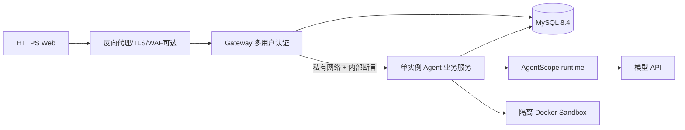

# Design：C4 发布准备与运维可信度

## 1. 构建与版本

- `server/pom.xml` 当前编译器 `maven.compiler.release=21`，但 `java.version=27`、实际测试用 JDK27。CI 固定依赖版本，并做两类构建：JDK27 现状完整回归；**JDK21 真实运行**单独验证。只有 JDK21 通过才能把 Java21 标为正式支持，失败时记录 SDK/框架实际兼容限制而不是悄然升级部署要求。
- 添加 `.github/workflows/ci.yml`：checkout → Node 22 + `npm ci` → `npm test` + `npm run build` → JDK27 `mvn -f server/pom.xml -B -ntp verify` → 设计检查 → 隔离 MySQL8.4 集成测试。测试配置指向 **CI 容器内专用 DB**，不能从仓库读取 `.env.local`，绝不连开发/正式库；Critical tests 的 skipped 必须由 CI 脚本识别并 fail，而不是 Maven `BUILD SUCCESS` 即合格。
- 依赖扫描（至少 Maven/npm 的 lockfile、基础镜像 CVE），结果按严重度记录；不盲目自动升级 AgentScope BETA 版本，SDK 升级属于独立兼容变更。
- 生产镜像以独立模块多阶段构建；非 root，健康检查，明确 `JAVA_OPTS`、只读挂载和优雅停止窗口，SSE 连接清理；镜像 digest 固定，禁止使用不受控 latest。

## 2. Staging 拓扑（初版推荐）

- 初版允许**一个业务执行实例** + 一个 Gateway + MySQL。Gateway 两实例能力在 C1 验证；业务多实例必须通过 C2 跨进程 SDK 恢复验证后才能启用。不得把 SDK 共享 workspace 的未验证状态隐匿。
- Edge 公网只暴露 HTTPS（443），网关仅被 Edge 访问，Server/DB/Sandbox 管理端口均在私有网络。业务 `server.address` 应按容器网络适配（部署配置），同时 firewall/NetworkPolicy 限制来源；不能简单把 18080 监听改为 0.0.0.0 就视为安全。
- Cookie `Secure/HttpOnly/SameSite`，统一同源路由，生产不开放通配 CORS；反代配置显式透传 SSE、不得缓冲流或长时间断开。配置 `Cache-Control: no-store` 于含用户数据端点。
- 生产默认拒绝缺少内部签名密钥、DB 连接密钥、模型配置且投递开启的危险组合；沙箱开关只有实测隔离可用才启用。

## 3. 配置与密钥

- `application-local.yml`、`application-test.yml`、`application-prod.yml`；prod 下 `spring.sql.init.mode=never`，正式数据库权限仅 DML/SELECT，不允许 DDL；迁移作业使用分离的 DBA 凭据和人工批准。
- `SQUAD_INTERNAL_AUTH_KEY`、模型 API Key、数据库密码、连接密钥来自部署密钥管理，不写入 repo/镜像/应用日志。内部断言密钥可通过 `kid` 滚动；记录轮换与回滚操作。
- 默认值 fail-closed：如果 `prod` profile 仍启用开发认证或危险故障注入，拒绝启动。隔离测试使用假的连接器，真实外部写操作必须另行授权。

## 4. 可观测性与告警

每个 HTTP 请求生成/接受经过格式校验的 `X-Request-Id`（客户端提供只能用于关联，不能作为信任）；Gateway 转发，Server 用 MDC 日志跟踪 `requestId`；命令异步派发/SDK 投影保留 `commandId/executionId/taskId/bindingId` 到日志与事件链路。不要把完整 Prompt、模型推理、密码、Cookie、工具秘钥和不可信模型输出打进日志。

建议指标：

| 指标 | 用途 |
|---|---|
| `http_server_requests` latency/error | HTTP 可靠性 |
| `squad_command_due_lag_ms`, `queue_depth` | 调度积压 |
| `squad_agent_running`, `worker_jobs_running` | 执行容量 |
| `squad_sse_connections`, `sse_poll_duration` | 实时推送负载 |
| `squad_model_call_total`, `model_call_duration`, `budget_unknown_total` | 模型耗时/不确定计费 |
| `squad_operation_unknown_total` | 外部副作用待核对 |
| `hikaricp.connections.active`, `jvm.memory.used` | 数据库与进程资源 |

- Actuator 健康端点 `/actuator/health/liveness` 和 readiness：readiness 验证 DB 与必须的 SDK 存储基础表，不把外部模型供应商偶发不可用直接变成进程死亡；metrics 只对受控内部网络暴露，不泄漏用户身份高基数标签。
- 告警按实测阈值设：长时间 due lag、异常 401/429 比例、UNKNOWN 升高、DB 连接池打满、持续 SSE 断开、进程反复重启；定期验证告警实际可触发。

## 5. 数据迁移、备份与回滚

- 基于 C1 的 `deploy/db/migrations` 受控 schema 版本链和 parity 校验，不允许业务服务自动跑 DDL。上线前执行 migration plan/dry-run，生成 SQL/元数据对比、备份计划和明确回退步骤。
- **备份必须覆盖**完整 MySQL 用户/任务/账本/AgentScope Journal/密钥密文等业务数据，且验证 binlog/事务一致性、恢复点和权限。数据库备份加密、限制访问和保留周期；不要把数据库 dump 放进 Git。
- 在隔离恢复环境真正还原数据库，核对用户数、会话数、消息数、Operation UNKNOWN、AgentScope 持久日志，以及应用能否在保持密钥正确的前提下读取记录。记录 RPO/RTO **实测值** 而不是虚构承诺。
- 发布/回滚采用“先备份→迁移→部署应用→健康检查→两用户冒烟→监控观察”；版本升级失败时优先回滚应用并保持向前兼容 schema，禁止未经批准直接反向 DROP 表/列。
- 对隐私数据制定实际 retention/deletion 策略，明确 user 关闭账号、会话删除、记忆删除、产物保留、备份到期与外部 UNKNOWN 证据必须分开；遵守适用法律和部署地区政策，这部分需要上线前专项法律/隐私审查。

## 6. 安全、负载与发布验收

- 安全测试：跨用户参数替换、SSE 游标伪造、业务端口直连伪造身份、CSRF、Cookie SameSite、管理权限、凭据泄漏扫描、XSS、文件下载/上传归属、模型 Prompt 注入的工具授权屏障。
- 负载：使用固定隔离 staging 及可控模型 Stub，逐级增加活跃用户与并发任务；记录容量上限/错误率/95p/99p/成本，确保不会无限创建任务。真实模型测少量成本受控流转，不拿真实供应商做无授权压测。
- 故障：Gateway A 重启后 B 会话持续有效，业务进程崩溃后持久命令按 C2 允许的部署形态恢复，SSE 断线客户端只读快照，UNKNOWN 未经核对不自动重试。部署至少一次有记录的演练。
- 灰度：仅经用户批准的测试账号先用；人工确认后再启用公开注册或正式对外访问。将发布限制写入 README 和 `evidence/release-gate.md`。
